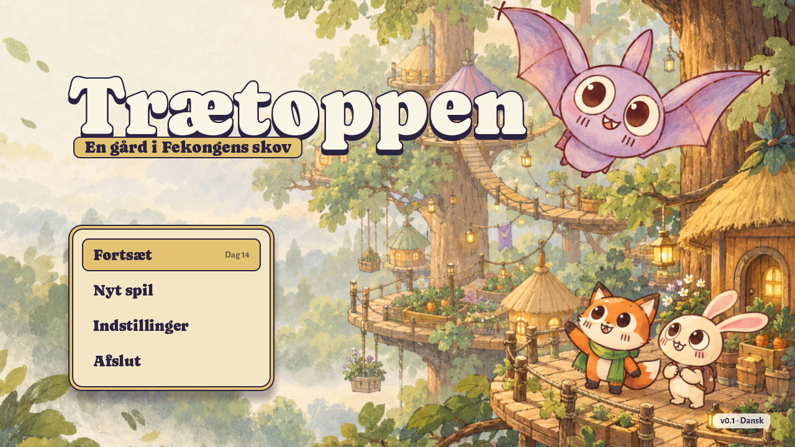
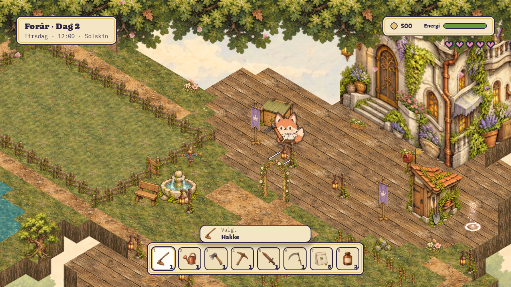
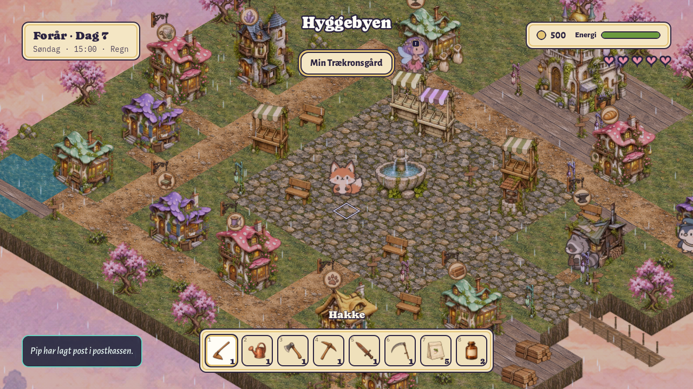
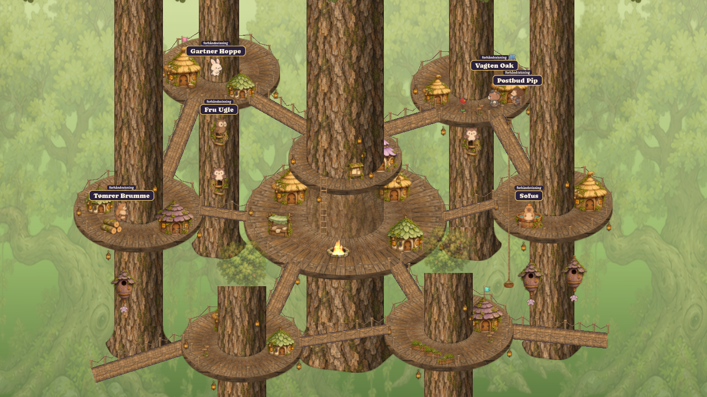
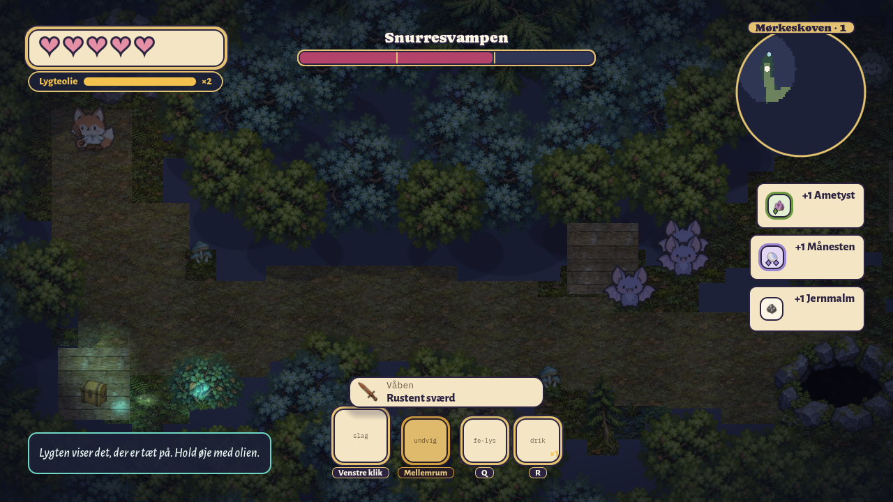
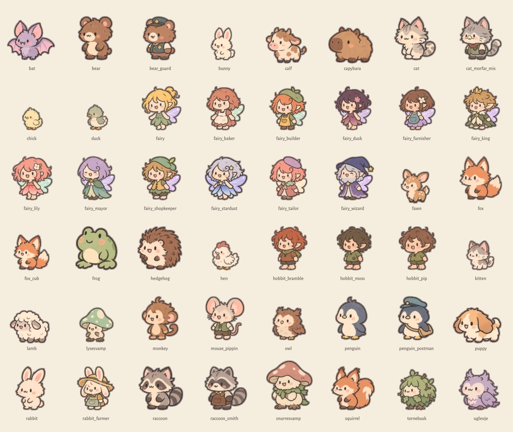

# Trætoppen

> *En gård i Fekongens skov.* (A farm in the Fairy King's forest.)

**Trætoppen** is a cozy farming and life game made in Godot 4.7, in the spirit of Stardew Valley. It is set in an enchanted forest full of chibi animals, fairies, halflings and friendly ghosts. You win a farm high in the treetops, *Min Trækronsgård*, in the Fairy King's lottery. Grow it from a garden shed into a castle, make friends in the treetop city of Trætoppen and the fairy shopping district Hyggebyen, and follow your missing mother's trail down into Mørkeskoven, the dark forest. All art is hand-painted isometric 2D. All text is Danish first, with English as a fallback, and the voices are Danish. The game content is written in Lua.

<p align="center">
  
</p>

<p align="center">
  
  
  <br>
  
  
</p>

<p align="center"><sub>The farm · Hyggebyen · Trætoppen · Mørkeskoven (captured in the engine at 1280×720)</sub></p>

---

## Features

**Your farm**
- 11 crops across four seasons, including moonflowers that need night watering and strawberries and glow berries that regrow.
- An east-field expansion (42 plots), a greenhouse (12 beds, year-round), sprinklers, preserves jars and kegs.
- 10 animal species (chicken, rabbit, duck, cat, dog, sheep, cow, deer, fox, owl) living in a coop, a barn and an animal house, each with 3 capacity tiers.

**Your home**
- 10 home tiers, from *Skur* (shed) to *Slottet* (castle). Eight of them unlock something new: workbench, oven, loom, guest visits, forge, forecast, festival and a royal visit.
- Storage grows from 12 to 100 slots, and the home from 1 to 14 rooms.
- 130 furniture pieces of 14 types, plus 10 furniture sets. Decorating raises your *hygge* through 6 levels, from *Køligt* to *Kongeligt hyggeligt*.

**Loot and style**
- 5 rarities: *Almindelig, Ualmindelig, Sjælden, Unik, Legendarisk*.
- 435 items, including 96 clothing pieces and 24 weapons in 5 families (dagger, sword, club, spear, staff).
- Clothing comes as hats, shirts, trousers, dresses, shoes and jewellery, worn across 9 equipment slots, with 7 wardrobe sets.
- 136 recipes for crafting, baking and forging.

**Your heroes**
- 8 playable heroes from 4 races, each race with its own perks: fairies fly, halflings get shop discounts, ghosts use less lantern oil, and so on.
- You name your hero and your farm yourself.

**People and festivals**
- 34 citizens with daily routines, gift tastes and birthdays.
- 40 heart events, plus 11 scenes for the ghost family Natlys.
- 9 seasonal festivals, each with 3 activities.
- Romance with 11 possible partners, consent-based proposals and a wedding.

**Story**
- 40 quests, starting with *Fekongens lotteri*. The main story is inspired by *The Secret Garden*: restore the hidden garden.
- A six-chapter Dark Forest investigation into your mother's fate, inspired by *The Hazel Wood*, with a bittersweet ending. Free play continues afterwards.

**The dungeon**
- Mørkeskoven has 12 procedurally generated floors in 4 bands of three.
- 7 enemy types and 3 bosses, with a real-time dodge and fairy-light combat system.
- Underground, lantern oil replaces the day clock as your time limit.

**Living world**
- A day clock that runs until 02:00, 28-day seasons and daily weather.
- Shop opening hours, and a night watch that walks you home after curfew.

## The world

| Place | What it is |
|---|---|
| **Min Trækronsgård** | Your treetop farm. A bridge leads to the city. |
| **Trætoppen** | The treetop city: giant trunks, ringed platforms and rope bridges. The *Skovlift* (rope lift) is the only way down into the forest. |
| **Hyggebyen** | The fairy-run shopping district, one bridge further on. It has the seed shop, *Rosmarins Bageri*, *Stokroses Møbler*, *Fingerbøls Skrædderi*, *Thorins Smedje*, *Zephyrs Tårn* and more. |
| **Den hemmelige have** | The secret garden behind a gate north of Hyggebyen's square. |
| **Skovkanten → Mørkeskoven** | The forest-edge hub at the foot of the Skovlift, and the dungeon below it. Floors 1–3 are the dark wood itself, followed by *Dybe Bregner*, *Svampelunden* and *Krystalgrotten*. |

There are 25 walk-in interiors in all.

**Heroes**

| Race | Heroes |
|---|---|
| Skovdyr (forest animal) | Rasmus the fox · Kiki the monkey |
| Fe (fairy) | Kløvermynte · her brother Birk |
| Halvling (halfling) | Bertil Bøgeknop · his sister Bodil |
| Spøgelse (ghost) | Pedro · Hviske ("Whisper") |

**Some of the neighbours:** Fekongen (the Fairy King), Borgmester Hyldeblomst, Bagerfe Rosmarin, Tømrerfe Hasselnød, Smeden Thorin, Fru Ugle, Postbud Pip, Vagten Oak, Natteblik the night-time map seller, and the ghost family Natlys.

<p align="center">
  
</p>

## Status

Trætoppen is in active development. Milestone *M1b, full usable towns* was merged on 2026-10-16. The single-player systems listed above are implemented and verified by the test harness, except where noted below. See [docs/M1B_STATUS.txt](docs/M1B_STATUS.txt), [docs/qa/mechanics/PROGRESS.md](docs/qa/mechanics/PROGRESS.md) and [docs/MECHANICS_STATUS.json](docs/MECHANICS_STATUS.json).

**Placeholder, partial or stubbed**
- **Voices.** 11 lines are original human recordings. The other 285 are synthetic Danish placeholders, made locally with macOS `say -v Sara` and ffmpeg. Native-speaker review of the text and the voices is still open.
- **Music, sound effects and ambience** are synthesized placeholders. You replace one by dropping a properly licensed OGG in with the same filename and recording its provenance.
- **Weather.** Fog, snow and thunder appear as labels only; rain is the only weather that is drawn.
- **Smaller gaps.** The fairy's flower-talk is flavour text. Dungeon chests have no open-lid art.
- **Not built yet:** the *Samlerbog* (collection book) and fishing. A design is proposed in [docs/design/COLLECTION_FISHING_ADDENDUM.md](docs/design/COLLECTION_FISHING_ADDENDUM.md).

**Planned / later**
- Children, multiplayer, yearly birthday cards and a fifth friendship event.
- Human playtesting (onboarding, balance, social routes), native-speaker copy and voice review, and low-end hardware, controller and long-session testing.

## Getting started

**Play a release.** Download the **Windows setup EXE** or the **macOS DMG** from [GitHub Releases](https://github.com/magudb/PongPong/releases). Windows Setup installs for your account and adds a Start menu shortcut and an uninstall entry; a desktop shortcut is optional. On macOS, open the DMG, drag Traetoppen.app to Applications, then eject the disk image. The Mac app supports Intel and Apple Silicon. New `vX.Y.Z` tags publish these installers after CI passes; the existing v0.1.0 release uses ZIPs. Installed production builds check for new releases; **Settings → Updates** downloads, verifies and installs an update after you confirm. ZIPs remain available as updater payloads. See [docs/RELEASING.txt](docs/RELEASING.txt) for the release and signing setup.

**Run from source.**

**Requirements**
- [Godot 4.7](https://godotengine.org/). The project uses the GL Compatibility renderer, and CI runs Godot 4.7.2.
- macOS is the main development platform: the dev scripts are bash and use `/usr/bin/lockf`.
- Git. The clone is large (about 2.3 GB of history), because art is stored as plain git blobs and Git LFS is not used.

```sh
git clone https://github.com/magudb/PongPong.git
cd PongPong
tools/dev/play.sh               # imports on first run (about a minute), then opens a 1280x720 window
tools/dev/play.sh --throwaway   # same, with a temporary profile that is deleted afterwards
```

`play.sh` expects Godot at `/Applications/Godot.app/Contents/MacOS/Godot`. Override that with `GODOT=/path/to/godot`. You can also open `project.godot` in Godot 4.7 and run the main scene; close the editor before running `play.sh`. Saves go to `~/Library/Application Support/Traetoppen/saves/` on macOS. There are 6 manual slots and an autosave slot.

**Controls** (keyboard and mouse; a controller works too, and the on-screen hints show its buttons)

| Action | Key |
|---|---|
| Move / run | WASD or arrows / Shift |
| Interact, talk | E or Enter |
| Use tool / attack | Left mouse |
| Jump / dodge | Space |
| Fairy flight / descend | F / Ctrl |
| Fairy light / drink a supply | Q / R |
| Inventory · journal · wardrobe | I or Tab · J · G |
| Farm upgrades (on the farm) · decorate · people | B · H · P |
| Hotbar | 1–8 |
| Rotate / pick up furniture | R / X or right mouse |
| Zoom | Mouse wheel |
| Area map | M |
| Pause · cheat menu (debug builds) | Esc · F8 |

More detail is in [docs/PLAYING.md](docs/PLAYING.md).

## Development

```sh
tests/run_playtest.sh --strict                     # full headless harness (exit 0 = green)
tests/run_playtest.sh --strict --character=ghost   # animal | fairy | hobbit | ghost
tests/run_playtest.sh --fast --only=area           # quick iteration on one section (not the gate)
tools/dev/run_windowed.sh --only=area              # sections that need a real window; saves screenshots
godot --headless --path . -s res://tools/lua/lint.gd   # lint the Lua content
python3 tools/loc/csv_lint.py --strict              # lint the localization CSVs
```

- **The gate.** `main` must import with zero errors or warnings and pass `tests/run_playtest.sh --strict` for all four hero races. The harness always uses a throwaway HOME, so your real saves are never touched.
- **Worktrees.** `main` stays green. Each branch is worked on in a sibling worktree, created with `tools/dev/worktree.sh new <name>` (it lives in `../PongPong-worktrees/<name>`). Finished branches are merged with `git merge --no-ff <name>`. Run only one Godot instance per worktree at a time.
- **Conventions.**
  - Commit subjects are short and imperative, with a `Co-Authored-By` trailer when an assistant wrote the code.
  - `*.import` and `*.uid` files are committed on purpose.
  - Outside `legacy/`, the project has 628 GDScript files and 67 scenes, with no GDExtensions or addons.
- **CI.** On every push to `main`, every pull request and on manual dispatch:
  - [`playtest.yml`](.github/workflows/playtest.yml) downloads a checksum-pinned Godot 4.7.2, imports the project and runs the strict harness for each of the four races on Ubuntu, split into 4 shards per race.
  - [`build.yml`](.github/workflows/build.yml) exports Windows and universal macOS builds, creates native installers, installs them and checks the real game, in-game update and Windows uninstallation.
  - [`release.yml`](.github/workflows/release.yml) publishes both platforms to GitHub Releases when a `vX.Y.Z` tag is pushed.

See [docs/DEVELOPMENT.md](docs/DEVELOPMENT.md) for the full workflow.

## Modding / content in Lua

All game content lives in `lua/` as plain Lua files: 224 of them, covering items, quests, dialogue, shops, recipes, festivals, routines and balance config. A pure-GDScript interpreter (`LuaRuntime`) runs a documented subset of Lua, so no native plugin is needed. Each file declares its `kind`. The text itself is stored as localization keys.

Here is the complete dialogue file for Lily, the fairy child (`lua/dialogue/fairy_lily.lua`):

```lua
kind = "dialogue"
id = "fairy_lily"
function get_dialogue(context)
  return {
    speaker = "fairy_lily", speaker_name_key = "NPC_FAIRY_LILY",
    lines = { { id = "greet", text_key = "DLG_LILY_GREET", voice_key = "voice/fairy_lily/greet" } },
    choices = { { id = "bye", text_key = "DLG_CHOICE_GOODBYE", action = "close" } },
  }
end
```

Quests use the same pattern. Here is an abridged excerpt from `lua/quests/cookie_delivery.lua`:

```lua
kind = "quest"
id = "cookie_delivery"
objectives = {
  { id = "collect_carrot", target = 12, on = "item_gained", item = "carrot", have = true,
    description_key = "OBJ_COOKIE_DELIVERY_COLLECT_CARROT" },
  { id = "deliver_to_baker", target = 1, on = "dialogue_started", npc = "baker_maja",
    after_others = true, needs = { carrot = 12 }, consume = true,
    description_key = "OBJ_COOKIE_DELIVERY_DELIVER_TO_BAKER" },
}
rewards = { gold = 500, items = { cookie = 3, fairy_dust = 1 } }
function is_available(context)
  return not api.has_flag("cookie_delivery_active")
end
```

In debug builds, press **F9** to hot-reload Lua.

The current reference for the subset and lint rules is [tools/lua/README.md](tools/lua/README.md); [docs/lua_api.md](docs/lua_api.md) covers the `api.*` calls and hooks. Note that parts of `docs/lua_api.md` are out of date: item rarities are now `normal, uncommon, rare, unique, legendary`.

## Localization

- Danish (`da`) is the default language and English (`en`) is the fallback; the player can switch between them in Settings.
- Strings live in 66 CSV files in `localization/`, with columns `keys,da,en`. Together they hold about 4,560 unique keys.
- `da.csv` loads first, then the other files in alphabetical order, so `zz_final.csv` wins.
- The CSVs are read at runtime, so no `.translation` files are generated.
- Code calls `LocalizationManager.t("KEY", [args])`, and scenes hold the keys.
- Danish voice lines are never played when the language is English.

Tools for working with the strings are `tools/loc/new_csv.py`, `csv_lint.py` and `prune_legacy.py`; see [tools/loc/README.md](tools/loc/README.md).

## Art pipeline

The look is hand-painted storybook 2D: matte gouache and watercolor, visible paper and wood grain, warm pencil contours and chibi silhouettes. See the [style guide](docs/art/style-guide.txt) and the [style guide review](docs/Tr%C3%A6toppen%20Style%20Guide%20Review/).

- **Paintings into sprites.** `tools/art/drawn/` packs the original paintings into the game's sprite atlases. The prompts are saved alongside, so no API key is needed to rebuild:
  ```sh
  tools/art/setup_env.sh                          # Python 3.12 venv in tools/art/.venv
  tools/art/.venv/bin/python tools/art/drawn/pack.py --only=characters
  ```
- **Characters.** There are 62 character rigs. Five painted views are mirrored into 8 directions, and steps and gestures come from 2D puppet deformation. Cells are 256 px, and isometric tiles are 128×76.
- **Older tooling.** The older Python/VTK bakers in `tools/art/` still supply floors, furniture, icons and source experiments.
- **Archive.** `legacy/` keeps the original 3D package. Godot ignores it, and nothing depends on it.

Details: [tools/art/drawn/README.md](tools/art/drawn/README.md), [tools/art/README.md](tools/art/README.md), [docs/voice_lines.md](docs/voice_lines.md) (audio and voice pipeline).

## Project layout

```
assets/         painted sprites, tiles, props, portraits, UI, fonts, audio
data/maps/      farm, greenhouse, home, hyggebyen, traetoppen, moerkeskoven, secret_garden + 25 interiors
lua/            game content (items, quests, dialogue, shops, festivals, routines, config ...)
localization/   da/en CSV string tables
scenes/         main menu, world, UI and player scenes
scripts/        GDScript: autoloads, ui, world2d, farm, towns, social, dungeon_run, data (Lua runtime) ...
shaders/        wardrobe, blur, mask and stripe shaders
tests/          run_playtest.sh, playtest.gd, sections/, lib/, tools/
tools/          dev scripts, art pipeline, localization, Lua lint, voice and content tools
docs/           design plans, playing and dev guides, style guide, QA evidence
legacy/         archived original 3D package (ignored by Godot)
```

## Documentation

| Doc | About |
|---|---|
| [docs/PLAYING.md](docs/PLAYING.md) | How to play, controls, current scope |
| [docs/DEVELOPMENT.md](docs/DEVELOPMENT.md) | Branches, worktrees, tests, conventions |
| [docs/game_design.md](docs/game_design.md) | Pillars and story premise |
| [docs/design/PLAN_2D.md](docs/design/PLAN_2D.md) · [PLAN_2D_FEATURES.md](docs/design/PLAN_2D_FEATURES.md) · [UI_NAVIGATION.md](docs/design/UI_NAVIGATION.md) | The plans the game is built from |
| [tools/lua/README.md](tools/lua/README.md) · [docs/lua_api.md](docs/lua_api.md) | Lua content API |
| [tools/loc/README.md](tools/loc/README.md) | Localization tooling |
| [tools/art/drawn/README.md](tools/art/drawn/README.md) · [docs/art/style-guide.txt](docs/art/style-guide.txt) | Art pipeline and style |
| [docs/voice_lines.md](docs/voice_lines.md) | Voice, music and sound effects |
| [legacy/README.md](legacy/README.md) | The archived 3D package |

## License

No license has been chosen yet; all rights reserved. The source is public to read, but it may not be reused or redistributed without permission.

---

<p align="center"><i>Velkommen til Trætoppen. Pas godt på gården.</i></p>
