# Trætoppen UI navigation and conformance specification

**Status: BINDING** for the builders of P16, P17, P18, P14, P19, P20, F7, F8 (F9 when it ships), P28 (new) and for the audit library (`tests/lib/ui_audit.gd`).
Version 1.1 (final edit of 2026-10-14: two independent reviews, every verified defect fixed; the engine facts re-probed in Godot 4.7.2), written for the user request "we need to make sure the menu and navigations follow our guide".
The lead copies this file to `docs/design/UI_NAVIGATION.md`. Machine-readable companions in the same folder: `ui_packages.json` (ownership, tasks, waves) and `ui_screens.proposed.json` (the screen table the audit library reads).
Spec language is English; Danish player-facing copy lives only in the localization CSVs (`tools/loc/new_csv.py`, `tools/loc/key_owners.json`).

**Authority order** (a lower number wins): (1) the user's request; (2) the style guide `docs/Trætoppen Style Guide Review/Trætoppen Style Guide.dc.html` (source with the data of every mock) with its render `refs/style_guide_render.png`, then the two newer sketches `Trætoppen Figurer v2.dc.html` and `Trætoppen Miljøer v2.dc.html`; (3) this document; (4) `docs/design/PLAN_2D.md` section 5 / R.3 / R.14 and `PLAN_2D_FEATURES.md` section 2.6; (5) the work orders. Where this document contradicts a work order, plan sentence or earlier handoff, this document wins; `ui_packages.json` carries the corrections to the work orders.

**Conventions.** Design pixels = the 1280x720 design canvas (the project viewport; the window stretches it, never multiply by 1.5). `%Name` = a unique node name in the scene. "Ring" = the selection ring `RING_SEL` = 3 px gold `#e3c372` + 2 px ink `#2b2340`, drawn OUTSIDE the control rect (CSS `box-shadow: 0 0 0 3px gold, 0 0 0 5px ink`). "Panel edge" = `RING_PANEL` = 4 px gold + 2 px ink outside the panel (CSS `0 0 0 4px gold, 0 0 0 6px ink`). "Selected" = a persistent choice (race card, species chip, tab, filter chip, selected slot/row). "Focus" = the keyboard / gamepad cursor. "Modal" = a screen that pushes a name on `GameManager`'s modal stack. All colours are the constants of `scripts/ui/theme/tt_colors.gd` (identical to the hex values of the guide source).

---

## 0. Summary for the lead

* **Cause.** The legacy menus never set a keyboard focus (0 `grab_focus` calls), have no pause scene, no HUD and no guide theme; the guide's rule "everything interactive gets a gold ring at focus so the game can be played with the keyboard" is therefore untrue today, and several guide rules (ink outline, gold only for focus / selected, numbers in Caprasimo, no red) are not enforced anywhere on screens.
* **What this document fixes.** Section 2 turns the guide's four rules, the type card and the building blocks into numbers with a named audit check each. Section 3 is the input model (probed engine facts, every action with keyboard / mouse / pad, event stages, focus patterns, the Esc depth table, text fields, hints). Section 5 gives every screen a card (layout from the guide, initial focus, exact neighbours, keys, Esc, hint, checks), section 6 the navigation graph, section 7 the conformance matrix and the guide-diff targets with real numbers, section 8 the legacy-to-replacement table, section 10 the API the audit library must provide.
* **Decisions the lead should look at first** (Appendix F): a new package **P28** (wave 3b) builds the shared focus / modal / hint / confirm infrastructure, the shared toast / prompt / whisper widgets, the slider and stepper fixes and the theme fixes before the screens; **P17 (HUD) moves to wave 4** (9.2); Window-based dialogs and `OptionButton` are banned; hover is never gold; pause rows transfer (including **Byg**, so a gamepad can build); the title shows the guide's four rows (plus "Indlæs spil" only with two or more saves).
* **Open questions for the user** (Appendix G): the newer Miljøer v2 sketch draws a different HUD than guide section 06, and the Figurer v2 sketch names a different playable cast than the Vælg figur chips.
* **What a builder reads:** sections 2, 3, 4 (if P28) and the cards of its own screens (5.2); the checks it must make green are named at the end of each card and listed in `ui_packages.json`.

---

## 1. What is wrong today (evidence)

Screenshots taken in a real 1280x720 window of the legacy screens that wave 4 replaces: `work/design_ui/1_title.png`, `2_select_page1.png`, `4_world_hud.png`, `5_pause.png`. `tests/checkpoints/compare_guide.py` on them (mean absolute RGB difference 0-255, pixels differing by more than 40):

| Legacy screen | Observation | compare_guide against the guide |
|---|---|---|
| Title (`1_title.png`) | flat dark green fill, title and subtitle in ink on dark green (unreadable), five full-width cream pills (incl. a "Sprog" row the guide does not have), no key art, no panel with double gold edge, no "Dag N", no version tag, "Nyt spil" listed before "Fortsæt" | **144.40** (97.3 % of pixels off by more than 40); target <= 8 |
| Vælg figur page 1 (`2_select_page1.png`) | no race cards, no ring, no species chips, no preview, a dashed "disabled" button used as the selected state, an `OptionButton` for the species, unreadable captions | **147.00** (94.4 %); target <= 15 |
| Farm (`4_world_hud.png`) | **no HUD at all** (no date, no money, no quests, no energy, no hotbar) | HUD frame vs guide: 38.09 (not comparable, there is nothing to compare) |
| Pause (`5_pause.png`) | identical to the farm: Esc shows nothing. `scenes/ui/pause_menu.tscn` does not exist (only a script that waits for `EventBus.ui_panel_toggled`) | - |

Code audit of the legacy `scripts/ui/*.gd` (12 files, read in the worktree):
* **0** calls to `grab_focus()` in all of `scripts/ui` and **0** `_input` / `_unhandled_input` handlers in any legacy screen: the keyboard focus owner is NONE when title and select open (probed), so no arrow key does anything (Godot's focus navigation only runs when a Control already owns focus - see 3.1 F1). Esc / I / J are not handled by any screen.
* `pause_menu.gd:25` sets `Input.mouse_mode = MOUSE_MODE_CAPTURED` (the 2D game never captures the mouse); quit-to-menu is a bare `change_scene_to_file` that leaves the tree paused.
* 5 of 12 scripts use `OptionButton`, `ItemList`, `ConfirmationDialog` or `AcceptDialog` (Window-based, they split focus ownership, see 3.1 F12).
* Every interaction prompt string has the key baked in (`UI_SLEEP "E: Sov"`, `WORLD_PROMPT_USE "E: Brug"`): on a gamepad it lies.
* Panels are toggled through `EventBus.ui_panel_toggled` plumbing instead of the modal stack.

Realistic numbers (recorded runs, same method: reference loses the 2 px frame, shot resized, mean absolute difference):

| Reference | Number | Source |
|---|---|---|
| UI spike screens re-rendered against the pinned `guide_ref/` set (the baseline the plan targets are built on) | title **7.55**, Vælg figur **14.58**, farm HUD **7.57** (guide fixture) / **8.91** (live fixture), quest book **10.87** / **10.72**, shop **16.60**, backpack + workshop **19.75**, forest HUD **14.47** | `reports/P07-ui-foundation.md` "compare_guide: spike numbers" |
| Foundation gallery (the built P07 components) against the guide render, template-matched per component (spec writer's run, `refs/style_guide_render.png` crops vs `ui_foundation_gallery_guide.png`) | primary button 8.9, secondary 11.7, tertiary 13.9 (text rendering and the 4 px page margin dominate), disabled 6.1, empty slot **1.3**, filled slot 8.1, selected slot 8.4, rare slot 6.9, three meters 7.3 | this document, section 7.4 |
| Gallery guide page vs the spike's component render | 2.34 | `reports/P07-ui-foundation.md` |

Reading of the numbers: a clean text-free component is below 2, anything with Caprasimo text sits between 6 and 14 because the browser and Godot rasterise the glyphs differently. Full-screen targets below therefore keep the plan's ceilings (title <= 8, farm HUD <= 9, quest book <= 12, forest HUD <= 15, Vælg figur <= 15, shop <= 18, backpack + workshop <= 22); real art should lower them, never raise them.

---

## 2. The guide as testable rules

Source of every number: the guide's `renderVals()` and inline styles (quoted below) and the built theme (`tools/ui/build_theme.gd`, which is the single source of the numbers; `assets/ui/theme.tres` is generated and never hand-edited). "Check" names the audit-library call that proves the rule (section 10 defines the call shapes, section 7 the per-screen matrix).

### 2.1 R1 - ink around everything

Guide: "Blæk omkring alt - 2 px mørk kontur på paneler, felter og figurer."
* Ink = `#2b2340`, width **2 px** (`border:2px solid #2b2340`) on: panels (radius 16 dialogue/menu, 18 shop/book/inventory/cards, 14 HUD blocks and quest card), buttons (radius 12), fields (`PanelField` r10, `LineEdit` r10), inventory/hotbar slots (r10-12), chips and pills (r999), meter tracks (r10, vertical r15), portrait frames (r12, round r999), list rows when selected, race cards (r18), recipe/ingredient boxes.
* Figures: every character sprite and portrait carries a baked ink outline (art validators of P21/P22), except the 12 pack characters, which keep the thin grey-violet outline of their pack art (plan R.12); in the UI a portrait always sits in `FrameInk`, `FramePortrait` or `FramePortraitRound` (2 px ink).
* Exempt by the guide's own mocks (a different or no outline): `NamePlate` (ink fill + 2 px gold ring), `VersionTag` / `VersionButton` / `HintButton` (translucent plates), `StepperButton` (lives inside a `PanelField`), `PanelScrim`, `MenuRow` / `ChoiceRow` in their idle state (transparent: the guide shows no border on idle menu rows and choices; the 2 px ink border appears with the gold fill), `RowButton` / `RecipeRow` idle (2 px `#cdb98f` divider border, `border:2px solid #cdb98f` in the shop and workshop mocks), every disabled state (dashed 2 px `#a3957f`), `PanelSidebar` / `PanelHeader` / `PanelFooter` (ink on one side only, checked per side through `border_sides`), `KeyCap` (1 px gold border), `FocusProxy` (new, section 4.6). `PillTab` idle is NOT exempt (the shop tabs have a 2 px ink border while transparent).
* **Check:** `UiAudit.rule_report(root)["r1_ink"]` is empty: for every visible Control whose current-state StyleBox is a `TTBoxStyle` with `draw_body`, fill alpha >= 0.5, border width != 2 or border colour != INK, the theme type variation must be in the exempt list above. Windowed: `UiAudit.panel_pixels(t, panel)` samples the edge profile (2.6).

### 2.2 R2 - gold means focus and selected, nothing else

Guide: "Guld betyder valgt - Guldringen bruges kun til fokus og det valgte." and "Alt interaktivt får en guldring ved fokus, så spillet også kan styres med tastatur."
* **The ring (RING_SEL)**: 3 px gold + 2 px ink around the control. Appears on the focused control (keyboard / pad focus, also after a mouse click) and on a **selected** slot/card (`Valgt` slot, selected race card, selected hotbar slot). A selected slot REPLACES its rarity ring (the rarity ring is lavender `#9b86d6` 3 px, never gold).
* **The gold fill** (gold `#e3c372` fill + 2 px ink border) marks the selected / focused ROW-like control: the title menu row "Fortsæt", the shop tab "Frø", the species chip "Ræv", the dialogue choice "Selvfølgelig!", the quest tab "Aktive · 4". It is the focus look of `MenuRow`, `ChoiceRow`, `PopupMenu` rows and the pressed (selected) look of `PillTab` / `Chip`.
* **Hover is never gold.** Hover = lift 2 px and a lighter face for buttons (`#7aac49` / `#ecd189`), a chalk wash (`#fbf5e6` at 55 %) for rows, chips and tabs. The built theme violates this today (hover fill GOLD on `MenuRow`, `ChoiceRow`, `StepperButton`; GOLD_HOVER on `Chip`; gold 35 % on `HintButton`) and fills sliders and scrollbar thumbs with gold: P28 fixes the theme (4.6, theme debt list in Appendix E). Mouse hover on list-like controls moves keyboard focus there (3.4 H), so the gold row the player sees is always the focused one.
* **Gold that is NOT focus/selected but is in the guide's own mocks (the ornament whitelist, `GOLD_ORNAMENT`)**: the panel edge (4 px gold + 2 px ink) of `PanelParchment/L/L24/Book/Menu/Hud/Hearts/Hotbar/Round`, `AcceptDialog` and `PopupMenu` panels; the 3 + 2 px ring of `PanelAbility` and `PanelAbilityBig`; the 3 px ring of `FramePortraitRound` (the quest-book portrait, `box-shadow: 0 0 0 3px gold`, no ink band); the 2 px ring of `NamePlate` and `MeterBoss`; the 1 px border of `KeyCap`; the gold border of `PillGold` and `PillNight`; the gold fills of `Tagline`, `ZoneChip`, `Coin`, `CoinInk`, `ButtonSecondary*` (the guide's gold "Acceptér" button) and the gold text of the unit label "guldagern" (`Bold15Gold`). **Built, not in the guide:** `PanelToast` (3 + 2 px ring) and `PromptPill` (gold border) are P07's own ornaments; the guide draws neither, and plan R.12 says gold outlines have no other use, so they are a recorded deviation (decision D20) that the lead may overturn by giving them an ink border instead. Nothing else may be gold.
* **Check (three layers):** (a) static: `UiAudit.theme_report` on the theme (section 10) - no `normal`, `hover` or `disabled` StyleBox of any variation outside `GOLD_ORNAMENT` has a gold fill or gold ring (`pressed` and `hover_pressed` may stay gold: they are the selected look of a toggle, exactly as 4.6 and 10.7 say); (b) per screen: every visible Control whose CURRENT StyleBox shows the gold ring or a gold fill is focused, selected (`button_pressed` of a toggle, or the component's `selected`) or in `GOLD_ORNAMENT` - `rule_report(root)["r2_gold"]` empty; (c) windowed: `await UiAudit.ring_pixels(t, control)` on the focused control finds gold at 1-3 px and ink at 4-5 px outside the body rect at the middle of ALL FOUR edges (every sampled pixel must match: a ring cut off at one side by a clipping parent is a defect), and the same sample on an unfocused sibling finds none. The audit also reads the SOURCE of the scripts a screen runs: a script that names `GOLD` / `GOLD_HOVER` or the hex of either (gold painted in `_draw`, which no node property shows) is reported unless the draw-only component is on the allow-list (`ladder_row.gd`, `rarity_slot.gd`) or its node carries the meta `tt_gold_ok` with the reason.

### 2.3 R3 - numbers in Caprasimo

Guide: "Tal i Caprasimo - Penge, tid og antal står altid i display-skriften." and the type card "Titler, navne, knapper, penge og tid. Kun i store størrelser, aldrig under 20 px."
* Caprasimo numerics: clock `Display30` ("10:40"), money in the pill `MoneyPill` 22 chalk, shop footer balance `Display24`, prices `Display20`, money on parchment `MoneyDark` 20 `#a5781f`, slot and hotbar counts `Display15` / `Display16`, ability cooldown `CooldownNumber` 22, reward chip "150 guldagern" `Display20`, stepper value `Display20`, the zone chip depth "Dybe Bregner · 2" `ZoneChip` 16.
* **Guide-explicit exceptions (verbatim in the mocks, so they stay Alegreya Sans):** "Dag 14" next to a menu row (`Bold15Mono`), "18 / 24" (Alegreya 700 16), ingredient "3 / 7" (Alegreya 800 14, `#4d7a2a`), "I alt 300" (Alegreya 700 17), quest progress "Spor fundet: 2 / 3" and "Bagerfe Rosmarin · 5 / 12" (Alegreya 15), the page counter "1 / 2" (Plex Mono 13), hotbar key digits (`HotkeyDigit` Alegreya 800 11), the unit label "guldagern".
* Numbers use lining figures (`lnum` OpenType feature, a deliberate legibility deviation of the theme from the mock's old-style figures; do not remove).
* **Check:** `rule_report(root)["r3_numbers"]`: every visible Label / RichTextLabel whose displayed text is purely numeric / money / clock (`^[+\-−×x]?\d[\d.,:]*$`) uses a Caprasimo variation or is in group `tt_number`; every Label in group `tt_number` uses Caprasimo. Mixed texts ("I alt 300") are exempt by construction.

### 2.4 R4 - no red, damage is thorn-berry pink

Guide: "Ingen rød fare - Skade vises med tornebær-rosa, aldrig skrigende rød."
* Danger / damage / "too dear" / "missing ingredient" / error text = `THORNBERRY #b3436b` (hue 339 degrees); hearts and relationship = `ROSE #e58fa6`, half heart `#f2c3cf`, empty heart `#4a4560`. The guide's dev-only safe-area outline `#c4506a` is pinkish (hue 346) and never ships.
* Destructive actions (Slet, Overskriv, Slip) are ordinary `ButtonTertiary` buttons behind a `UiConfirm` whose default focus is the harmless answer; they are never red.
* **Check:** `rule_report(root)["r4_red"]` empty: no colour of any theme item, StyleBox fill / border / ring / shadow, font colour, `modulate` / `self_modulate` or Label colour override reachable from the screen has HSV hue in [350, 360) or [0, 15] with saturation >= 0.45 and value >= 0.45. `ui_conformance.theme_no_red` runs the same scan over the whole theme.

### 2.5 Typography (the guide's type card)

* Caprasimo: titles, names, buttons, money, time, counts. Alegreya Sans 500 / 700 / 800 (+ 500 italic for whispers): body, dialogue, descriptions, quest text. IBM Plex Mono: eyebrows ("AKTIVE OPGAVER"), file paths, page counters, key hints. `TTSymbols` is the metric-corrected fallback for `▸ ◂ ▴ ▾ ♥ ★ ✓ ✗`; `↑ ↓ ← →` come from Alegreya / Plex Mono (probed with `Font.has_char`). `Æ Ø Å æ ø å` exist in all three families.
* Size floors by role (the built theme's variations are the whole scale; a screen may use only those variations - plan 5.1 "never per-node overrides"):

| Role | Font | Sizes (design px) | Floor |
|---|---|---|---|
| Hero title | Caprasimo | 132 (cream, 3 px ink stroke + hard ink drop 6 px) | - |
| Screen title, panel title | Caprasimo | 48 / 40 / 34 / 32 / 28 | 28 |
| Buttons, menu rows, tabs-as-buttons | Caprasimo | 24 (L, MenuRow) / 22 / 20 | 20 |
| Names, prices, plates | Caprasimo | 20 (NamePlate, price, ToolName) | 20 |
| Number roles listed in R3 | Caprasimo | 30 / 24 / 22 / 20 / **19** (tracked quest title) / **16** (zone chip, slot count) / **15** (hotbar and backpack counts) | 15 |
| Reading text (dialogue, quest description, steps, choices) | Alegreya | 22 / 20 (`Body`, `DialogueText`) / 19 (`BodyM`, steps) / 18 (choices, `Whisper`) | **18** |
| Meta text (giver line, perk text, item description, giver in lists) | Alegreya | 17 / 16 / 15 / 14 / 13 (`Muted17..13`, `Bold*`, `Heavy14..19`) | **13** |
| Eyebrow, paths, counters, hints | Plex Mono | 13 / 12 / 11 | **11** |

* **Check:** `rule_report(root)["typography"]`: for every visible text control the pair (font family, effective size) must be in the scale above (derived from the theme variations, no `theme_override_font_sizes/*`, `theme_override_fonts/*`, `theme_override_colors/font_*` on any node of a screen scene - `["overrides"]`). `["raw_keys"]` and `["hard_coded"]` (section 10) catch untranslated text.

### 2.6 UI building blocks (guide section 03), as pixel specs

| Block | Spec (guide source) | Theme variation | Pixel check |
|---|---|---|---|
| **Parchment panel** | fill `#f4e6c4`, border 2 px ink, radius 16 (18 shop / book / inventory), `box-shadow: 0 0 0 4px #e3c372, 0 0 0 6px #2b2340` + soft shadow (dialogue `0 12 28 .3`, shop `0 16 36 .35`, title menu `0 14 30 .35`, book `0 20 40 .4`) | `PanelParchment`, `PanelParchmentL`, `PanelParchmentL24`, `PanelMenu`, `PanelBook`, `PanelHud`, `PanelHearts`, `PanelHotbar` | `await UiAudit.panel_pixels(t, panel)`: walking outward from the left mid-edge of the control rect the colour sequence is parchment, ink x2, gold x4, ink x2, then shadow / backdrop (tolerance 8 per channel) |
| **Button** | Caprasimo 22 (24 L), padding 10 / 26 (12 / 30 L, 8 / 26 S), radius 12, border 2 ink, hard shadow `0 4px 0 ink`, inset bottom band 5 px `rgba(ink,.3)` (primary) / `.2` (secondary) / none (tertiary). Primary moss `#6b9a3e` text chalk, secondary gold `#e3c372` text ink, tertiary chalk `#fbf5e6` text ink. Hover: lift 2 px + `#7aac49` / `#ecd189`. Pressed: sink 3 px, shadow 1 px, band 2 px. Disabled: dashed 2 px `#a3957f`, fill `#e7d8b6`, text `#a3957f`, no shadow | `ButtonPrimary/Secondary/Tertiary` + `S`/`L`, plain `Button` = tertiary | `await UiAudit.button_pixels(t, button)`: vertical line through the centre: ink 2, face, band (primary / secondary), ink 2, hard shadow 4 ink |
| **Slot** | 72 (inventory 66, hotbar 58) square, radius 10-12, border 2 ink; empty `#ecdcb4` + 3 px inner top shade `rgba(ink,.15)`; filled `#fbf5e6`; selected = RING_SEL; rare = fill `#e2d8f4` + 3 px `#9b86d6`; count Caprasimo 15-16 bottom-right (4-5 px from the edge); key digit Alegreya 800 11 `#8d7c66` top-left (4,1) | `SlotEmpty/Filled/Uncommon/Rare/Unique/Legendary` | `ring_pixels` on the selected slot; `rule_report` r2 |
| **Meter** | track `#e7d8b6`, border 2 ink, height 20 (vertical 30 x 150, r15; night 12 px; boss 16 px + 2 px gold ring), fill with 4 px highlight `rgba(255,255,255,.35)`; Energi moss `#6b9a3e`, Hjerter rose `#e58fa6`, Lygteolie honey `#e8b04a`, forest oil `#f2c14e` on `#2f3654`, boss `#b3436b` | `MeterGreen/Rose/Honey/Vertical/Night/Boss` | `rule_report` r1/r4 |
| **Dialogue box** | panel with 150 px portrait frame, `NamePlate` (Caprasimo 20 chalk on ink, 2 px gold ring), text Alegreya 500 20 / 1.45, choices Alegreya 700 18 (selected = gold fill + 2 px ink + `▸`), hint Plex Mono 11 `#6a5a48` bottom-right at (18, 12) | `PanelParchment` + `NamePlate`, `DialogueText`, `ChoiceRow`, `HintButton` | `compare_guide --ref guide_ref_ui/dialogue_box.png` (7.3) |
| **Chips / tabs** | height from padding 5 / 14 (tab, 16 px Alegreya 800) and 6 / 16 (species, 17 px), radius 999, border 2 ink, selected = gold fill, idle = transparent (tabs) or chalk (species) | `PillTab`, `Chip` | `rule_report` r1/r2 |
| **Selected race card** | lifts 8 px (`translateY(-8px)`) and gets RING_SEL; the other cards stay | `CardButton` (`pressed`) | `ui_conformance` select shot |
| **Hover / press feel** | hover lifts a button 2 px, pressed sinks 3 px | button variations | built (P07), no new check |

Everything in this section is already encoded in the built theme and components except the debt listed in Appendix E.

---
## 3. The input model

### 3.1 Engine facts this model is built on (probed in Godot 4.7.2, headless, 1280x720 root)

The probes (`work/design_ui/probes/probe_nav1..6.gd`, run in an APFS clone against the committed project, results quoted; labels E*, T* in the Fact column are their output lines) are the reason for several rules below. `ui_nav.engine_facts` (P28) re-runs them as checks so that an engine update that changes one of them fails loudly.

| # | Fact | Consequence |
|---|---|---|
| F1 | `ui_up/down/left/right` do nothing when no Control owns focus (E4). `Tab` with no focus owner focuses the first focusable Control and is consumed (E2b); with NO focusable Control in the tree Tab, arrows, Space, Enter and Esc all reach `_unhandled_input` (T4). | Every screen MUST set an initial focus when it opens (legacy screens never did). A hidden or freed focus owner leaves focus NONE (E12, E13): TTScreen restores it. |
| F2 | Order of delivery: `_input` -> GUI stage (focus navigation, Button press, LineEdit) -> `_shortcut_input` -> `_unhandled_input`. The GUI stage consumes Tab, arrows, Enter in a LineEdit (E2, T3). | A key that must work while a Control has focus (Esc, Tab-as-hotkey, the page keys) is handled in `_input`. **`ui_accept` is the exception: it must reach the GUI stage** (F4). |
| F3 | Plain letters / digits are NOT consumed by a focused Button (E2c) but ARE consumed by a typing LineEdit (T1: `i j 1 e w` typed, `_unhandled_input` saw none). | World gameplay keys (`slot_n`, `interact`, tools, jump, zoom) live in `_unhandled_input` and are text-field-safe by construction. The modal-toggle keys (I / Tab, J, B, H, G, C) are read in `_input` (F2) and therefore carry the `UiNav.text_field_focused()` guard. |
| F4 | A Button pressed with Enter / Space / pad A (`ui_accept`) does NOT mark the event handled: the same press reaches `_unhandled_input` as `interact` / `jump` (T7). **A node that marks `ui_accept` handled in `_input` stops the focused Button from pressing at all** (probe `probes/final_probe_accept.gd`: a real Enter, Space and pad A each pressed a focused Button once when nothing ate them, and zero times when an `_input` handler called `set_input_as_handled()`). Marking the event handled in `_unhandled_input` instead leaves the press intact and still stops the world: GameUI sits AFTER the player in the world tree, so its `_unhandled_input` runs first (F14; probed: the world saw 0 of 4 presses). `set_input_as_handled()` called from inside the Button's own `pressed` handler does NOT stop the later `_unhandled_input` stage (probed: the world still saw the Enter). | **No modal consumes `ui_accept` or `interact` in `_input`** (Enter, Space and pad A would activate nothing in any menu). A `TTScreen` marks `ui_accept` / `interact` handled in its `_unhandled_input` while it is the top modal, and `TTScreen.close()` calls `UiNav.swallow(vp)`, which arms a one-frame flag that every `TTScreen._unhandled_input` honours: the press that CLOSED the modal never reaches the world's `interact` (the modal is gone by then, `is_modal_open()` is false). Only a screen that dispatches the press itself consumes it in `_input`: the dialogue (it picks the focused `ChoiceRow` or completes the line, so no `Button` is pressed) and Indretning PLACE (`interact` places). World handlers additionally refuse while `GameManager.is_modal_open()`; HUD controls are `FOCUS_NONE` (plan R.14). Verify: `ui_nav.accept_presses_focused_button`, `ui_nav.closing_press_does_not_reach_the_world`. |
| F5 | Disabled Buttons still take focus by navigation and by `grab_focus()` (E1c, E5). | A disabled row is also `focus_mode = NONE` (`UiNav.set_enabled`). |
| F6 | Godot does not wrap focus at list ends (E1d): the last item's `ui_down` stays. | Wrap is explicit (`UiNav.wire_*`). |
| F7 | A single-line LineEdit consumes the Up / Down KEYS (focus stays, T2); the D-pad, the stick and `InputEventAction ui_down` leave it (T2b-d). Tab / Shift+Tab leave it (T3). | `UiNav.yield_updown_from_fields()` makes Up / Down leave a field for keyboard users too. |
| F8 | Esc in an actively edited LineEdit is consumed by the field (`_input` still sees it, `_unhandled_input` does not, E3b); after a submit it passes (T3d). Enter in a LineEdit emits `text_submitted` and is consumed (T3c). | Esc / back is handled in `_input`. |
| F9 | One physical key matches several actions (E8): Esc = `pause` + `ui_cancel`; Enter = `interact` + `ui_accept`; Space = `jump` + `dodge` + `ui_accept`; Tab = `inventory` + `ui_focus_next`. | A modal handles the key once and marks it handled; the world never sees it. The audit sends REAL key / pad events (not only `InputEventAction`) so both actions match like in the game. |
| F10 | `ui_page_up` / `ui_page_down` have only PageUp / PageDown, no pad events (E8b). `ui_up/down/left/right` carry the D-pad and the left stick. Mouse clicks on empty space do NOT drop focus (T5b, T5d); echo events navigate (T6); focus navigation works in a paused tree for `PROCESS_MODE_ALWAYS` nodes (E14). | LB / RB are added to `ui_page_up/down` (4.7); modals must be `PROCESS_MODE_ALWAYS`. |
| F11 | With a 1280x720 root, a click grabs focus and `mouse_entered` fires (probe 3); with the 64x64 root of a bare `-s` script nothing is hit. | Headless mouse tests set `root.size = Vector2i(1280, 720)` (the harness already does). |
| F12 | While a `ConfirmationDialog` is open `root.gui_get_focus_owner()` still returns the Button behind it; the dialog's own focus is in its Window viewport (`embed_subwindows` = true, `dialog.get_viewport() != root`). An `OptionButton` popup is a `Window` too. | **Window-based controls are banned in game UI**: no `AcceptDialog`, `ConfirmationDialog`, `FileDialog`, `PopupMenu`, `OptionButton`, `ItemList`-with-popup. Dialogs are `UiConfirm` (a Control), drop-downs are chips. The audit only sees the root viewport. |
| F13 | Glyph coverage (`Font.has_char`): `↑ ↓ ← →` in Alegreya Sans and Plex Mono, `▸ ◂ ▴ ▾ ♥ ★ ✓ ✗` in TTSymbols, none of the arrows in Caprasimo. | Key hints use Alegreya / Plex Mono for arrows. |
| F14 | `_input` and `_unhandled_input` reach sibling nodes in REVERSE tree order (probe: third, second, first). | The LAST screen of `GameUI.SCREEN_ORDER` sees a key first (3.3). |

### 3.2 The action table (every UI-relevant action of `project.godot`, 37 today + 2 added by P28's P01 amendment)

Bindings are physical keys unless written otherwise. "Stage" says where the screen reads it (`I` = `_input`, `U` = `_unhandled_input`, `G` = Godot's own GUI handling). Gamepad names: A = joy 0, B = 1, X = 2, Y = 3, Back = 4, Start = 6, LB = 9, RB = 10, D-pad 11-14, left stick axes 0/1.

| Action | Keyboard / mouse | Gamepad | UI meaning | Stage | Repeat |
|---|---|---|---|---|---|
| `ui_up/down/left/right` | arrows (Godot default) | D-pad, left stick (default) | move focus / adjust slider, stepper, chips (3.4) | G (+ `I` for the wrap guard) | key echo repeats; **never wraps on echo** (a fresh press wraps) |
| W A S D | `move_*` actions | - | **in a modal / title / select: same as the arrows** (`UiNav.wasd_as_arrows`), not in a text field, not in the world | I | as arrows |
| `ui_accept` | Enter, Kp Enter, Space | A | press the focused control | G (the focused Button presses); the top modal marks it handled afterwards in `U` (F4) | echo ignored, except slider / stepper |
| `ui_cancel` | Esc | B | back / close the top layer (3.5) | I | echo ignored |
| `pause` | Esc | Start | on the world with no modal: open the pause menu. With a modal open: close the top modal (same as `ui_cancel`) | I | echo ignored |
| `interact` | E, Enter | A | in the world: talk / use / sleep / harvest. In dialogue: same as `ui_accept` (advance, complete typing, pick the focused choice). In Indretning: place | U (world); I (dialogue and Indretning PLACE only: they dispatch the press themselves, F4) | echo ignored |
| `jump` / `dodge` | Space | A / B | world only; **refused while a modal is open** | U | - |
| `run`, `fly_toggle`, `fly_descend`, `light`, `drink` | Shift, F, Ctrl, Q, R | - / - / - / Y / RB | world only | U / poll | - |
| `use_tool` / `attack` | LMB | X | world only; a click on a UI Control never reaches it (the Control consumes the mouse, 3.7) | U | - |
| `slot_1` .. `slot_10` | 1-9, 0 | - (D-pad left / right cycle, P06 amendment) | select the hotbar slot; in the backpack with an item selected: assign it to that slot; in a modal otherwise ignored | U | echo ignored |
| `inventory` | I, Tab | - (pause-menu row) | open / close the backpack. Opening is refused while another modal is open. **Closing is read in `_input`**, because Tab is also `ui_focus_next` and the GUI stage eats it while a Control has focus (F1, F2) | I | echo ignored |
| `journal` | J | - (pause-menu row) | open / close the quest book (same stage rule) | I | echo ignored |
| `build_menu` | B | - (pause-menu row **Byg**, farm only, only if the screen exists) | open / close the build menu (farm only) | I | echo ignored |
| `decorate` | H | Back | in area `home`: open Indretning; outside: whisper `INDRET_ONLY_HOME` (the key of `features_ui.csv`); inside Indretning: close it | I | echo ignored |
| `wardrobe` | G | pause-menu row | open / close Garderobe (farm, Hyggebyen, home; not in the forest: whisper `WARDROBE_UI_CHANGE_AT_HOME`) | I | echo ignored |
| `collection` | C | pause-menu row | Samlerbog (only if F9 ships) | I | echo ignored |
| `rotate_item` | R | RB | Indretning PLACE mode only | I | echo ignored |
| `pickup_item` | X, RMB | X | Indretning only | I | echo ignored |
| `zoom_in` / `zoom_out` | mouse wheel | - | camera zoom; **ignored while any modal is open**; Indretning consumes the wheel itself (rotate) | U | - |
| `ui_focus_next` / `ui_focus_prev` | Tab / Shift+Tab | - | next / previous focus stop; in the backpack Tab belongs to `inventory` | G | echo repeats |
| `ui_page_up` / `ui_page_down` | PageUp / PageDown | **LB / RB (added)** | previous / next tab or page: shop tabs, quest tabs, Garderobe filters, Indretning filters (BROWSE), Vælg figur page 2 / 1; settings: nothing | I | echo ignored |
| `ui_home` / `ui_end` | Home / End | - | not used | - | - |
| Delete | Delete | - | save/load: delete the focused slot (confirm) | I | echo ignored |
| LMB / RMB / wheel | click / secondary / scroll | - | click presses; RMB only in Indretning (`pickup_item`); wheel scrolls a `ScrollContainer` under the pointer in a modal | G | - |

Rules on the table:
* **Shared bindings are intentional** (the P01 contract lists them): Esc `pause`+`ui_cancel`, Enter `interact`+`ui_accept`, Space `jump`+`dodge`+`ui_accept`, LMB `use_tool`+`attack`, A `interact`+`jump`+`ui_accept`, X `use_tool`+`attack`+`pickup_item`, R / RB `drink`+`rotate_item`. The rule that keeps them from firing twice: **the top layer consumes the event** - Esc, the page keys and the hotkeys in `_input`; `ui_accept` / `interact` / `jump` / `dodge` by letting the focused Button press in the GUI stage and marking the event handled in `_unhandled_input` (F4); the world reads gameplay actions in `_unhandled_input` (event-driven, not `Input.is_action_just_pressed` polling, except movement `Input.get_vector`) and checks `GameManager.is_modal_open()` first.
* **Hotkeys never act while a text field has focus** (3.6) and never while their own modal is not allowed (opening is refused while another modal is open; Esc is the only key that works at every depth).
* **Gamepad coverage (honest scope):** every screen is reachable and closable with a pad: farm actions on A / B / X / Y / RB, `pause` on Start, `decorate` on Back, the other screens through pause-menu rows (Rygsæk, Opgavebog, **Byg** on the farm, Garderobe, Samlerbog), and menu navigation with D-pad / stick, A, B, LB / RB. `build_menu` (B) is the one screen no pad button opens, so the pause row Byg is what lets a pad player build a coop or a barn. The plan labelled gamepad a "stub"; this document makes it a tested path (`zz_acceptance.gamepad_only_flow`) without new gameplay actions.

### 3.3 Where each key is read (so the screens do not fight)

1. `GameUI` (P07) draws screens in `SCREEN_ORDER` (back to front) and has **no key handling** (`ui_foundation.game_ui_no_key_handling`). Godot calls `_input` in REVERSE tree order, so the screens at the END of `SCREEN_ORDER` see a key first: `settings_ui`, `save_load_ui`, then `pause_menu`, `samlerbog`, `garderobe`, ... `dialogue_ui`. Pause is therefore ahead of every world modal and behind its own children, which is exactly the order the Esc rule needs.
2. Each modal (`TTScreen`, 4.2) in `_input`: if it is the TOP modal (`GameManager.top_modal() == modal_name`): handles `ui_cancel` / `pause` (close), `ui_page_*` (tabs), its own hotkey, and marks the event handled. It does NOT touch `ui_accept` / `interact` there (F4): the focused Button presses in the GUI stage and the screen marks the event handled in its `_unhandled_input` (it runs before the player's, F14). If it is not the top modal it ignores everything except its own opening key when no modal is open at all.
3. `pause_menu` additionally opens on `pause` only when `GameManager.current_phase == PLAYING`, no modal is open, the world is not `sleeping` / `traveling` and the scene is the world; Esc / Start then opens it. A pressed Esc that just CLOSED a modal never also opens pause (the closing modal marked the event handled; pause's `_input` runs earlier but sees `is_modal_open() == true`).
4. World nodes (`Player2D`, `Hotbar`, `WorldRoot2D`, interactables): `_unhandled_input` only, event-driven, guarded by `not GameManager.is_modal_open()` and by the player not being in the TALKING state. They never read `ui_*`, except the one documented case: `Hotbar` cycles slots with the D-pad (`InputEventJoypadButton` D-pad left / right) when no modal is open. The pause menu and the hotkey openers read the built P04 world's public vars `sleeping` and `traveling` (duck-typed on `get_tree().current_scene`) to refuse while a fade runs.
5. Hotkey openers (I, J, B, H, G, C): `_input` of the owning screen (hidden screens still run `_input`; they are `PROCESS_MODE_ALWAYS`); they check `UiNav.text_field_focused()` first.

### 3.4 The focus model

**Initial focus.** Opening a screen focuses a defined control (the card of each screen in section 5 names it). `UiAudit.initial_focus(root)` returns it; `null` is a defect, except screens whose row says `focus: none` (the HUDs, the sleep fade, plain dialogue text). Focus is set after the screen is visible (`call_deferred` one frame after `show()`), never in `_ready` of a hidden node.

**Selected vs focused.** Race cards, species chips, tabs and filter chips are radio groups: focus moves with Left / Right and the focused member becomes selected immediately (keyboard / pad), a click selects too, a mouse hover does NOT (hover on cards, chips and tabs is a plain hover style). Everything else is focus-then-accept.

**The patterns.** Every screen card says which pattern each group uses; the neighbours follow mechanically. Directions that go nowhere on a group's cross axis are "consumed": `UiNav.wire_*` makes them wrap or leave the group so there is never a silent dead end on the primary axis.

| Pattern | Used for | Left / Right | Up / Down |
|---|---|---|---|
| **L** vertical list | menu rows, quest rows, slot rows, recipe rows, ladder rows, drawer rows | consumed (cross axis) unless the card says "crosses to group X" | +/-1; past either end it LEAVES to the previous / next group of the screen's ring; if the list is the only group it wraps to the other end (fresh press only, not on echo) |
| **G** grid (cols x rows, row-major) | backpack 6 x 4, shop list 2 columns, wardrobe grid, chest grids | +/-1 inside the row; at a row edge it crosses to the neighbouring group on that side if the card declares one, otherwise it wraps to the other end of the same row | +/-1 row keeping the column (clamped to the nearest existing cell in a short last row); past the top / bottom row it leaves to the previous / next group, or wraps if alone |
| **T** tab / chip row, radio group | shop tabs, quest tabs, filter chips, species chips, language and window-size chips | +/-1, wraps inside the row; **moving onto a member selects it** (radio group; the content below refreshes at once); Accept on a member moves focus into its content group | Down: first member of the content group (focus memory = the last focused member, else the selected one); Up from the content group's first row: the CURRENT tab |
| **F** form rows (settings) | slider row, chip row, checkbox row | slider +/-5 % (echo repeats, Shift = +/-1 %), chips move, checkbox Left = off / Right = on | next / previous row, wraps |
| **S** stepper | `quantity_stepper` | -1 / +1 (echo repeats); PageUp / PageDown +/-5; `ui_accept` = commit (Køb) | Up: the list it belongs to (focus memory), Down: the commit button |
| **C** confirm | `UiConfirm` | swaps between the two buttons | swaps too (no dead end); focus never leaves the dialog |
| **D** dialogue choices | `ChoiceRow` list | consumed | +/-1, wraps |
| **H** hover | list-like rows only (menu rows, quest rows, slot rows, shop rows, drawer rows, choices) | - | mouse enters a row: it grabs focus (`UiNav.hover_focus`). NOT on cards, chips, tabs, text fields, sliders |

* **Rings.** A screen's groups form an ordered ring (the "ring" line in each card). `ui_down` from the last item of the last group goes to the first group; `ui_up` from the first item of the first group goes to the last group. Groups placed side by side declare Left / Right crossings explicitly (backpack <-> workshop, wardrobe columns, chest grids).
* **Focus memory.** Leaving a group remembers the focused member; coming back (Up / Down / Left / Right crossing) lands on it. Memory of an item that is no longer there falls back to the first member.
* **Disabled / hidden controls are not focus stops** (`focus_mode = NONE` while disabled, F5). A row that becomes enabled (a save appears) becomes a stop again.
* **Focus loss guard.** While a screen is open and visible, if the viewport's focus owner is NONE or outside the screen (a clicked-away control was hidden, a list refreshed), `TTScreen` re-focuses the last good control (or the initial one) within one frame. Clicking empty space never drops focus (F10). **A mode that holds no focus owner on purpose** (Indretning PLACE, a dialogue text line) says so through `TTScreen._wants_focus() -> bool` (default `true`; PLACE and text lines return `false`): while it is false the guard does nothing, `UiAudit.initial_focus_report` asks for no initial focus and `UiAudit.focus_walk` skips the screen with a note (the BROWSE / choice state is the one that is walked).
* **Focus returns to the opener.** `TTScreen.open(opener)` stores the Control that had focus when the screen opened (a pause row, a title row, a shop tab). `close()` focuses it again if it is still valid and visible; if the opener was the world (no Control), `UiNav.release_world_focus()` leaves NO focus owner so Space / Enter / arrows act on the world again.
  * Scene-level openers (title -> select -> back to title) use `UiNav.remember(&"title", "NewGameButton")`: the re-created title focuses the row that opened the child.
* **Focus ring visibility.** The ring is drawn by the theme's `focus` StyleBox on every focused control, also after a mouse click (the guide: "alt interaktivt får en guldring ved fokus"); sliders and the stepper paint their own ring (4.6). The guide compare shots release focus only for RING controls (cards, slots, buttons, chips, tabs): the HTML mocks show no ring on them. A control whose focus look IS a gold fill (`MenuRow`, `ChoiceRow`) stays focused in the shot, because the mock paints exactly that gold row: the title mock paints "Fortsæt" gold and the dialogue mock paints "Selvfølgelig!" gold (repainting the gold row of the pinned title reference as idle parchment adds at least +0.58 for the fill alone and +0.83 for the whole row, against a 7.55 baseline and a target of 8; the dialogue crop adds +4.86). `ring_pixels` shots are separate.
* **Draw-only components** (`RaritySlot`, `LadderRow`, `RarityPips`) never take focus themselves: wrap them in a transparent `Button` with `theme_type_variation = FocusProxy` (4.6) and set the component's `selected` from `proxy.has_focus() or proxy.button_pressed`. `focusable_report` reports such a stop as `focus_visual = "proxy"` and requires the meta `tt_focus_proxy_for` (NodePath of the component).

### 3.5 The modal stack, Esc and Start at every depth

`GameManager.push_modal(name, pauses_tree)` / `pop_modal(name)`: exactly once each, order free, phase derived (PAUSED when any pausing modal, CUTSCENE for dialogue only, else the base phase). Rules:
* **The top modal closes first.** Esc (`pause` + `ui_cancel`), Start (`pause`) and pad B (`ui_cancel`) all mean "close the top layer": a layer is a modal, a `UiConfirm`, or an internal state of a modal that has one (Indretning PLACE, Husbyggeri confirm). Only when NO modal is open does `pause` open the pause menu. B on the world does nothing (B is `dodge` in action areas).
* **Siblings do not stack.** While any modal is open, the opening keys of other top-level modals (I, J, B, H, G, C) are ignored. Nested screens exist only where the table below says so. The one cross-screen offer is the shop's **"Tag på nu?"**: after a garment is bought the shop asks a `UiConfirm` (default "Fortryd"); only its "Ja" closes the shop first and then opens Garderobe (a transfer like a dialogue action), so the two screens are never open together.
* **Dialogue actions transfer.** A dialogue choice whose action opens a screen (`open_shop`, `open_journal`, `home_upgrade` -> Husbyggeri) first ENDS the dialogue (modal popped, `dialogue_ended` once) and then opens the target; the two are never open together.
* **Pause rows transfer, Gem / Indlæs / Indstillinger nest.** `Rygsæk`, `Opgavebog`, `Byg` (farm only), `Garderobe`, `Samlerbog` in the pause menu close the pause menu first and then open the target (the target is drawn BELOW pause in `SCREEN_ORDER`, so nesting it would hide it); closing it returns to the world, not to pause. Every one of these rows is created only when `GameUI.get_screen(<SCREEN_ORDER id>)` finds its screen (`inventory_ui`, `quest_journal`, `build_menu_ui`, `garderobe`, `samlerbog`: the ids of the list, not the registry ids of 5.1), so wave 4 shows no dead row for a screen that lands in wave 5. `Gem`, `Indlæs`, `Indstillinger` open on top of pause (they are later in `SCREEN_ORDER`) and closing them returns focus to their pause row.
* **On the title** (no GameUI): `settings_ui` and `save_load_ui` are instanced by the title scene itself and push their modal with `pauses_tree = false` (the key-art animation keeps running); `GameManager.change_phase(MENU)` has dropped the stack on `_ready`. **The title and the select scene also instance their own `ToastStack` (P28's widget)**: a failed Fortsæt or Indlæs (`NOTIF_LOAD_FAILED_*`: a corrupt or newer save) and the language confirmation are `notification_posted` events that nothing else on a title would show.
* **Pausing:** pause menu, inventory, journal, shop, build menu, animal care, home screens, Garderobe, Samlerbog, settings, save/load pause the tree (`pauses_tree = true`); the dialogue does not (`push_modal("dialogue", false)` -> phase CUTSCENE). `UiConfirm` pushes `&"confirm"` with `pauses_tree = get_tree().paused` (it never changes the pause state).
* **Refusals.** The pause menu and every hotkey opener ignore their key while the world is `sleeping` or `traveling` (the fade tweens must not freeze) and while `GameManager.current_phase` is not PLAYING / CUTSCENE-with-modal as above.

Esc / Start / B at every depth (this table is the authority for `UiAudit.escape_chain`):

| State | Esc (`pause` + `ui_cancel`) | Start | B | Focus afterwards |
|---|---|---|---|---|
| World, no modal | opens the pause menu | opens the pause menu | nothing | pause: Fortsæt |
| World, dialogue open | ends the dialogue (`dialogue_ended` exactly once) | same | same | none (world) |
| Pause menu | closes it, game resumes | same | same | none (world) |
| Pause > Indstillinger / Gem / Indlæs | closes that layer | same | same | its row in the pause menu |
| Pause > Gem / Indlæs > confirm | cancels the confirm (answer "no") | same | same | the slot row |
| Shop > "Tag på nu?" confirm (after a garment was bought) | cancels the confirm (answer "no"); the shop stays open | same | same | the item row that was bought |
| Pause > row Rygsæk / Opgavebog / Garderobe / Samlerbog | (the pause menu is already gone) the opened screen closes on Esc | same | same | none (world) |
| Backpack, quest book, shop, build menu, animal care, home chest, Garderobe, Samlerbog | closes it | same | same | none (world) |
| Husbyggeri | closes it; with the confirm open: cancels the confirm first | same | same | ladder row (after confirm), world (after the screen) |
| Indretning, PLACE mode | back to BROWSE (the piece is not placed) | same | same | the drawer row of that piece |
| Indretning, BROWSE | closes Indretning (also `decorate` / H) | same | same | none (world) |
| Title | nothing (no accidental quit) | nothing | nothing | unchanged |
| Title > Indstillinger / Indlæs spil | closes the layer | same | same | its title row |
| Vælg figur page 1 | back to the title | same | same | title: Nyt spil |
| Vælg figur page 2 | back to page 1 (typed names are kept) | same | same | page 1: the selected card |
| Sleep / travel fade | ignored | ignored | ignored | - |

### 3.6 Text fields

Fields exist on Vælg figur page 2 (`%NameInput` max 20, `%FarmNameInput` max 24) and in the animal rename step (P20). Rules:
* A focused field owns the keyboard: letters, digits, space, Backspace, Delete, Home / End, Left / Right (caret) are typed or caret movement; **no hotkey and no `slot_n` / `inventory` / `journal` reacts** (`UiNav.text_field_focused()` guards every `_input` hotkey; `_unhandled_input` hotkeys are safe by F3). `ui_cancel` / Esc still goes back (handled in `_input`, F8). Enter = `text_submitted`: moves to the next field; in the last field it presses the primary button. Tab / Shift+Tab move between fields and buttons. Up / Down leave the field (F7).
* `select_all_on_focus = true`; empty text is allowed and replaced by the default (`DEFAULT_PLAYER_NAME`, `DEFAULT_FARM_NAME`) on confirm; names are `strip_edges()`ed.
* A gamepad has no on-screen keyboard: its path is "accept the defaults": the page-2 fields are skippable with D-pad Down to Start (Down from the farm field enters the bottom pair on **Start**, never on Tilbage: S05).
* `LineEdit` theme: chalk fill, 2 px ink border, focus = RING_SEL (built).

### 3.7 Mouse

* The mouse is never captured: `Input.mouse_mode == MOUSE_MODE_VISIBLE` in every phase (`core.no_mouse_capture` lints the code, `menus.cursor_always_visible` checks the phase list).
* Hover over list-like rows moves focus there (H); hover over cards, chips, tabs and buttons only changes the hover style (lift / wash). A click on a Button presses it and (Godot default) focuses it.
* **UI clicks never reach the world.** Every interactive Control has `mouse_filter = STOP`; HUD roots and layout containers are `IGNORE`; the hotbar tray, quest card, date block and minimap are `STOP` so a click on them neither swings a tool nor walks. `use_tool` / `attack` are read in `_unhandled_input`, which a consumed click never reaches. A click on the world with a modal open does nothing (the world is paused or refused).
* The wheel scrolls `ScrollContainer`s under the pointer inside a modal and zooms the camera on the farm; it never does both. Indretning rotates with it.
* No drag-and-drop anywhere. The backpack assigns the hotbar with "select, then press 1..0" (or the Hurtigplads picker, S15).

### 3.8 Gamepad

* D-pad and left stick navigate (`ui_*` defaults), A accepts, B cancels, Start pauses, LB / RB switch tabs and pages (`ui_page_up/down`), Back opens / closes Indretning. In the world: A interact / jump, B dodge, X use / attack / pick up, Y light, RB drink / rotate, D-pad left / right cycle the hotbar slot. Rotate is RB only in Indretning PLACE mode; in BROWSE the same RB switches the filter.
* Key hints switch to pad glyphs on the first pad event and back to keyboard glyphs on the first key or mouse-button event (stick noise below 0.5 does not flip it).
* A gamepad can reach: title, Vælg figur (defaults), settings, pause, save / load, every modal through the pause rows or its own button, shop and dialogue through the world's A button. Text entry is the only thing that needs a keyboard (3.6).

### 3.9 Key hints

* The guide's hint is `🔊 dansk stemme · E for at fortsætte` in Plex Mono 11 `#6a5a48`, bottom-right inside the dialogue panel (right 18, bottom 12). The same style is used for the hint line of every screen with focusable controls: `HintBar` (4.4), Plex Mono 11 text with `KeyCap` glyphs (Alegreya 800 13 chalk on ink, 1 px gold border, radius 6 - the guide's own ability-key chips), at the bottom-right inside the panel; menu panels (title, pause) put it below the panel; Indretning PLACE puts it centred above the bottom edge.
* Glyph text comes from `UiHints.glyph(action)` for the CURRENT device: keyboard `E`, `Enter`, `Esc`, `Mellemrum`, `Tab`, `↑↓`, `←→`, `PgUp`, `PgDn`; pad `A`, `B`, `X`, `Y`, `LB`, `RB`, `Start`, `Back`, `D-pad` (Appendix A). Mouse-only hints ("Venstre klik") come from the existing `KEY_MOUSE_LEFT` / `KEY_MOUSE_RIGHT` / `KEY_SPACE` rows of `ui.csv`.
* **Prompts never bake a key into the translation.** `UI_SLEEP "E: Sov"` and `WORLD_PROMPT_USE "E: Brug"` (built, `world.csv`), `UI_READ` (referenced by `iso_area.gd`, defined by P11 in `areas.csv`), and P14's `E · Tal med <name>` keep their text (built / planned), and the HUD's `prompt_pill` splits it with `UiHints.split_prompt(text)`: a leading single key token followed by `": "` or `" · "` is replaced by a `KeyCap` with `glyph(&"interact")`. New prompts should be written as the verb only.
* Hints never show a key that is not live (no "Delete" hint on a slot without a Slet button).

---
## 4. Shared UI infrastructure (new package P28-ui-nav-foundation, wave 3b)

Why a package: every rule of section 3 (initial focus, restore, wrap, Esc depth, hover focus, hints, confirm, text-field guard) would otherwise be re-implemented by seven screen owners in the same wave and drift. P28 builds them ONCE, before the screens, and the audit library checks them everywhere. P28 owns no screen except `UiConfirm`. Size M. Depends on P02, P03, P07, P09 (+ the audit library merged by the lead from branch `ui-audit`). If the lead prefers no new wave, P16 builds 4.1-4.5 first and P17 / P18 code against the signatures below until it merges; the API here is complete enough for that.

### 4.1 `UiNav` (`scripts/ui/nav/ui_nav.gd`, `class_name UiNav`, static API; a hidden `UiNavWatcher` node under the root is created on first use)

```gdscript
static func device() -> StringName                      # &"keyboard" (also mouse) | &"gamepad": the last REAL input device
static func watcher() -> Node                           # signals: device_changed(dev), focus_moved(c), accepted(c), cancelled()  (P24 may play SFX from them)
static func text_field_focused(vp: Viewport = null) -> bool
static func release_world_focus() -> void               # get_viewport().gui_release_focus(); no owner left
static func set_enabled(c: Control, on: bool) -> void   # BaseButton.disabled AND focus_mode NONE <-> ALL
static func first_enabled(items: Array) -> Control
static func link(a: Control, dir: StringName, b: Control) -> void              # one focus_neighbor (up|down|left|right)
static func wire_ring(items: Array, axis: StringName = &"v", wrap := true) -> void   # pattern L: neighbours + wrap
static func wire_row(items: Array, wrap := true) -> void                       # pattern T (horizontal)
static func wire_grid(cells: Array, cols: int, wrap_h := true) -> void         # pattern G, row-major, clamps a short last row
static func wire_groups(groups: Array, ring := true) -> void                   # leave-group links + focus memory between groups
static func hover_focus(items: Array) -> void                                  # pattern H: mouse_entered -> grab_focus (not for cards / chips / tabs)
static func yield_updown_from_fields(root: Node) -> void                       # F7: Up / Down leave a LineEdit (reads focus_neighbor_top / bottom)
static func wasd_as_arrows(root: Node) -> void                                 # W/A/S/D as ui_* inside the screen; never in a field
static func remember(key: StringName, name: String) -> void                    # scene-level opener memory (title -> select -> title)
static func recall(key: StringName) -> String
static func swallow(vp: Viewport) -> void                                      # set_input_as_handled() AND arm a one-frame flag every TTScreen._unhandled_input honours (F4)
static func swallowing() -> bool                                               # the flag: true from swallow() until the end of that frame
```
Behaviour notes: `wire_*` only set `focus_neighbor_*` and `focus_next/previous`; they never connect to anything except `hover_focus` (mouse_entered). No wrap on echo: `wire_ring` installs a tiny guard in the owning TTScreen's `_input` (an echo `ui_up/down/left/right` that would leave the first / last item of a ring is swallowed). `wasd_as_arrows` turns a physical W/A/S/D press (not echo-suppressed) into the matching `ui_*` action event and handles the original.

### 4.2 `TTScreen` (`scripts/ui/nav/tt_screen.gd`, `class_name TTScreen extends Control`) - the base class of every modal

```gdscript
@export var screen_id: StringName          # the GameUI.SCREEN_ORDER id (scene scenes/ui/<id>.tscn)
@export var modal_name: StringName         # the push_modal name ("pause", "inventory", "journal", ...)
@export var pauses_tree := true
signal opened
signal closed
func open(opener: Control = null) -> void  # show, push_modal ONCE, remember the opener, focus _initial_focus() next frame, refresh texts
func close() -> void                       # hide, pop_modal ONCE, restore opener focus or release_world_focus()
func is_open() -> bool
func _initial_focus() -> Control           # REQUIRED override: the card of the screen names it
func _on_cancel() -> void                  # default close(); overridden for inner layers (Indretning PLACE, Husbyggeri confirm)
func _on_page(step: int) -> void           # ui_page_up (-1) / ui_page_down (+1): tabs; default nothing
func _refresh_texts() -> void              # called on NOTIFICATION_TRANSLATION_CHANGED (never reconnect signals there)
func _wants_focus() -> bool                # default true; a mode that holds no focus owner on purpose (Indretning PLACE, a dialogue text line) returns false (3.4)
var consumed_actions: Array[StringName] = []   # EMPTY by default: extra actions this screen marks handled in its _unhandled_input while it is the top modal (never ui_accept: F4)
```
Guarantees: `EventBus.ui_panel_toggled(panel_name, is_open)` stays an open / close REQUEST (plan 3.5): `TTScreen` connects ONCE in `_ready` and calls `open()` / `close()` when `panel_name == modal_name` (the dialogue actions `open_journal`, `open_shop` and the pause rows use it or call `GameUI.get_screen(id).open(opener)` directly); the modal stack, never this signal, is the state. `process_mode = ALWAYS`; hidden in `_ready`; `_input` is the key handler for Esc and the hotkeys (the screen's own hotkey toggles open / close, `ui_cancel` and `pause` close the TOP modal, `ui_page_*` call `_on_page`, WASD translation, the echo wrap guard) and it never touches `ui_accept` / `interact`; `_unhandled_input` marks `ui_accept` / `interact` / `jump` / `dodge` handled while the screen is the top modal, honours `UiNav.swallowing()` and `consumed_actions`, and `close()` calls `UiNav.swallow(get_viewport())` (F4); the focus-loss guard runs in `_process` while open and `_wants_focus()` is true; `close()` is idempotent; `open()` while another modal is open refuses unless the screen declares itself nested (`nested_under = &"pause"`); language switch refreshes every text without engine errors; `mouse_filter` of the root is STOP while open (clicks on the scrim do not reach the world) and the root swallows nothing while hidden.

### 4.3 `UiHints` (`scripts/ui/nav/ui_hints.gd`)

```gdscript
static func glyph(action: StringName, dev: StringName = &"") -> String       # "E", "Enter", "Esc", "Mellemrum", "A", "RB", "D-pad" ...
static func glyph_pair(a: StringName, b: StringName, dev := &"") -> String   # "↑↓" or "D-pad"
static func format(key: String, action: StringName) -> String                # tr(key) with %s := glyph(action)
static func split_prompt(text: String) -> Dictionary                         # {key: bool, rest: String}; "E: Sov" -> {key:true, rest:"Sov"}
```
Source of glyphs: the first event of the action in the live `InputMap` matching the device (physical key -> `OS.get_keycode_string(DisplayServer.keyboard_get_keycode_from_physical(pk))`, special names mapped by Appendix A), so a rebinding in a later version changes the hint with no text change.

### 4.4 `HintBar` (`scenes/ui/components/hint_bar.tscn`, `scripts/ui/components/hint_bar.gd`)

`set_hints(items: Array)` where an item is `{ "action": &"ui_accept" | "pair": [&"ui_up", &"ui_down"], "key": "HINT_OK" }`. Renders `[KeyCap glyph] label` pairs separated by `·` in Plex Mono 11 `#6a5a48` (`Eyebrow`); refreshes on `UiNav.watcher().device_changed` and `NOTIFICATION_TRANSLATION_CHANGED`; `mouse_filter = IGNORE`; `focus_mode = NONE`; hides itself when the list is empty. Strings: `HINT_*` in `localization/nav.csv` (Appendix B).

### 4.5 `UiConfirm` (`scenes/ui/components/ui_confirm.tscn`, `scripts/ui/components/ui_confirm.gd`) - the only dialog

```gdscript
static func ask(owner: Control, title_key: String, text: String, ok_key: String, cancel_key := "NAV_CANCEL", default := &"cancel") -> bool   # await
static func ask_text(owner: Control, title_key: String, initial: String, max_len := 24, ok_key := "NAV_OK") -> String                          # "" = cancelled
```
A scrim (`PanelScrim`, `mouse_filter = STOP`) + `AcceptDialog`-styled panel (parchment, 2 px ink, 4 + 2 px gold edge, radius 16) as the LAST child of `owner` (so it draws above the screen that asked), title in Caprasimo 32, text Alegreya 20, buttons `ButtonPrimary` (OK / the verb: "Overskriv", "Slet", "Indlæs", "Byg") and `ButtonTertiary` ("Fortryd"). Pattern C: Left / Right / Up / Down / Tab swap the two buttons, focus never leaves the dialog, `default` picks the initially focused button (**the harmless answer for every destructive question**), Esc / B = cancel, Enter / A = the focused button. Pushes `&"confirm"` with `pauses_tree = get_tree().paused`; pops exactly once; on close focuses the control that had focus before. `ask_text` adds one `LineEdit` (chalk, max length, Enter = OK, Esc = cancel). Replaces every `ConfirmationDialog` / `AcceptDialog` / rename `Window` of the legacy screens.

### 4.6 Theme conformance (P28 takes over `tools/ui/build_theme.gd` and `assets/ui/theme.tres` from P07; the theme is regenerated, never hand-edited)

1. **Hover is not gold**: `MenuRow`, `ChoiceRow`, `Chip`, `StepperButton`, `HintButton`, `PopupMenu` row hover -> chalk wash `#fbf5e6` at 55 % (the `RowButton` hover). `focus`, `pressed`, `hover_pressed` stay gold where the guide shows selected gold.
2. **Sliders** (`HSlider`): track `DISABLED_BG` + 2 px ink (as now), fill **moss** with the 4 px highlight band (the Energi meter), grabber = chalk disc with ink outline (`assets/ui/icons/slider_grabber.svg` / `_hi.svg` redrawn), and an `HSlider/focus` entry = RING_SEL. **The theme alone cannot ring a slider:** Godot's `Slider` never draws a `focus` StyleBox (probed in 4.7.2 and looked at: a magenta 6 px `focus` style defined for `HSlider` and `Button` left 0 magenta pixels on a focused slider and 2976 on a focused button). The ring is painted by **`TTSlider`** (`scripts/ui/components/tt_slider.gd`, `class_name TTSlider extends HSlider`, P28): `_draw` paints `get_theme_stylebox("focus")` around the whole slider while `has_focus()` (the ring rect is the control rect grown by half the grabber width at both ends: the built grabber icon sticks out of the control rect at value 0 and at the maximum, which the windowed proof showed), redraws on focus changes, and sets the meta `tt_focus_style` so the audit knows the style is there. Every slider of every screen is a `TTSlider` (`ui_conformance.sliders_are_ttslider` scans the scenes; the audit reports a plain slider as `no_focus_style` even when the theme has the entry). **Scrollbars**: thumb `#cdb98f` with 2 px ink, hover chalk, pressed moss-hover.
3. New variation **`FocusProxy`**: a `Button` whose five states are `StyleBoxEmpty` (the proxy itself draws nothing; the wrapped draw-only component draws the ring through its `selected` flag).
3b. **Pill height**: `PillTab` and `Chip` vertical content margins gain 2 px on each side (the built margins 5 / 6 omit the 2 px border): `PillTab` 29 -> 33 px (the guide's 29 px gold fill + 2 x 2 px border), `Chip` 33 -> 37 px (32 + 4). Without it every shop tab and quest tab fails the 32 px hit target of 10.6.
3c. **New label variations** `Bold16` (Alegreya Sans 700 16, ink: the "18 / 24" counter of the backpack) and `Bold14` (Alegreya Sans 700 14, ink: the recipe state "Kan laves"), because the screens may use theme variations only and P18 cannot edit the theme.
3d. **Stepper** (`quantity_stepper`, P07's component, amended by P28 because the shop and the home chest both use it): ONE focus stop - the root takes focus, the two buttons are `FOCUS_NONE` (mouse only) - with Left / Right (+/-1, echo repeats), PageUp / PageDown (+/-5) and Accept (commit, emits `committed`) read in the focused root's `_gui_input` (a focused Button would hand Left / Right to focus navigation before an `_unhandled_key_input` sees them), its own focus ring painted like `TTSlider`, and a disabled "-" never a stop. Verify: `ui_nav.stepper_one_stop_keys`.
4. `HintButton` keeps its Plex Mono 11 look; `KeyCap` keeps ink fill + 1 px gold border (guide ornament); both documented in `GOLD_ORNAMENT`.
5. Unchanged: every other variation, all numbers of section 2, `theme_matches_builder` (P07's check stays green: the committed theme equals what the builder generates).
6. Checks: `ui_conformance.theme_no_gold_hover`, `ui_conformance.theme_no_red`, `ui_conformance.theme_ink_outline`, `ui_conformance.theme_font_scale`, `ui_conformance.theme_focus_styles` (the `HSlider` entry counts as the style `TTSlider` paints), `ui_conformance.sliders_are_ttslider`, `ui_conformance.pill_heights` (`PillTab` >= 33 px, `Chip` >= 37 px), `ui_foundation.theme_matches_builder`.

### 4.7 Input additions (a tiny reopening of P01, `project.godot` + `tests/tools/input_contract.gd` + `check_project.gd`)

`ui_page_up` gains pad LB (joy 9) and `ui_page_down` gains pad RB (joy 10) next to PageUp / PageDown (two more `UI_OVERRIDES`, 39 actions in total). No new gameplay action: the hotbar D-pad cycle reads the D-pad pad events directly (P06 task). `check_project.gd` keeps `ACTIONS.size() == 35`, adds the two overrides to `ui_errors()` and the probe table (LB triggers `ui_page_up`, RB triggers `ui_page_down`). Verify: `project.ui_page_pad_bindings`.

### 4.8 Pinned guide crops and the conformance section

* `tests/checkpoints/guide_ref_ui/` (P28): crops of `refs/style_guide_render.png` for the parts with no 1280x720 screen reference: `dialogue_box.png` = region `(684, 1844, 680, 300)` of the render (the dialogue panel's border box is 660 x 266 at (694, 1854); the crop keeps its 6 px rings and the soft shadow), `SHA256SUMS`, `README.md`, generated by `tools/ui/crop_guide_refs.py` (Pillow only, run with the project venv `-I`). `ui_conformance.guide_crops_pinned` fails when a crop drifts. The `<screen>_guide` fixtures of `scripts/ui/dev/ui_fixtures.gd` (P28) install the guide's mock copy and state and **hide what the mock does not have**: the `HintBar`, the `%BackButton` of the select page (the select ceiling of 15 has only 0.42 of headroom over the 14.58 baseline and a 120 x 40 Tilbage button alone costs +0.425), any toast, and the focus ring of ring-type controls (2.2); a `MenuRow` / `ChoiceRow` the mock paints gold keeps its focus.
* `tests/sections/ui_nav.gd` (engine facts F1-F14, TTScreen lifecycle, UiNav helpers, UiHints, HintBar, UiConfirm) and `tests/sections/ui_conformance.gd` (the theme scans, the sweep over `UiAudit.screens()`, the mutation checks, the windowed ring / panel / button pixel checks) belong to P28. Per-screen checks stay in the owners' sections (section 7).

---
## 5. Screen inventory and navigation

### 5.1 Inventory (every surface the player sees; each has exactly one owning package)

| id | Screen | Guide | Scene (script) | Owner | Modal key (pauses) | Opens | Closes |
|---|---|---|---|---|---|---|---|
| `title` | Titelskærm | 04 | `scenes/main/main_menu.tscn` (`scripts/ui/main_menu.gd`) | P16 | - (a scene) | game start, "Hovedmenu" | Fortsæt / Nyt spil / Afslut |
| `language` | Sprog: the "v0.1 · Dansk" tag + the chips of Indstillinger | 04 + 03 | parts of `title` and `settings` (no scene of its own, **no registry row**: proved by `menus.language_switch_no_errors`) | P16 | - | tag click / Enter | instantly (a toggle) |
| `settings` | Indstillinger | none (same language) | `scenes/ui/settings_ui.tscn` | P16 | `settings` (yes; title: no) | title row, pause row | Esc / Færdig |
| `select_1` | Vælg figur 1 / 2 | 05 | `scenes/ui/character_select.tscn` | P16 | - | Nyt spil | Videre / Esc |
| `select_2` | Vælg figur 2 / 2 (names) | none (page 2 by analogy) | same scene | P16 | - | Videre | Start / Esc |
| `saveload` | Gem / Indlæs | none | `scenes/ui/save_load_ui.tscn` | P16 | `save_load` (yes; title: no) | pause rows, title "Indlæs spil" | Esc / Tilbage |
| `pause` | Pause | none (same language) | `scenes/ui/pause_menu.tscn` | P16 | `pause` (yes) | Esc / Start on the world | Esc / Fortsæt |
| `confirm` | Bekræft | none (`AcceptDialog` theme) | `scenes/ui/components/ui_confirm.tscn` | **P28** | `confirm` (inherits) | overwrite / delete / load / build | any answer |
| `hud` | HUD på gården | 06 | `scenes/ui/hud.tscn` | **P17** | - | always in iso areas | `GameUI.set_mode(&"action")` |
| `toasts` | Notifikationer | none (foundation toast) | `scenes/ui/components/toast_stack.tscn` | **P28** | - | `notification_posted` | fade |
| `prompt` | Interaktions-prompt | none | `scenes/ui/components/prompt_pill.tscn` | **P28** | - | `interaction_prompt_changed` | text empty |
| `whisper` | Hvisken (refusals: too early for bed, locked warp, missing items, Indretning outside home) | none (forest HUD mock 10 shows it) | `scenes/ui/components/whisper_line.tscn` | **P28** | - | `whisper_requested(text_key)` | fade (3.5 s); no registry row (a part of every HUD), proved by `ui_nav.whisper_line` |
| `area_banner` | Områdenavn ("Trætoppen") | Miljøer v2 sketch | `scenes/ui/components/area_banner.tscn` | P17 | - | `area_changed` | fade (2.5 s) |
| `forest_hud` | Mørkeskoven HUD | 10 | `scenes/ui/forest_hud.tscn` | P19 | - | `GameUI.set_mode(&"action")` | `set_mode(&"farm")` |
| `minimap` | Minikort + zone chip | 10 | node `Minimap2D` in `forest_hud.tscn` | P19 | - | with the forest HUD | with it |
| `dialogue` | Dialogboks | 03 | `scenes/ui/dialogue_ui.tscn` | P14 | `dialogue` (no -> CUTSCENE) | `interact` on an NPC | Esc / last line |
| `intro` | Fekongens brev (new game) | 03 | `DialogueUI` driven by `IntroSequence` | P14 | `dialogue` | first world frame of a new game | last line / Esc |
| `shop` | Butik i Hyggebyen | 07 | `scenes/ui/shop_ui.tscn` | P18 | `shop` (yes) | `shop_opened(shop_id)` | Esc / Luk |
| `journal` | Opgavebog | 08 | `scenes/ui/quest_journal.tscn` | P14 | `journal` (yes) | J, pause row, dialogue action `open_journal` | J / Esc |
| `inventory` | Rygsæk og værksted | 09 | `scenes/ui/inventory_ui.tscn` | P18 | `inventory` (yes) | I / Tab, pause row | I / Tab / Esc |
| `animal_care` | Dyrepleje | none (by analogy) | `scenes/ui/animal_care_ui.tscn` | P20 | `animal_care` (yes) | `interact` on an animal | Esc / Luk |
| `build_menu` | Byg | none (by analogy) | `scenes/ui/build_menu_ui.tscn` | P20 | `build_menu` (yes) | B (farm), pause row **Byg** (farm only) | B / Esc / Luk |
| `husbyggeri` | Husbyggeri (+ confirm, + building state) | F7 mock | `scenes/ui/husbyggeri.tscn` | F7 | `husbyggeri` (yes) | `game_event open_home_builder` | Esc / Tilbage |
| `indretning` | Indretning (placement mode) | F7 mock | `scenes/ui/indretning.tscn` | F7 | `indretning` (yes) | H / Back in area `home` | H / Esc (PLACE: Esc = BROWSE) |
| `home_chest` | Hjemmekiste | none (by analogy) | `scenes/ui/home_chest.tscn` | F7 | `home_chest` (yes) | `game_event open_home_chest` | Esc / Luk |
| `garderobe` | Garderobe | F8 mock | `scenes/ui/garderobe.tscn` | F8 | `garderobe` (yes) | G, pause row, "Tag på nu?" after a purchase (a `UiConfirm` asked by the shop, 3.5) | G / Esc |
| `samlerbog` | Samlerbog (**optional**, F9 is not in `owners.json`) | F9 mock | `scenes/ui/samlerbog.tscn` | F9 (only if the lead schedules it) | `samlerbog` (yes) | C, pause row | C / Esc |
| `sleep` | Søvn og besvimelse (a fade + a toast, no widget) | none | `FadeLayer` in `scripts/world2d/world_2d.gd` (**no registry row**: proved by `zz_acceptance.sleep_and_passout_ui`) | P04 (built, no change) | - | bed `interact` / midnight | fade-in |

`GameUI.SCREEN_ORDER` (P07) already lists every scene id above except the components, which are not screens; its ids are the scene names (`inventory_ui`, `quest_journal`, `shop_ui`, `build_menu_ui`, `dialogue_ui`), which differ from the registry ids of this table (`inventory`, `journal`, `shop`, `build_menu`, `dialogue`): `GameUI.get_screen(...)` and `TTScreen.screen_id` always take the list id. `toast_stack`, `prompt_pill` and `whisper_line` are **P28 components** (wave 3b, so that P16 and P17 both build on them): they are children of `hud.tscn` AND `forest_hud.tscn` (a mode switch hides the whole HUD node, so each HUD owns its own instance) and of `main_menu.tscn` and `character_select.tscn`, which have no GameUI at all. `area_banner` stays P17's.

### 5.2 Screen cards

Each card: **Layout** (design px from the guide or the plan), **Focus** (initial, groups, ring, neighbours), **Keys** (accept, cancel, extra), **Hint**, **Close**, **Checks**. Check names are defined in Appendix C; `UiAudit.*` calls are section 10.

#### S01 `title` (P16, guide 04)
* **Layout.** Key art `assets/ui/keyart/title.webp` full bleed (P23; until it exists a `TTStripes` fill `#b9d7c4` / `#aacbb6`, band 18, and the `ArtNote` plate - not shipped once the art exists). `%HeroTitle` "Trætoppen" (`HeroTitle` 132, chalk, 3 px ink stroke, 6 px hard drop) at (110, 110); `%Tagline` (`Tagline`, Caprasimo 26 on gold) under it at x = 118; `%MenuPanel` (`PanelMenu`, 320 wide, padding 14, left 116, bottom 96, row gap 4) with `MenuRow`s (Caprasimo 24, padding 10 / 16, radius 10; the focused row = gold fill + 2 px ink); "Dag N" (`MENU_CONTINUE_DAY`, `Bold15Mono`) right-aligned on Fortsæt; `%LanguageButton` (`VersionButton`) at right 40 / bottom 30; `HintBar` under the menu panel; `%ToastStack` (P28's widget, top centre from y = 96): the title has no GameUI, so without its own stack a failed Fortsæt, a corrupt Indlæs and the language toast would be silent.
* **Rows (top to bottom):** `%ContinueButton` (disabled, non-focusable, no "Dag" label without a save), `%LoadButton` "Indlæs spil" (present only when two or more loadable saves exist - decision D3, otherwise the panel has exactly the guide's four rows), `%NewGameButton`, `%SettingsButton`, `%QuitButton`; then the tag `%LanguageButton`.
* **Focus.** Initial: the first enabled row (Fortsæt with a save, else Nyt spil). Pattern L over the rows + the tag as the last stop: Down from `%QuitButton` -> tag -> first enabled row; Up reverses. Left / Right: from a row -> the tag, from the tag -> the last focused row (memory). Hover on a row focuses it (H). Coming back from select / settings / load restores the row that opened it (`UiNav.remember`).
* **Keys.** Accept: Fortsæt -> `SaveManager.continue_latest()` only (a failure toasts `NOTIF_LOAD_FAILED_*` itself and focus stays on the row); Nyt spil -> `character_select.tscn`; Indlæs -> `save_load_ui` (mode load, nested on the title); Indstillinger -> `settings_ui` (nested); Afslut -> `get_tree().quit()`; tag -> `LocalizationManager.set_locale(other)` (toggles da <-> en at once, refreshes through `NOTIFICATION_TRANSLATION_CHANGED`, no signal is re-connected, zero engine errors per click). Cancel: **nothing** (no accidental quit). Page keys: nothing.
* **Start state.** `_ready`: `GameManager.change_phase(MENU)`, `get_tree().paused = false`, modals dropped, `SettingsUI.apply_saved()`.
* **Hint.** `[↑↓] Vælg · [Enter] OK` (pad: `[D-pad] Vælg · [A] OK`).
* **Checks.** `menus.initial_focus_all_screens`, `menus.title_focus_ring`, `menus.title_continue_states`, `menus.title_load_row_conditional`, `menus.title_esc_inert` (the registry row `title` has `esc_depth: 0` and `escape.vias` = Esc key, pad B, pad Start: the audit PRESSES each once and the stack, phase and pause state must not move), `menus.title_failure_toast_visible` (a corrupt save pressed on Fortsæt shows `NOTIF_LOAD_FAILED_*` on the title's own toast stack), `menus.language_switch_no_errors`, `menus.harness_unique_names`, `UiAudit.focus_walk` (cycle_down true, tag reachable), `rule_report` clean, windowed `ring_pixels` on the gold row (fill) and the tag (ring), `panel_pixels(%MenuPanel)`, `compare_guide title=` **<= 8** (fixture `title_guide`: one save, Dag 14, **Fortsæt keeps its focus** because the mock paints it gold, HintBar and toasts hidden).

#### S02 `settings` (P16, no mock, same language)
* **Layout.** Scrim + `PanelParchmentL24` 560 wide centered (padding 26); header `PanelHeader` with "Indstillinger" (`Display34`); rows 52 high, label `Heavy18` left, control right: `%LangDaButton` / `%LangEnButton` (`Chip`, radio), four `TTSlider` rows `%MasterSlider %MusicSlider %SfxSlider %VoiceSlider` (0-100 step 5, value readout `Display20`; a `TTSlider` paints its own gold ring, a plain `HSlider` has none: 4.6), `%FullscreenCheck` (`CheckBox`), `%Size720Button %Size900Button %Size1080Button` (`Chip`, radio, 1280x720 / 1600x900 / 1920x1080, non-focusable and dimmed while fullscreen), `%DoneButton` (`ButtonPrimary` "Færdig", `SET_DONE`). Sliders bound to the buses AudioManager creates; settings persisted in `user://settings.cfg` shared with LocalizationManager (load-modify-save), applied live.
* **Focus.** Initial: the chip of the CURRENT language. Pattern F, ring (top to bottom): language chips -> Master -> Music -> SFX -> Voice -> Fullscreen -> size chips -> Færdig -> language chips. Left / Right: chips move (radio, selects while moving), sliders +/-5 (echo repeats), checkbox Left = off / Right = on, Færdig consumes them.
* **Keys.** Accept: chip selects, checkbox toggles, Færdig closes. Cancel / Start / B / Esc: close and persist. Page keys: none.
* **Hint.** `[↑↓] Vælg · [←→] Skift · [Esc] Færdig`.
* **Close.** `close()` focuses the opener row (title: Indstillinger; pause: Indstillinger). On the title it pushes `settings` with `pauses_tree = false`.
* **Checks.** `menus.settings_sliders_keyboard`, `menus.settings_chips`, `menus.settings_fullscreen_disables_sizes`, `menus.settings_persist_across_restart`, `menus.esc_chain_depths`, focus_walk (cycle_down true), rule_report clean, `menus.no_window_dialogs` (no `OptionButton`).

#### S03 `language` (P16)
* The tag `%LanguageButton` on the title and the two language chips in settings are the only language controls (the legacy "Sprog" row and screen are deleted: the guide menu has four rows). Both call `LocalizationManager.set_locale` and show the toast `NOTIF_LANGUAGE_CHANGED_MSG` (on the title through the title's own `ToastStack`, in settings through the HUD's); every open screen re-labels itself on `NOTIFICATION_TRANSLATION_CHANGED`.
* **Checks.** `menus.language_switch_no_errors`, `menus.no_raw_keys_all_screens_both_locales`.

#### S04 `select_1` Vælg figur 1 / 2 (P16, guide 05)
* **Layout** (1280x720 on `#e7d8b6`, padding 48 / 64, gap 28): header `CHAR_SELECT_TITLE` "Hvem er du?" (`Display48`) + `CHAR_SELECT_SUBTITLE` (`Subtitle` 20) left, counter "1 / 2" (`EyebrowL`) right; three `CardButton`s `%AnimalButton` ("Skovdyr"), `%FairyButton`, `%HobbitButton` in a 3-column grid, gap 32: card = padding 16, gap 14, parchment, 2 px ink, radius 18; image = `TTSpriteFace` of the real sprite (fox / fairy / hobbit_pip; the equipped bust `assets/portraits/<base>.webp` when it exists) in a 2 px ink frame; name `Display32`, perk text `Muted17` (`CHAR_*_PERK`); the **selected card lifts 8 px and shows RING_SEL**. Bottom bar: "Dyr:" (`CHAR_SPECIES_PREFIX`, `Heavy18`) + `Chip`s `%SpeciesFoxButton %SpeciesRabbitButton %SpeciesHedgehogButton %SpeciesSquirrelButton` (Ræv / Kanin / Pindsvin / Egern; gold when selected; shown only while Skovdyr is selected); for Fe and Hobbit the same row shows the variant chips (Eng / Stjernestøv / Skumring, Pip / Mos / Tornebusk - stretch, hidden while not built); `%BackButton` (`ButtonTertiaryS`, "◂ Tilbage") and `%NextButton` (`ButtonPrimary` L "Videre ▸", `CHAR_NEXT`) bottom-right; a `HintBar` and a `%ToastStack`. **The guide's mock has no Tilbage button and no hint line; the `select_guide` fixture hides `%BackButton` and the `HintBar`** (a 120 x 40 Tilbage button alone adds +0.425 to the 14.58 baseline, which would use up the 0.42 of headroom under the ceiling of 15), checked by `ui_conformance.fixtures_guide_extras_hidden`.
* **Focus.** Initial: the SELECTED card (Skovdyr on entry). Groups: cards (radio, pattern T) -> bottom bar [chips..., Tilbage, Videre] (one horizontal row). Left / Right on a card: +/-1 with wrap and the card becomes selected (the lift and the ring follow); hover does not. Down from a card -> the selected chip (or Videre when no chips); Up from the bottom bar -> the selected card; Down from the bottom bar -> the selected card (two-row ring). Left / Right in the bottom bar: +/-1 along the whole bar, wraps; chips are radio (select while moving).
* **Keys.** Accept: card -> same as Videre (page 2); chip -> selects and focuses Videre; Tilbage -> title; Videre -> page 2 (stores race, species / variant). Esc / B / Start -> title (focus: Nyt spil). `ui_page_down` / RB = Videre, `ui_page_up` / LB = Tilbage.
* **Hint.** `[←→] Vælg · [Enter] Videre · [Esc] Tilbage`.
* **Checks.** `menus.select_radio_focus_selects`, `menus.select_species_chips_all`, `menus.new_game_flow_all_races` (3 races x each species chip, through real key events), `menus.harness_unique_names`, focus_walk (cycle_right on the card row true, cycle_down true), `ring_pixels` on the selected card, windowed `compare_guide select=` **<= 15** (fixture `select_guide`: focus released from the ring controls, Ræv selected, `%BackButton`, HintBar and toasts hidden).

#### S05 `select_2` Vælg figur 2 / 2 (P16, by analogy to the guide)
* **Layout.** Same background; left a read-only preview of the chosen race (the card of page 1 at 320 wide, no focus, no hover); right `CHAR_NAME_TITLE` "Hvad hedder du?" (`Display48`) + `CHAR_NAME_SUBTITLE`; `%NameInput` (caption `CHAR_NAME_CAPTION`, max 20, placeholder = the default name) and `%FarmNameInput` (`CHAR_FARM_CAPTION`, max 24, prefilled `DEFAULT_FARM_NAME`), `LineEdit` 54 high; counter "2 / 2"; bottom-right `%BackButton` "◂ Tilbage" + `%ConfirmButton` (`ButtonPrimary` L "Start ▸", `CHAR_START`).
* **Focus.** Initial: `%NameInput` (select-all). Ring: name -> farm -> [Tilbage, Start] -> name. **Entering the bottom pair from above (Down from the farm field, Tab from it) focuses Start, never Tilbage** (focus memory of the pair starts on Start): the gamepad path Down, Down, A then accepts the defaults. Tab / Shift+Tab as the ring; Up / Down leave the fields (F7); Enter in the name field -> the farm field; Enter in the farm field -> presses Start. Left / Right between Tilbage and Start.
* **Keys.** Start: `GameManager.start_new_game(name, type, farm, skin)` (4th argument, no later skin assignment) then `change_scene_to_file(world.tscn)`; empty name -> default. Esc / B / Tilbage -> page 1 (names kept, focus: the selected card). `ui_page_up` / LB = Tilbage, `ui_page_down` / RB = Start. A gamepad can Down-Down-A to accept the defaults (Down from the name field lands on the farm field, Down from it on **Start**).
* **Hint.** `[Tab] Næste felt · [Enter] Næste / Start · [Esc] Tilbage`.
* **Checks.** `menus.select_page2_fields` (Enter chain, Tab, Up / Down yield, Esc back, defaults, max lengths, **Down from the farm field focuses Start**; the registry row `select_2` has `esc_depth: 2`: page 2 > page 1 > title), `ui_nav.text_field_typing_is_inert`, `ui_nav.esc_uses_input_not_unhandled`, `menus.new_game_flow_all_races`, rule_report, no pixel mock (shot looked at, `panel_pixels` on nothing: the page has no panel).

#### S06 `saveload` Gem / Indlæs (P16, no mock)
* **Layout.** Scrim + `PanelParchmentL24` 760 wide centered: title `UI_SAVE_GAME` / `UI_LOAD_GAME` (`Display32`) + info line `UI_SAVE_INFO` / `UI_LOAD_INFO` (`Subtitle`); seven `RowButton` rows 64 high from `SaveManager.describe_slots()` (`%Slot0 .. %Slot5`, `%SlotAuto`): left a slot number (Caprasimo 22), then farm name (`Heavy18`) over player name (`Muted15`); middle "Dag N · Forår" (`Heavy17`); the money "1.250" in `MoneyDark` 20 with the coin; play time and saved-at (`Muted13`); a state chip for `backup` ("Gendannet"), `newer`, `corrupt` in THORNBERRY text (never red); empty slots show `UI_SLOT_EMPTY_HINT`. Occupied manual rows carry a `%DeleteSlotN` (`CloseButton`-style "Slet"); the auto row is read-only (`Autogem`). Footer: `%BackButton` "Tilbage". A slot that fails to load (`corrupt`, `newer`) posts `NOTIF_LOAD_FAILED_*`: on the title the nested load screen rides on the title's own `ToastStack`, in game on the HUD's.
* **Focus.** Initial: save mode - `SaveManager.current_slot` if manual, else the first empty manual slot, else slot 0; load mode - `get_latest_slot()` (the auto slot included), else the first occupied row. Ring: rows (pattern L, 7) -> Tilbage -> rows. Right on a row -> its Slet button, else Tilbage; Left from Slet -> its row; Left from Tilbage -> last row. Empty rows are non-focusable in load mode; the auto row is non-focusable in save mode; corrupt / newer rows are focusable and fail through the toast.
* **Keys.** Accept (save): empty slot -> `SaveManager.save_game(slot)` at once (it toasts itself, no second toast); occupied -> `UiConfirm.ask(overwrite, default cancel)`; an unset `current_slot` never calls `save_game(-1)`. Accept (load): in game -> `UiConfirm` (load, default cancel), on the title no confirm; then `SaveManager.load_and_enter(slot)`. Delete key / Slet -> `UiConfirm` (default cancel) -> `delete_save`, focus stays on that row. Esc / B / Tilbage -> close.
* **Hint.** `[↑↓] Vælg · [Enter] Gem / Indlæs · [Delete] Slet · [Esc] Tilbage` (the Delete hint only while a Slet exists).
* **Checks.** `menus.saveload_focus_map`, `menus.saveload_save_flow`, `menus.saveload_load_flow` (including: a corrupt slot pressed on the title shows its failure toast), `menus.saveload_delete_confirm`, `menus.saveload_auto_read_only`, `menus.pause_save_load_roundtrip` (existing), `ui_nav.confirm_default_focus_and_escape`, `escape_chain(depth 3: pause > save > confirm)` (the registry row has `esc_depth: 3`), rule_report, `panel_pixels(%Panel)`.

#### S07 `pause` (P16, no mock, same language)
* **Layout.** Scrim (`PanelScrim`) + `PanelMenu` 340 wide centered, padding 16: title `UI_PAUSED` "Pause" (`Display34`, centered) then `MenuRow`s with a right-aligned key hint (`Bold15Mono`: I, J, B, G, C): `%ResumeButton` Fortsæt, `%InventoryButton` Rygsæk (I), `%JournalButton` Opgavebog (J), `%BuildButton` Byg (B; the farm only), `%WardrobeButton` Garderobe (G), `%CollectionButton` Samlerbog (C), a 2 px divider, `%SaveButton` Gem, `%LoadButton` Indlæs, `%SettingsButton` Indstillinger, a divider, `%MenuButton` Til titelskærmen (`UI_TO_TITLE`), `%QuitButton` Afslut spil. **All five transfer rows are guarded by `GameUI.get_screen(<id>)`** (`inventory_ui`, `quest_journal`, `build_menu_ui`, `garderobe`, `samlerbog`): a row of a screen that does not exist is not created, so the wave-4 pause menu (P14's quest book and P20's build menu land in wave 5) shows no dead row (`menus.pause_rows_optional_screens`). Byg is also created only while the current area is the farm (the build menu is farm-only); it is the only way a gamepad opens it, because `build_menu` (B) has no pad button. With every screen present the panel has 11 rows and still fits 1280 x 720 (`menus.pause_panel_fits_720`).
* **Focus.** Initial `%ResumeButton`. Pattern L, one ring, hover focuses (H). Left / Right consumed.
* **Keys.** Opens on `pause` only on the free world (3.5). Fortsæt / Esc / Start / B closes. Rygsæk / Opgavebog / Byg / Garderobe / Samlerbog: close pause, then open the target (transfer). Gem / Indlæs / Indstillinger: nested (focus returns to the row). Til titelskærmen: `SaveManager.autosave()`, `GameManager.pop_all_modals()`, `change_phase(MENU)`, scene to the title (a live, unpaused menu). Afslut spil: autosave, quit.
* **Hint.** `[↑↓] Vælg · [Enter] OK · [Esc] Fortsæt` below the panel.
* **Checks.** `menus.pause_resume_on_second_esc`, `menus.pause_opens_only_on_free_world`, `menus.pause_refused_while_sleeping_or_traveling`, `menus.pause_rows_optional_screens`, `menus.pause_build_row_farm_only`, `menus.pause_rows_transfer_vs_nest` (P16's clone has none of the target scenes: the check registers stub screens through `GameUI.load_screens` with its own folder and proves transfer for every row and nesting for Gem / Indlæs / Indstillinger), `menus.quit_to_menu_is_live`, `menus.cursor_always_visible`, `escape_chain`, focus_walk, rule_report, `panel_pixels`, the keyboard-only walk of `zz_acceptance.keyboard_only_flow`.

#### S08 `confirm` (P28)
* Spec in 4.5. **Focus.** Initial: the `default` answer (always "Fortryd" for overwrite, delete, load, build). Pattern C. Esc / B = cancel. **Checks.** `ui_nav.confirm_default_focus_and_escape`, `ui_nav.confirm_traps_focus` (50 random direction presses never leave the two buttons), `panel_pixels`, `ring_pixels` on both buttons.

#### S09 `hud` HUD på gården (P17, guide 06) - focus NONE
* **Layout** (anchors keep 40 px from the left / top / right and 30 px from the bottom at every window shape; `hud.stretch_anchors`): `%DateBlock` (`PanelHud`, left 40 top 40, padding 10 / 18): line 1 `TimeManager.date_text()` ("Tirsdag 14. Blomstermåned", `Heavy17`), line 2 clock `Display30` + " · Solskin" (`Bold17Muted`, `UI_WEATHER_*`); `%MoneyPill` (`PillGold`, under it, gap 12): `Coin` 24 + amount `MoneyPill` 22 chalk ("1.250", thousands separator by locale) + "guldagern" (`Bold15Gold`); `%HeartsRow` (`PanelHearts`, under the pill: guide extension of plan R.12 so that the health bar is always visible; `TTHearts` with halves); `%ConstructionChip` (`PillGold`, `Heavy17`, under the hearts row, gap 12, hidden unless a home upgrade runs: `HUD_CONSTRUCTION` "Byggeriet: færdig om N dage"); `%QuestCard` (`PanelCard`, right 40 top 40, 300 wide): eyebrow `HUD_ACTIVE_QUESTS` (`Eyebrow`), up to 3 entries (title `Display19`, progress `Muted15`, 1 px `#cdb98f` divider), hidden when empty; `%EnergyMeter` (`MeterVertical` 30 x 150, right 40 bottom 40) + `EnergyTag` "Energi"; `%Hotbar` (`PanelHotbar`, centred, bottom 30): ten `item_slot`s 58 px, gap 6, key digit `HotkeyDigit` top-left, count `Display15` bottom-right, the selected slot = RING_SEL, 0-count entries dimmed; `%ToolName` (`ToolName`, `Display20` chalk + 3 px ink outline) centred 118 above the bottom; `%PromptPill`, `%ToastStack`, `%Whisper` (all three P28 widgets, S22 / S23 and 5.1) and `%AreaBanner` (S24). **`%Whisper`** (`PanelWhisper`, left 40 bottom 40, max 360 wide, `Whisper` italic 18, teal `#6fd6c4` border: the same place and look as the forest HUD's) shows `tr(text_key)` of every `whisper_requested` for 3.5 s: the bed before 18:00 (`WHISPER_TOO_EARLY`), fainting (`WHISPER_FAINT`), a locked warp (`WORLD_WARP_LOCKED`), a station that needs items (`WORLD_NEEDS_ITEMS`), Indretning outside the home (`INDRET_ONLY_HOME`), wrong-season planting. Without it every refusal on the farm, in Hyggebyen and at home gives no feedback at all (the emitters are in `iso_area.gd`, `warp_2d.gd`, `world_2d.gd`).
* **Focus.** NONE: every control is `FOCUS_NONE` (GameUI forces it for `hud` and `forest_hud`); `mouse_filter`: roots and layout `IGNORE`, tray / card / blocks `STOP`. The keyboard path to everything the HUD shows is the number keys (hotbar), the D-pad (hotbar) and the hotkeys of section 3.2.
* **Mouse.** Clicking a hotbar slot sends the synthetic `InputEventAction` of `slot_n` (press + release), so the click and the key take the same code path in `Hotbar`; no dependency on the player API. Hover shows nothing (no tooltips on the HUD).
* **Events (no polling).** `gold_changed`, `time_of_day_changed`, `day_started`, `weather_changed`, `player_stats_changed` (stamina), `player_health_changed`, `hotbar_changed(entries, selected)` (entries `{id, amount, name?, rare?}`), `quest_*`, `notification_posted`, `interaction_prompt_changed`, `new_game_started` (refresh from state: `start_new_game` emits neither `day_started` nor `time_of_day_changed`), `area_changed`, `home_upgrade_progress` (construction chip), `whisper_requested`, `friend_changed`; language switch refreshes every text.
* **Visibility.** Shown in the iso areas, hidden by `GameUI.set_mode(&"action")`; phase PAUSED / CUTSCENE never hides it (it stays visible under the pause scrim and under the dialogue).
* **Checks.** `hud.values_after_signals`, `hud.hotbar_ten_slots`, `hud.all_controls_focus_none` (`focusable_report` finds 0 focusable), `hud.mouse_filters`, `hud.slot_click_sends_action`, `hud.hearts_row_always_visible`, `hud.date_text_real_keys`, `hud.quest_card`, `hud.visible_in_cutscene_and_paused`, `hud.stretch_anchors`, `hud.no_raw_keys`, `hud.rule_report_clean`, `hud.whisper_on_farm` (every emitter of 5.2 S09 shows its text on the farm HUD), `hud.construction_chip_position` (under the hearts row, left 40, hidden without an upgrade), `hud.integration_player_quests` (after the wave merge), windowed `compare_guide hud=` **<= 9** (fixture `hud_guide`).

#### S10 `forest_hud` Mørkeskoven HUD (P19, guide 10) - focus NONE
* **Layout** (guide): `%HeartsRow` (`PanelHearts`, left 40 top 40, 5 hearts with halves, pink `#e58fa6` / `#f2c3cf` / `#4a4560`) + `%OilPill` (`PillNight`, 10 below: "Lygteolie" `OwlEye15` + `MeterNight` 180 x 12); `%BossBar` (top 40 centred, 420 wide: name `DisplayCream24` + `MeterBoss` 16 px with 2 px gold ring, thorn-berry fill) only while `boss_bar_changed(visible)`; `%Minimap` (`PanelRound` 180 round, right 40 top 40) with `%ZoneChip` (`ZoneChip`, "Dybe Bregner · 2") 14 px above its top; `%LootFeed` (right 40, top 262, gap 8, right-aligned `PanelLoot` rows: 30 px icon + "+1 Månesten" `Heavy17`, opacity 1 / .85 / .6, fade); `%Abilities` (bottom 30 centred, gap 12): slag 78 px, undvig / fe-lys / drik 64 px `ability_slot`s with `KeyCap` labels read from the InputMap through `UiHints` (keyboard "Venstre klik, Mellemrum, Q, R"; pad "X, B, Y, RB"); `%Whisper` (P28's `whisper_line`: `PanelWhisper`, left 40 bottom 40, max 360, `Whisper` italic 18, teal `#6fd6c4` border). Shares `%PromptPill` and `%ToastStack` (P28's widgets, toasts at y = 96).
* **Focus / mouse / events** as S09 (`forest.hud_focus_none`, boss, oil, whisper, loot feed from `item_gained` with the rank >= rare highlight, `area_changed` -> zone chip + minimap).
* **Checks.** `forest.hud_focus_none`, `forest.hud_ability_keys_follow_device`, `forest.hud_shares_prompt_and_toasts`, `forest.hud_hides_farm_hud`, `forest.minimap_texture_and_chip`, `forest.hud_rule_report_clean`, windowed `compare_guide forest=` **<= 15** (fixture `forest_guide`).

#### S11 `dialogue` Dialogboks (P14, guide 03)
* **Layout.** `PanelParchment` anchored bottom-centre, 880 wide, bottom margin 120 (clears the hotbar and tool name); grid 150 px portrait (`FramePortrait`, the speaker's `portrait.webp` through `TTPortraits`) + column: `%NamePlate` (`NamePlate`), `%Text` (`DialogueText` 20 / 1.45, typewriter at `ui.dialogue_chars_per_second`), `%Choices` (`ChoiceRow`s, `▸` icon, Alegreya 700 18, gap 6), `%Hint` bottom-right (`HintButton`, Plex Mono 11): `🔊 dansk stemme · E for at fortsætte` - the voice part only when `AudioManager` really plays a voice file, the key from `UiHints.glyph(&"interact")` ("E" / "A").
* **Input (3.3: `_input`, consumes).** While typing: `interact` / `ui_accept` / a click completes the line. Complete, no choices: the same keys advance to the next line or end the dialogue. Complete with choices: focus moves to the first `ChoiceRow` (the gold row of the guide); Up / Down move (pattern D, wraps); `interact`, `ui_accept` and a click pick the focused choice; **a `ChoiceRow` pressed by Enter must not also reach the world's `interact`** (F4: the dialogue is one of the two screens that dispatch the press themselves, so it handles `interact` / `ui_accept` in `_input` and picks the focused row itself; the `ChoiceRow` Buttons are then not pressed by the key, only by a click). No number-key picking. Esc / Start / B end the dialogue immediately; `dialogue_ended` is emitted exactly once on every path. A choice whose action opens a screen (`open_shop`, `open_journal`, `home_upgrade`) ends the dialogue first and then opens the target (transfer, 3.5).
* **Focus.** Text lines: no focus owner (`_wants_focus()` is false, the dialogue captures the keys itself; `%Hint` is `FOCUS_NONE`, mouse-clickable). Choices: initial focus = first choice. Hover on a choice focuses it (H).
* **Phase.** `push_modal("dialogue", false)` -> CUTSCENE; the HUD stays; mouse always visible; world hotkeys refused; the NPC faces the player; opening the dialogue closes nothing else.
* **Hint.** The guide's own hint line.
* **Close.** Focus: none (`release_world_focus`). Re-pressing `interact` the same frame does not re-open it (the closing event was consumed).
* **Checks.** `npc.dialogue_input_modes`, `npc.dialogue_choice_focus`, `npc.dialogue_interact_not_double`, `npc.dialogue_esc_ends_once`, `npc.dialogue_hint_glyph`, `npc.talk_every_roster_npc` (existing), windowed `compare_guide --ref guide_ref_ui/dialogue_box.png --no-frame-crop --region 0,0,680,300` **<= 16** (fixture `dialogue_guide`: the panel's border box at (10, 10) sized 660 x 266 with the guide copy; first real run N sets the pinned target to ceil(N + 0.5), never above 16).

#### S12 `intro` Fekongens brev (P14)
* `IntroSequence` runs once per NEW game (not on Continue / Load) through the same `DialogueUI` (S11) with the fairy king's portrait; Esc skips the rest (ends the dialogue, the quest `intro_lottery` is accepted either way). **Check.** `npc.intro_once`, `npc.intro_skippable_with_esc`.

#### S13 `shop` Butik i Hyggebyen (P18, guide 07)
* **Layout** (guide): blurred world backdrop with the lavender tint (`blur_scrim`); keeper bust + `PanelBubble` greeting bottom-left (x = 60, 340 wide); `PanelParchmentL` 780 x 600 at right 60 / top 60: header `PanelHeader` (shop name `Display32` + `PillTab` tabs from the shop def, last "Sælg", + a round `%CloseButton` x), body 2-column grid of `RowButton` items (icon box 56 + name `Heavy18` + description `Muted14` + price `Display20`, thorn-berry when gold < price, "Du ejer: n", rarity tab / pips from the amendment), `PanelFooter`: coin + balance `Display24`, `%Stepper` (`quantity_stepper` as amended by P28, 4.6 item 3d: one focus stop, − 5 +), "I alt N" (`Bold17Muted`), `%BuyButton` (`ButtonPrimary` "Køb" / "Sælg" on the sell tab; a garment already owned shows "Du har den allerede." instead of a button).
* **Focus.** Initial: the first item row of the current tab (the first tab when the shop has no items). Groups (ring): tab row `[tabs..., ✕]` (T) -> item grid (G, 2 columns) -> footer `[%Stepper, %BuyButton]`. Left / Right in the tab row +/-1 with wrap; Down -> the item grid (memory); item grid Up from row 1 -> the current tab; Down from the last row -> `%Stepper`; `%Stepper`: Left / Right quantity (-1 / +1, echo repeats), PageUp / PageDown +/-5, Up -> the item grid (memory), Down -> `%BuyButton`; `%BuyButton`: Up -> `%Stepper`, Down -> the first tab (ring), Left -> `%Stepper`. `ui_page_up` / `ui_page_down` / LB / RB switch tabs from anywhere (focus stays, the grid refreshes, focus goes to its first row only if it was in the grid).
* **Keys.** Accept: item row -> selects it (detail + `%Stepper` reset to 1) and focuses `%Stepper`; `%Stepper` -> buys the quantity (same as Køb); `%BuyButton` -> buys; a refused buy (no gold / no room / closed) shakes nothing, shows the reason as a toast and keeps focus. After a buy: toast, balance and "Du ejer" update, focus returns to the item row. Too dear: price in THORNBERRY, `%BuyButton` disabled and non-focusable (dashed). Esc / ✕ / Start / B: close (`shop_closed`, focus: none).
* **Hint.** `[←→↑↓] Vælg · [Enter] Vælg / Køb · [PgUp PgDn] Fane · [Esc] Luk`.
* **Checks.** `shop_ui.initial_focus`, `shop_ui.focus_map_shop`, `shop_ui.stepper_keys`, `shop_ui.tab_switch_page_actions`, `shop_ui.esc_closes_and_restores`, `shop_ui.buy_sell_through_controls` (existing), `shop_ui.too_dear_styling`, `shop_ui.hobbit_discount`, `shop_ui.rarity_tabs_and_closed`, `shop_ui.gamepad_only_buy` (real pad events), `shop_ui.no_window_dialogs`, `shop_ui.rule_report_clean`, windowed `compare_guide shop=` **<= 18** (fixture `shop_guide`).

#### S14 `journal` Opgavebog (P14, guide 08)
* **Layout** (guide): backdrop `#3a3150` (blur tint), `PanelBook` 1120 x 620 centred, grid 420 | rest: sidebar (`PanelSidebar`): title `QJ_TITLE` `Display34`, `%TabActive` / `%TabDone` (`PillTab`: "Aktive · 4", "Fuldført · 11"), quest rows (`RowButton`: 44 px tag chip with FIND lavender `#e2d8f4`, HØST `#cde0a6`, BYG `#f0d49a`, SKOV `#b9c3e3` + title `Heavy18` + giver and place `Muted14`); detail: 96 px round portrait with gold ring (`FramePortraitRound`), title `Display40`, "Fra Pippin Bøgeknop · Hyggebyen" (`Subtitle` 18), description `Body` 20, steps (`StepBox` + `StepOpen` / `StepDone` with strike-through), dashed divider, rewards chips ("150 guldagern" `Display20`, "Kattemynte-frø × 3", rose "♥ Pippin"), file path (`FilePath`). Everything is read from the Lua fields through `TTQuestText`.
* **Focus.** Initial: the first quest row of the active tab; with no quest, `%TabActive`. Groups: tab row `[%TabActive, %TabDone]` (T) -> quest list (L). Down from a tab -> first row (memory); Up from the first row -> the current tab; Down from the last row -> the current tab (ring). In the list **Left / Right = previous / next tab** (consumed, the list refreshes, focus lands on its first row). The detail follows focus (the focused row shows chalk + ink = the guide's selected look, plus the ring). The detail has no focus stop (read only); a long detail scrolls with the mouse wheel / PageUp / PageDown while the list has focus.
* **Keys.** Moving onto a tab selects it (radio group, 3.4); Accept on a tab moves focus into the list; Accept on a row: nothing (the detail is already shown). J / Esc / Start / B close (`journal` is read in `_input`). `ui_page_up/down` / LB / RB switch tabs.
* **Hint.** `[↑↓] Vælg · [←→] Fane · [J] Luk`.
* **Checks.** `npc.journal_focus_map`, `npc.journal_tabs_page_actions`, `npc.journal_toggle_j` (existing), `npc.journal_esc_and_pad`, `npc.journal_shows_lua_fields_of_lost_cat`, windowed `compare_guide quest=` **<= 12** (fixture `journal_guide`, focus released).

#### S15 `inventory` Rygsæk og værksted (P18, guide 09)
* **Layout** (guide): backdrop `#3a3150`; left `PanelParchmentL24` "Rygsæk" (`Display32`) + "18 / 24" (`Bold16`), 6 x 4 grid of `item_slot`s 66 px, gap 8 (empty / filled / selected / rare states, counts `Display15`, rarity tile + pips), detail card (`PanelDetail`: icon 72, name `Heavy19` + rarity word " · Sjælden" (`RarityWord*`), description `Muted15`, "Sælges for 220") and the action row `%UseButton` Brug, `%EquipButton` Udstyr, `%DropButton` Slip (`ButtonTertiaryS`, only the applicable ones are enabled / focusable), `%HotslotButton` Hurtigplads; right `PanelParchmentL24` "Værksted": recipe rows (`RecipeRow`: name `Heavy18` + state "Kan laves" / "Mangler mel" / "Kræver Hytte" / "Kræver tegning" in `Bold14`), craft card (`PanelRecipe`: recipe name, ingredient tiles with have / need "3 / 7" in moss `#4d7a2a` or THORNBERRY, `%CraftButton` `ButtonPrimary` "Lav").
* **Focus.** Initial: the first non-empty slot (else slot 0). Groups: grid (G, 6 x 4) -> action row (T, only when an item is selected) -> recipe list (L) -> `%CraftButton`. Left at column 0 wraps to column 5 (same row); **Right at column 5 crosses to the recipe list** (memory), Left from the recipe list crosses back to the grid (the last cell), Right from the recipe list / `%CraftButton` wraps to the grid (column 0, memory row); Up / Down: grid Down from the last row -> the action row (if enabled) else wraps to row 1; action row Up -> the grid (memory); recipe list Down from the last row -> `%CraftButton` (if enabled) else wraps; `%CraftButton` Up -> the list. Empty cells are focus stops.
* **Keys.** Selecting = focusing (the detail card follows). Accept on a slot: the item's default action (Brug for consumables / Udstyr for equipment / nothing otherwise); `slot_1 .. slot_10` with a slot focused assigns the item to that hotbar slot (`EventBus.hotbar_assign_requested(n - 1, item_id)`, a toast and a brief ring flash on the hotbar are the confirmation); `%HotslotButton` opens a ten-cell picker row (pattern T, accept assigns) for pad users. Accept on a recipe row selects it; `%CraftButton` -> `CraftingSystem.craft` (a locked recipe shows its "Kræver ..." state and its button is disabled / non-focusable). I / Tab / Esc / Start / B close: **`inventory` is read in `_input`** (Tab is also `ui_focus_next`, F2).
* **Hint.** `[↑↓←→] Vælg · [1-0] Hurtigplads · [I] Luk`.
* **Checks.** `shop_ui.inventory_focus_map`, `shop_ui.inventory_toggle_i_tab` (existing, Tab closes with a focused slot), `shop_ui.hotbar_assign_by_digit`, `shop_ui.hotbar_assign_by_picker_pad`, `shop_ui.workshop_station_locks`, `shop_ui.craft_guide_recipes`, `shop_ui.rarity_ring_replaced_by_selection`, windowed `compare_guide inventory=` **<= 22** (fixture `inventory_guide`).

#### S16 `animal_care` Dyrepleje (P20, by analogy)
* **Layout.** `PanelParchmentL24` ~ 860 x 560 centred: left `%AnimalList` (`RowButton` rows: species icon, name `Heavy18`, bond hearts `TTHearts`), right: name (`Display32`), species / bond / age (`Muted15`), `%HappinessBar` (`MeterRose`) and `%HungerBar` "Fylde" (`MeterHoney`), food chips `%FoodList` (filtered by the species' `feed_types`, `item_slot` 58 px with counts), action buttons `%FeedButton %BrushButton %PlayButton %CollectButton %RenameButton` (`ButtonSecondary` / `ButtonTertiary`), `%CloseButton`. Rename = `UiConfirm.ask_text` (no `Window`). `ItemList` is gone.
* **Focus.** Initial: the animal that was interacted with (else the first). Ring: list (L) -> food (T) -> actions (L, 2 columns allowed) -> Luk. Right from the list -> food (memory), Left from food / actions -> the list. Esc closes.
* **Checks.** `animals.care_focus_map`, `animals.no_itemlist_no_window`, `animals.rename_inline`, `animals.build_menu_opens` (existing), `animals.esc_closes`.

#### S17 `build_menu` Byg (P20, by analogy)
* **Layout.** `PanelParchmentL24` ~ 640 x 480: `%BuildingList` (`RowButton` rows: icon, name, cost chips in `Display20`), detail (`%CostLabel`, `%CapacityLabel` `Muted15`), `%BuildButton` (`ButtonPrimary` "Byg", disabled / non-focusable with the reason when a cost is missing), `%CloseButton`.
* **Focus.** Initial: the first building. Ring: list -> Byg -> Luk. B toggles (read in `_input`), Esc closes.
* **Checks.** `animals.build_menu_toggle_b`, `animals.care_focus_map` (shared helper), rule_report.

#### S18 `husbyggeri` Husbyggeri (F7, F7 mock)
* **Layout** (F7 order task 1): left "Trappen" = ten `LadderRow`s (current / done / next with a gold chip / locked dashed) wrapped in `FocusProxy` buttons; right column: house picture (`assets/iso_props/home/house_tNN.webp` on a Himmel box), name, flavour `HOME_TIER_n_DESC`, perks list, card "Krav" with one row per `HomeManager.requirements(n)` (have / need in `Display20`, moss when met, THORNBERRY when missing), footer: gold pill, `%BackButton` "Tilbage", `%BuildButton` "Byg" (dashed + first blocker text when disabled), `%FeastButton` "Hold fe-fest" at tier >= 8; building state: scaffold picture + `MeterGreen` + "Færdig om N dage". Confirm = `UiConfirm.ask(default cancel)` ("Fortryd" focused).
* **Focus.** Initial: the "next" row (tier + 1). Ring: ladder (L, 10 rows, selection follows focus: the right column shows the focused tier) -> footer `[Tilbage, Byg, (Fest)]` (T). Right from the ladder -> the footer (memory), Left from the footer -> the ladder; Down from the last row -> the footer; Up from the footer -> the ladder. The ONLY gold ring on the screen is the focus ring.
* **Keys.** Accept on a ladder row: nothing (focus already shows it) except on the next row with all requirements met -> focuses `%BuildButton`. `%BuildButton` -> confirm -> `HomeManager.start_upgrade`. Esc: confirm first, then the screen.
* **Checks.** `home_ui.husbyggeri_focus_walk`, `home_ui.confirm_default_focus_fortryd`, `home_ui.building_state`, `home_ui.ladder_selected_mirrors_focus`, `home_ui.keyboard_only_upgrade`, windowed `compare_guide --ref guide_ref_features/ui_husbyggeri.png --no-frame-crop` **<= 18** (+ `ui_husbyggeri_confirm`, `ui_husbyggeri_bygger`).

#### S19 `indretning` Indretning (F7, F7 mock)
* **Layout.** Left drawer "Møbelmagasin": filter chips `[Alle, Gulv, Væg, Bord, Loft]` (T) + `RaritySlot` rows in `FocusProxy`s sorted by `Rarity.compare` (name, pips, "Ejer / Opsat"); top-right hygge card (score, level, bar, set progress; no focus); `%HintBar` at the bottom; the ghost sprite snaps to the grid with a footprint tint (moss valid / thorn-berry invalid) and a reason bubble `FURNI_REJECT_*`.
* **Modes.** BROWSE (focus in the drawer): Up / Down rows (L), Left / Right and LB / RB (`ui_page_*`) switch the filter chip, Accept on a row picks that piece -> PLACE. PLACE (focus released, `_wants_focus()` false, the modal handles the keys in `_input`): arrows / WASD / D-pad / stick move the ghost one cell per press (echo repeats every 0.12 s), the mouse moves it to the cell under the pointer, `interact` / Enter / A / a left click on the ghost places (the piece stays selected while copies remain), `rotate_item` (R / RB) rotates, `pickup_item` (X / RMB / pad X) picks up the piece under the ghost (a table brings its vases), the wheel is consumed (rotate). **Esc / B / Start in PLACE: back to BROWSE** with focus on that drawer row; **in BROWSE: close.** `decorate` (H / Back) closes from either mode. The world is paused (no zoom, no walk).
* **Hint.** BROWSE `[↑↓] Vælg · [←→] Filter · [Enter] Vælg møbel · [Esc] Færdig`; PLACE `[E] Sæt · [R] Drej · [X] Tag op · [Esc] Tilbage` (pad glyphs on a pad).
* **Checks.** `home_ui.indretning_place_rotate_pickup`, `home_ui.reject_reason_text`, `home_ui.indretning_modes_and_esc_chain`, `home_ui.indretning_gamepad_flow`, `home_ui.indretning_hint_bar`, `home_ui.drawer_focus_map`, windowed `compare_guide --ref guide_ref_features/ui_indretning.png --no-frame-crop` **<= 22**.

#### S20 `home_chest` Hjemmekiste (F7, by analogy)
* **Layout.** `PanelParchmentL24`: two `item_slot` grids (backpack 6 x 4 | chest `storage_slots` cells) with "n / storage_slots", a centre column `%TransferStepper` + `%PutButton` "Læg ▸" + `%TakeButton` "◂ Tag", `%CloseButton`.
* **Focus.** Initial: the first backpack cell. Groups: backpack grid (G) -> centre column (S, then the two buttons) -> chest grid (G); Right at column 5 of the backpack -> the centre stepper (memory), Right from the centre -> the chest grid, Left from the chest grid -> the centre; the ring closes through Down. Accept on a cell selects it (the source side), the transfer buttons move `%TransferStepper.value` items; Accept on a cell with a stack of 1 moves it at once.
* **Checks.** `home_ui.home_chest_transfer`, `home_ui.chest_focus_map`.

#### S21 `garderobe` Garderobe (F8, F8 mock)
* **Layout** (F8 order task 1): left: live `SubViewport` preview with two turn arrows `%TurnLeft` / `%TurnRight` (`StepperButton`s, focusable) and the Fordele card (no focus); middle "Har på": seven `RaritySlot` cells in `FocusProxy`s (Hoved, Hals, Ører, Krop, Ben, Håndled, Fødder) + the "Dækket af kjolen" line + the Sætbonus card; right "Dit tøj": filter chips `[Alt, Hoved, Krop, Ben, Fødder, Smykker]` (T), the grid sorted by rarity (G, 4 columns), the detail card with `%EquipButton` "Tag på" / "Tag af"; bottom: three outfit chips (T).
* **Focus.** Initial: the first grid item (else the first cell). Ring: turn arrows -> cells (L, 7) -> filter chips -> grid -> detail button -> outfit chips -> turn arrows. Left from the grid column 0 -> the cells (memory); Right from a cell -> the grid; Left from the cells -> the turn arrows; Accept on a grid item selects it (detail); `%EquipButton` equips / unequips; accept on a cell with a garment unequips it; `ui_page_*` / LB / RB switch the filter chip. G / Esc / Start / B close. It also opens from the shop: after a garment is bought the shop asks `UiConfirm.ask(... default "Fortryd")` "Tag på nu?"; "Ja" closes the shop first and then opens Garderobe (a transfer, never two modals together), Esc / B / "Fortryd" keeps the shop open with focus on the bought row (3.5).
* **Checks.** `wardrobe_ui.focus_map`, `wardrobe_ui.cells_and_exclusions`, `wardrobe_ui.equip_unequip_through_controls`, `wardrobe_ui.g_key_and_pause_row`, `wardrobe_ui.after_buy_prompt`, `wardrobe_ui.turn_arrows_keyboard`, windowed `compare_guide --ref guide_ref_features/ui_garderobe.png --no-frame-crop` **<= 20**.

#### S22 `toasts` Notifikationer (P28)
* `ToastStack` (P28's component; a child of `hud.tscn`, `forest_hud.tscn`, `main_menu.tscn` and `character_select.tscn`): `notification_posted(title, message, icon)` -> `notification_toast` (gold double ring `PanelToast`, ink outline, optional 40 px item icon with the rarity tile), at most 3 visible at the top centre from y = 96, newest on top, 4 s + 0.4 s fade; item gains with the same title stack their count; quest toasts whose title / text are loc keys (`^[A-Z0-9_]+$`) run `tr()`; item notifications in the forest go to the loot feed instead; save / load results come from `SaveManager`. Not focusable, `mouse_filter = IGNORE`.
* **Checks.** `ui_nav.toast_stack_caps_and_rarity` (the widget), `ui_nav.whisper_line` (the whisper widget of S09 / S10 / S01), `hud.toast_rarity_style`, `hud.toast` (the HUD wiring), `menus.title_failure_toast_visible` (the title's own stack), `ui_foundation.toast_second_setup` (existing).

#### S23 `prompt` Interaktions-prompt (P28)
* `PromptPill` (`PromptPill`: ink pill, 2 px gold border, `Heavy18` chalk) centred 160 above the bottom (above the tool name), shown while `interaction_prompt_changed(text)` is non-empty; the leading key token is replaced by a `KeyCap` with the current device's `interact` glyph (`UiHints.split_prompt`). Not focusable.
* **Checks.** `hud.prompt` (the HUD wiring), `ui_nav.prompt_pill_follows_device` (the widget), `ui_nav.prompt_prefix_glyph`.

#### S24 `area_banner` Områdenavn (P17, Miljøer v2 sketch)
* On `area_changed(area_id)` in an iso area the area's `@title` (`ZONE_*`, e.g. "Trætoppen") fades in top-centre (y = 24, Caprasimo 30 chalk with a 3 px ink outline, the sketch's own HUD title) for 2.5 s, then out; not shown on load or on the first frame of a new game's intro. The forest keeps its permanent zone chip instead. **`outline_size` is 3**: the sketch's CSS `-webkit-text-stroke: 6px` with `paint-order: stroke fill` paints the fill over the stroke, so only the outer 3 px of the stroke show; a Godot `outline_size` of 6 would be twice as heavy.
* **Checks.** `hud.area_banner_on_area_changed`.

#### S25 `sleep` Søvn og besvimelse (P04 built; verified by P16 and P27)
* `WorldRoot2D._sleep_sequence`: night-coloured `FadeLayer` (`#1c2138`, 0.7 s out, 0.6 s in), the player in the sleep pose, the toast `NOTIF_PASSED_OUT` (pass-out) or none (bed), energy and hearts restored, the new day rolled. **No widget, no focus, input ignored** (`sleeping` / `traveling` are true: Esc, hotkeys and the pause menu refuse). The bed prompt is `UI_SLEEP`; before 18:00 the whisper `WHISPER_TOO_EARLY`.
* **Checks.** `menus.pause_refused_while_sleeping_or_traveling`, `zz_acceptance.sleep_and_passout_ui`.

#### S26 `minimap` (P19, guide 10)
* Round `Minimap2D` (1 px per cell `ImageTexture`, clipped round, gold / ink ring, player / enemy / boss / warp dots) inside `PanelRound` 180 + the `ZoneChip`. No focus, no click. **Check.** `forest.minimap_texture_and_chip`.

#### S27 `samlerbog` Samlerbog (F9, optional)
* Only if the lead schedules F9 (it is in the plan but not in `owners.json`). If it ships: `PanelParchmentL24`, category chips with found / total (T), tile grid in rarity order with dashed silhouettes for undiscovered items (G, `FocusProxy` wrappers), detail card; C / Esc close; pause row guarded by `get_screen`; same pattern rules. **Checks.** `collection.focus_map`, `collection.screen_counts`; with F9 absent every other check still passes (`menus.pause_rows_optional_screens`).

---
## 6. Navigation graph

Edges are labelled with the key (keyboard / pad). `Esc` always means "Esc, Start or B" except where the table in 3.5 says otherwise. Dotted edges are transfers (the source closes first).

```mermaid
flowchart TD
  BOOT([game start]) --> TITLE

  subgraph MENU_SCENES [menu scenes - GameManager phase MENU, tree unpaused]
    TITLE["TITLE<br/>Fortsæt · (Indlæs) · Nyt spil · Indstillinger · Afslut · tag"]
    SEL1["VÆLG FIGUR 1/2<br/>cards · species chips · Videre"]
    SEL2["VÆLG FIGUR 2/2<br/>name · farm name · Start"]
    SET_T["INDSTILLINGER (nested)"]
    LOAD_T["INDLÆS (nested, list of slots)"]
    TITLE -- "Nyt spil  Enter/A" --> SEL1
    SEL1 -- "Videre / Enter on card / RB" --> SEL2
    SEL2 -- "Esc / Tilbage / LB" --> SEL1
    SEL1 -- "Esc / Tilbage" --> TITLE
    TITLE -- "Indstillinger" --> SET_T
    SET_T -- "Esc / Færdig" --> TITLE
    TITLE -- "Indlæs spil (2+ saves)" --> LOAD_T
    LOAD_T -- "Esc / Tilbage" --> TITLE
    TITLE -- "tag v0.1 · Dansk" --> TITLE
  end

  TITLE -- "Fortsæt: continue_latest" --> FARM
  LOAD_T -- "slot: load_and_enter" --> FARM
  SEL2 -- "Start: start_new_game" --> INTRO["FEKONGENS BREV<br/>(dialogue, Esc skips)"]
  INTRO --> FARM
  TITLE -- "Afslut" --> QUIT([quit])

  subgraph WORLD [world - HUD always on; modals below pause the tree]
    FARM["FARM / HYGGEBYEN / HOME<br/>HUD + prompt + toasts + area banner"]
    FOREST["MØRKESKOVEN<br/>forest HUD + minimap + abilities"]
    FARM -- "warp (walk in)" --> FOREST
    FOREST -- "warp / faint" --> FARM
    FARM -- "bed: E" --> SLEEP["SØVN / BESVIMELSE<br/>fade, input ignored"]
    SLEEP --> FARM
  end

  FARM -- "Esc / Start" --> PAUSE
  FOREST -- "Esc / Start" --> PAUSE
  PAUSE["PAUSE<br/>Fortsæt · Rygsæk · Opgavebog · Byg (farm) · Garderobe · Samlerbog · Gem · Indlæs · Indstillinger · Til titelskærmen · Afslut spil"]
  PAUSE -- "Esc / Fortsæt" --> FARM
  PAUSE -- "Indstillinger" --> SET_P["INDSTILLINGER (nested)"]
  PAUSE -- "Gem" --> SAVE["GEM (nested)"]
  PAUSE -- "Indlæs" --> LOAD_P["INDLÆS (nested)"]
  SET_P -- "Esc" --> PAUSE
  SAVE -- "Esc" --> PAUSE
  LOAD_P -- "Esc" --> PAUSE
  SAVE -- "occupied slot" --> CONF["BEKRÆFT (UiConfirm)<br/>default Fortryd"]
  LOAD_P -- "slot in game" --> CONF
  SAVE -- "Slet" --> CONF
  CONF -- "any answer / Esc" --> SAVE
  LOAD_P -- "confirmed: load_and_enter" --> FARM
  PAUSE -- "Til titelskærmen: autosave" --> TITLE
  PAUSE -- "Afslut spil: autosave" --> QUIT
  PAUSE -. "Rygsæk" .-> INV
  PAUSE -. "Opgavebog" .-> JOURNAL
  PAUSE -. "Byg (farm only)" .-> BUILD
  PAUSE -. "Garderobe" .-> WARDROBE

  subgraph MODALS [world modals - one at a time, siblings refuse each other's key]
    INV["RYGSÆK + VÆRKSTED"]
    JOURNAL["OPGAVEBOG"]
    SHOP["BUTIK"]
    DLG["DIALOG<br/>(CUTSCENE, tree runs)"]
    BUILD["BYG"]
    ANIMAL["DYREPLEJE"]
    HUS["HUSBYGGERI"]
    HUS_CONF["bekræft bygning"]
    INDR_B["INDRETNING: BROWSE"]
    INDR_P["INDRETNING: PLACE"]
    CHEST["HJEMMEKISTE"]
    WARDROBE["GARDEROBE"]
    COLL["SAMLERBOG (optional)"]
  end
  FARM -- "I / Tab" --> INV
  FARM -- "J" --> JOURNAL
  FARM -- "B (farm)" --> BUILD
  %% a gamepad has no button for B: it reaches BUILD through the pause row Byg
  FARM -- "G" --> WARDROBE
  FARM -- "C (if F9)" --> COLL
  FARM -- "H / Back (home only)" --> INDR_B
  FARM -- "E on NPC" --> DLG
  FARM -- "E on animal" --> ANIMAL
  DLG -- "choice open_shop / shop counter" --> SHOP
  DLG -- "choice open_journal" --> JOURNAL
  DLG -- "choice home_upgrade (open_home_builder)" --> HUS
  FARM -- "E on home chest (open_home_chest)" --> CHEST
  HUS -- "Byg" --> HUS_CONF
  HUS_CONF -- "Esc / Fortryd" --> HUS
  INDR_B -- "Enter on a piece" --> INDR_P
  INDR_P -- "Esc / B" --> INDR_B
  INV -- "I / Tab / Esc" --> FARM
  JOURNAL -- "J / Esc" --> FARM
  SHOP -- "Esc / x" --> FARM
  DLG -- "last line / Esc" --> FARM
  BUILD -- "B / Esc" --> FARM
  ANIMAL -- "Esc" --> FARM
  HUS -- "Esc" --> FARM
  INDR_B -- "Esc / H" --> FARM
  INDR_P -- "H / Back" --> FARM
  CHEST -- "Esc" --> FARM
  WARDROBE -- "G / Esc" --> FARM
  COLL -- "C / Esc" --> FARM
  SHOP -- "bought a garment" --> WCONF["TAG PÅ NU?<br/>(UiConfirm, default Fortryd)"]
  WCONF -- "Fortryd / Esc" --> SHOP
  WCONF -. "Ja: the shop closes first" .-> WARDROBE
```



Depth rules the graph hides: a modal never opens while another is open (the keys are ignored); pause is the only layer that nests three deep (pause > Gem / Indlæs > confirm); the dialogue is the only modal that does not pause the tree.

---

## 7. Conformance: what proves a screen follows the guide

### 7.1 The universal checks (the sweep in `ui_conformance.live_screens_sweep`, one run per live row of `UiAudit.screens()`; owners re-run the ones that matter in their own section)

| # | Check | API call | Passes when |
|---|---|---|---|
| U1 | initial focus | `UiAudit.initial_focus(root)` | returns the control the card names; `null` only for rows with `focus: none`, which instead need `focusable_report(root)["focusable"] == []` |
| U2 | focus map | `await UiAudit.focus_walk(t, root, 200, opts)` | `unreachable == []`, `traps == []`, `focus_loss == 0`, `truncated == false`, `cycle_down == true` for every vertical group of the card, `cycle_right == true` for every horizontal group, `edges` equal the card's declared neighbours (owners pass `opts.expect_edges`) |
| U3 | focusable inventory | `UiAudit.focusable_report(root)` | every visible interactive control has `focus_mode != NONE` and `focus_visual` in `stylebox` / `proxy` (never `none`); disabled controls are non-focusable; no `Window` descendant (`AcceptDialog`, `ConfirmationDialog`, `PopupMenu`, `OptionButton`, `ItemList` popup) in a game screen; HUD rows: zero focusable |
| U4 | guide rules | `UiAudit.rule_report(root)` (`await rule_report_pages` when the screen has radio tabs / chips: the page behind every tab is scanned too) | `r1_ink`, `r2_gold`, `r3_numbers`, `r4_red`, `typography`, `overrides`, `raw_keys` (da and en), `hard_coded`, `hit_targets` (32 px, 20 px for the HintButton / VersionButton tag plates) all empty |
| U5 | Esc depth | `await UiAudit.escape_chain(t, opener, expected_depth, opts)` | each Esc / Start / B closes exactly the top layer, the modal stack shrinks by one per press, the opener's focus is restored (or `release_world_focus`), the world sees none of the events; at depth 0 (the title, the sleep fade) the key is pressed once per way (Esc, B, Start) and nothing may change |
| U6 | language | switch da -> en -> da with the screen open | zero engine errors (the harness catcher), `raw_keys == []` in both locales, hint glyph strings re-render |
| U7 | pixels (windowed) | `await UiAudit.ring_pixels(t, c)`, `panel_pixels`, `button_pixels` | focused control has the gold ring / gold fill profile, an unfocused sibling none; panels have the double edge; buttons the dark underside |
| U8 | guide diff (windowed) | `python tests/checkpoints/compare_guide.py ...` | the number of 7.3 |
| U9 | status | `UiAudit.screens()` row `status` | `live` (a `legacy` row is a failure from the wave in which its owner lands; `pending` is allowed until then) |

### 7.2 Per-screen matrix

`ec` = escape-chain depth. "walk" lists the `focus_walk` expectations beyond U2's generic ones. Named checks (Appendix C) carry the screen-specific proofs of the cards.

| id | Initial focus | walk | ec | Pixels (windowed) | Compare (7.3) |
|---|---|---|---|---|---|
| `title` | first enabled row | ring rows + tag, `cycle_down` true; Left / Right row <-> tag | 0 (Esc inert: pressed as Esc, B and Start) | gold fill on the focused row; ring on the tag; `panel_pixels(%MenuPanel)` | `title` <= 8 |
| `settings` | current language chip | 8 stops, `cycle_down`; sliders consume Left / Right (opts.consumes); the radio chips are walked page by page | 1 (title) / 1 (pause) | ring on a `TTSlider` and a chip; panel | - |
| `select_1` | selected card | `cycle_right` over the cards, then the bottom bar; selecting while moving | 1 (scene back) | ring + 8 px lift on the selected card | `select` <= 15 |
| `select_2` | `%NameInput` | `cycle_down`; Tab ring; Up / Down yield; Down from the farm field = Start | 2 (page 2 > page 1 > title) | ring on the LineEdit | - |
| `saveload` | by mode | 7 rows + Tilbage + per-row Slet | 3 | ring on rows; `panel_pixels` | - |
| `pause` | `%ResumeButton` | `cycle_down` over <= 11 rows | 1 | gold row; `panel_pixels` | - |
| `confirm` | the `default` answer | 50 random presses never leave the two buttons | 1 | ring on both | - |
| `hud` | none (`focusable == []`) | - | - | `panel_pixels` on `%DateBlock` and `%Hotbar`; ring on the selected slot | `hud` <= 9 |
| `forest_hud` | none | - | - | `panel_pixels` on `%HeartsRow`, `%Minimap` | `forest` <= 15 |
| `dialogue` | text: none; choices: first choice | choices `cycle_down` | 1 | gold fill on the focused choice; `panel_pixels` | crop <= 16 |
| `shop` | first item row | ring tabs -> grid -> footer; stepper consumes Left / Right | 1 | ring on a row, a tab and Køb; `panel_pixels` | `shop` <= 18 |
| `journal` | first quest row | ring tabs <-> list; list Left / Right = tab switch (consumes) | 1 | ring on a row, a tab | `quest` <= 12 |
| `inventory` | first non-empty slot | grid -> actions -> recipes -> Lav; Right at column 5 crosses | 1 | selected slot ring replaces the rarity ring | `inventory` <= 22 |
| `animal_care` | the interacted animal | ring list -> food -> actions -> Luk | 1 | ring | - |
| `build_menu` | first building | ring list -> Byg -> Luk | 1 | ring | - |
| `husbyggeri` | the next-tier row | ring ladder -> footer; selection mirrors focus | 2 (confirm) | ring through the `FocusProxy` | ref <= 18 |
| `indretning` | first drawer row | BROWSE ring; PLACE: focus none and keys in `_input` | 2 (PLACE -> BROWSE -> close) | ring on a drawer row | ref <= 22 |
| `home_chest` | first backpack cell | grid -> centre -> grid ring | 1 | ring | - |
| `garderobe` | first grid item | turn arrows -> cells -> chips -> grid -> button -> outfits | 1 | ring through proxies | ref <= 20 |
| `toasts`, `prompt`, `area_banner` | none | - | - | `panel_pixels(PanelToast)`; prompt border gold, key cap profile | - |
| `sleep` | none | - | Esc ignored | fade colour `#1c2138` at full alpha | - |

### 7.3 Guide-compare shots (windowed, `tools/dev/run_windowed.sh`, the capture is looked at)

Fixtures come from `scripts/ui/dev/ui_fixtures.gd` (`<screen>_guide` installs the guide's mock copy and state; **the compare capture releases focus only for RING controls** (cards, slots, buttons, chips): the HTML mocks show no ring on them. `title_guide` keeps "Fortsæt" focused and `dialogue_guide` keeps the first `ChoiceRow` focused, because for a `MenuRow` / `ChoiceRow` the gold fill IS the focus look and the mocks paint it. `title_guide` and `select_guide` also hide the HintBar, the `%BackButton` and any toast, which the mocks do not have). The targets are the plan's ceilings (the spike baselines in brackets are the numbers to beat; real art should lower them).

| Screen | Fixture | Reference | Region | Target | Baseline | Owner |
|---|---|---|---|---|---|---|
| title | `title_guide` | `guide_ref/pw1x_title.png` | whole | **<= 8** | 7.55 | P16 |
| select page 1 | `select_guide` | `guide_ref/pw1x_select.png` | whole | **<= 15** | 14.58 | P16 |
| farm HUD | `hud_guide` | `guide_ref/pw1x_hud.png` | whole | **<= 9** | 7.57 / 8.91 | P17 |
| shop | `shop_guide` | `guide_ref/pw1x_shop.png` | whole | **<= 18** | 16.60 | P18 |
| quest book | `journal_guide` | `guide_ref/pw1x_quest.png` | whole | **<= 12** | 10.87 / 10.72 | P14 |
| backpack + workshop | `inventory_guide` | `guide_ref/pw1x_inventory.png` | whole | **<= 22** | 19.75 | P18 |
| forest HUD | `forest_guide` | `guide_ref/pw1x_forest.png` | whole | **<= 15** | 14.47 | P19 |
| dialogue box | `dialogue_guide` | `guide_ref_ui/dialogue_box.png` (`--no-frame-crop`) | `0,0,680,300` | **<= 16**, ratcheted | none yet | P14 |
| Husbyggeri (+ confirm, building) | `husbyggeri_guide` | `guide_ref_features/ui_husbyggeri*.png` | whole (`--no-frame-crop`) | <= 18 | - | F7 |
| Indretning | `indretning_guide` | `guide_ref_features/ui_indretning.png` | whole | <= 22 | - | F7 |
| Garderobe | `garderobe_guide` | `guide_ref_features/ui_garderobe.png` | whole | <= 20 | - | F8 |
| Samlerbog (optional) | `samlerbog_guide` | `guide_ref_features/ui_samlerbog.png` | whole (`--no-frame-crop`) | <= 20 (by analogy with Garderobe) | - | F9 |
| pause, settings, save / load, confirm, select page 2, home chest, animal care, build menu, toasts, prompt, area banner | per screen | **no HTML mock**: the owner's first windowed capture is LOOKED at by the lead at the wave gate, then committed by the OWNER as `docs/qa/ui_baseline/<id>.png` in its own wave (the file is in the owner's `ownsAdd`), so the guard is live from the first capture; P27 only re-runs it | whole (`--no-frame-crop`) | <= 1.5 against the pin (a regression guard, not a guide diff), plus the pixel checks of 7.1 U7 | - | owners |

The ratchet rule for the dialogue crop: the first accepted windowed run gives a number N; the pinned target becomes `ceil(N + 0.5)` and never rises later.

### 7.4 Component-level numbers (so the thresholds above are not guesses)

Spec writer's run of 2026-10-13: `refs/style_guide_render.png` crops (1x, content offset x = 80) template-matched into the built foundation gallery capture `ui_foundation_gallery_guide.png` (1280x720): primary button 8.88 (7.7 % of pixels > 40), secondary 11.73, tertiary 13.93, disabled 6.13, empty slot 1.32, filled slot 8.11, selected slot 8.39, rare slot 6.94, the three meters 7.29. Text-free geometry (slot, meter fill) is exact within ~1-2; every Caprasimo word adds the glyph-rasteriser noise. Full screens therefore stay at the plan's ceilings; a number above its target fails the owner's guide-diff check (`menus.guide_diff_title`, `menus.guide_diff_select`, `hud.guide_diff`, `shop_ui.guide_diff_shop`, `shop_ui.guide_diff_inventory`, `npc.guide_diff_journal`, `npc.guide_diff_dialogue_crop`, `forest.guide_diff`, `home_ui.guide_diff_husbyggeri`, `home_ui.guide_diff_indretning`, `wardrobe_ui.guide_diff`); P27 records every first accepted number in `docs/qa/` so a later slide is visible.

### 7.5 Test sections, commands, mutation checks

* Headless (every package run, `tests/run_playtest.sh --only=<section>`): `ui_nav`, `ui_conformance` (P28), `menus` (P16), `hud` (P17), `shop_ui` (P18), `npc` (P14), `forest` (P19), `animals` (P20), `home_ui` (F7), `wardrobe_ui` (F8). Windowed (`tools/dev/run_windowed.sh --only=ui_conformance,menus,...`): the pixel checks and the guide diffs, one window at a time.
* **Mutation checks** (the repo convention: break it on a clone, the check must fail): `ui_conformance.mutant_gold_hover_caught` (a gold hover StyleBox on `Chip`), `ui_conformance.mutant_focus_none_caught` (a button set to `FOCUS_NONE`), `ui_conformance.mutant_override_caught` (`add_theme_font_size_override` on a label), `ui_conformance.mutant_red_caught` (a `#ff2020` label colour), `ui_conformance.mutant_hud_focus_caught` (a focusable control in the HUD), `ui_conformance.mutant_no_initial_focus_caught` (a screen whose `_initial_focus` returns null), `ui_conformance.mutant_window_dialog_caught` (an `AcceptDialog` in a screen), `ui_conformance.mutant_hotkey_in_field_caught` (a hotkey that fires while a field has focus), `ui_conformance.mutant_plain_slider_caught` (an `HSlider` that is not a `TTSlider`), `ui_conformance.mutant_tab_page_defect_caught` (a red label on the second page behind a `PillTab` group), `ui_conformance.mutant_accept_eaten_caught` (a screen whose `_input` marks `ui_accept` handled: Enter / Space / pad A no longer press the focused Button).
* The keyboard-only and gamepad-only flows (`zz_acceptance.keyboard_only_flow`, `zz_acceptance.gamepad_only_flow`, `zz_features.keyboard_only_home_flow`) drive the whole game with REAL `InputEventKey` / `InputEventJoypadButton` events through `Input.parse_input_event`, no `press()` shortcuts: title -> Nyt spil -> page 1 -> page 2 -> Start -> intro -> farm -> pause -> save -> load -> resume -> backpack -> shop buy -> journal -> dialogue -> quit to title.

---
## 8. Legacy -> replacement

| Legacy (today's tree) | What is wrong (evidence) | Replaced by | Package |
|---|---|---|---|
| `scenes/main/main_menu.tscn` + `scripts/ui/main_menu.gd` | flat dark fill, unreadable title, five full-width pills incl. "Sprog", no key art / panel / "Dag N" / tag, `_on_continue` loads slot 0 only, no initial focus, `_on_language` calls `_ready()` again (re-connects signals: the 5-errors-per-click bug) | S01 `title` + S03 `language` (same scene path, rebuilt on the guide theme) | P16 (art: P23) |
| `scenes/ui/character_select.tscn` + `character_select.gd` | no cards / ring / chips / preview, a dashed disabled button as "selected", `OptionButton` for the species, one page, assigns `character_skin` after `start_new_game`, `change_scene` Back | S04 + S05 (two pages, `CardButton`s, chips, `LineEdit`s), the nine harness unique names kept | P16 |
| `scripts/ui/pause_menu.gd` (no scene) | Esc shows nothing (`5_pause.png` = the farm), `Input.mouse_mode = CAPTURED`, second Esc cannot resume, quit leaves the tree paused, plumbing through `ui_panel_toggled` | S07 `pause` on `TTScreen` + the modal stack | P16 (base: P28) |
| `scripts/ui/save_load_ui.gd` | `ConfirmationDialog` / `AcceptDialog` (Window focus split, English defaults), slot 0 assumptions, no auto slot, no state chips | S06 `saveload` + S08 `confirm` | P16 / P28 |
| (no settings screen; `ui_panel_toggled(&"settings")` has no listener) | the title's Indstillinger row does nothing | S02 `settings` | P16 |
| `scripts/ui/hud.gd` (no scene, nothing instances it) | the farm shows no HUD at all (`4_world_hud.png`) | S09 `hud` (+ whisper, construction chip) + S24 `area_banner` | P17; S22 `toasts` + S23 `prompt` + the whisper line are P28's widgets |
| `scripts/ui/inventory_ui.gd` | `INV_RARITY_%s` keys, panel plumbing, no grid focus, Tab closes nothing while a slot has focus | S15 `inventory` | P18 |
| `scripts/ui/shop_ui.gd` | `ItemList` / `AcceptDialog`, no tabs / stepper / footer, price mismatch, hard-coded `guld` literals | S13 `shop` | P18 |
| `scripts/ui/quest_journal.gd` | no tag chips, no steps from Lua, no tab focus | S14 `journal` | P14 |
| `scripts/ui/dialogue_ui.gd` | choices not focusable, no typewriter / hint / portrait frame, double `interact` | S11 `dialogue` + S12 `intro` | P14 |
| `scripts/ui/animal_care_ui.gd`, `build_menu_ui.gd` | `ItemList`, rename in a `Window`, `ItemList.selected` crash | S16 `animal_care`, S17 `build_menu` | P20 |
| `EventBus.ui_panel_toggled` as the way panels open | state lives in each script, nothing pushes the modal stack | `TTScreen` push / pop exactly once; `ui_panel_toggled` stays only as an open / close REQUEST that `TTScreen` answers | P28 |
| Prompt strings with a baked key (`"E: Sov"`) | lie on a gamepad | `UiHints.split_prompt` in `prompt_pill`; new prompts are verb-only | P28 (the widget), P17 / P19 (the wiring), P14 for NPC prompts |
| `OptionButton`, `ItemList`, `ConfirmationDialog`, `AcceptDialog`, `PopupMenu` anywhere in game UI | Window-based, split focus (F12), not auditable | chips, `RowButton` lists, `UiConfirm` | P28 + every screen owner |
| Hover = gold in `MenuRow`, `ChoiceRow`, `Chip`, `StepperButton`, `HintButton`; gold sliders and scroll thumbs | violates R2 | theme regeneration (4.6) | P28 |
| `scripts/ui/dev/ui_fixtures.gd` counts the legacy title / select as "not available" | a legacy scene can never reach `live` | status derivation in `UiAudit.screens()`; `LEGACY_SHARED` stays until P16 lands | P28 / library |

---

## 9. Packages: who owns what, and the P17 wave decision

### 9.1 One owner per screen

Section 5.1 is the table (screen -> package). New component files and their owners: `area_banner` = P17; **`toast_stack`, `prompt_pill`, `whisper_line`, `tt_slider`, `hint_bar`, `ui_confirm`, `scripts/ui/nav/*` = P28** (the toast, prompt and whisper widgets move from P17 to P28 because the title and select scenes need them too and P16 and P17 are both wave 4: neither may build on the other's code); `ability_slot`, `item_slot`, `notification_toast`, `ladder_row`, `rarity_slot` stay with the built P07 (the screens add `FocusProxy` wrappers, they do not edit them); **`quantity_stepper` is the one P07 component P28 amends** (4.6 item 3d). Shared edits that stay with their file owners: `project.godot` / `input_contract.gd` = P01 (the two `ui_page_*` overrides), `tools/loc/key_owners.json` = P03 (new key families, Appendix B), `scripts/ui/dev/ui_fixtures.gd` moves from P07 to P28, `localization/ui.csv` = P07 (P14 deletes `DIALOGUE_CONTINUE_HINT` from it when its dialogue stops referencing it), `tests/lib/ui_audit.gd`, `tests/lib/ui_audit_rules.gd`, `tests/lib/ui_screens.json`, `tests/sections/ui_audit*.gd` and `tests/fixtures/ui_audit/**` = P09 (built by the library builder; the registry is the same file as `ui_screens.proposed.json`).

### 9.2 Should P17 (HUD) move from wave 5 to wave 4? Yes.

Evidence, from `owners.json`, the built contracts and the work orders:
1. **The farm is HUD-less and the user sees it.** `4_world_hud.png` has nothing; `scripts/ui/hud.gd` has no scene. Wave 4 lands the menus (P16), the shop and backpack (P18), the player and farm (P06) and quests (P13); without P17 the wave-4 gate shows a farm with a pause menu and no date, money, quest card, energy or hotbar, and the refusals of the farm (the bed too early, a locked warp) have no whisper to show them. P18's hotbar assignment ("select a slot, press 1..0", `hotbar_assign_requested`) cannot be confirmed visually without a hotbar on screen.
2. **P17's declared dependencies are contracts, not code.** `dependsOn` = P02 (built: `EventBus` signals, `GameManager`, `TimeManager.date_text()`), P06 (wave 4), P07 (built), P13 (wave 4). Everything P17 reads from P06 and P13 is already a declared, linted signal of P02: `hotbar_changed(entries, selected)` with entries `{id, amount, name?, rare?}` (plan decision D9), `player_stats_changed(stats)`, `player_health_changed`, `interaction_prompt_changed(text)`, `quest_*`, `notification_posted`, `gold_changed`, `time_of_day_changed`, `weather_changed`. P17's own order says "everything event-driven, no `_process` polling". The two method calls (`QuestManager.get_tracked`, `get_objective_text`) have a working fallback (`TTQuestText` + `get_active_quests()`, which exist today).
3. **The one place P17 touched the player API disappears:** "Slot click selects via the player API" becomes the synthetic `InputEventAction` of `slot_n`, handled by `Hotbar` exactly like the key.
4. **P17 is size M while wave 4 already carries P16 and P18 (both L).** Moving it does not make wave 4 the critical path: it only depends on P28 (wave 3b).
5. **No package of waves 4-5 depends on P17 today**; P25, P26, P27 (waves 6-7) do and still come later. P19 (wave 5) reuses the `toast_stack`, `prompt_pill` and `whisper_line` widgets, which are P28's (wave 3b), so it gains `dependsOn P28` and no dependency on P17.

What changes: `P17.dependsOn` = `[P02-bus-gamemanager-time, P07-ui-foundation, P28-ui-nav-foundation]` (P06 and P13 become **integration contracts**). The checks that need the real producers are written capability-guarded (`t.skip(...)` while `Player2D` / `QuestManager.get_tracked` are absent in the package's clone) and run for real in the wave-4 gate on the merged tree (`hud.integration_player_quests`); P27 repeats them. Risk: a signature drift between P06's emitter and P17's reader is caught only at the gate, not in the clone; mitigated by the shared fixture `hud_guide` that emits the documented entry shape and by the P06 amendment test `player.hotbar_signal_shape` (entries carry `id`, `amount`; selected is an int).

### 9.3 Amendments overview (full text in `ui_packages.json`)

| Package | Change |
|---|---|
| **P28** (new, wave 3b) | `UiNav`, `TTScreen`, `UiHints`, `HintBar`, `UiConfirm`, `toast_stack`, `prompt_pill`, `whisper_line`, `TTSlider`, the `quantity_stepper` fix, theme conformance (incl. pill heights, `Bold14` / `Bold16`), `ui_nav` + `ui_conformance` sections, guide crops, takes `build_theme.gd` / `theme.tres` / `ui_fixtures.gd` |
| P01 | `ui_page_up` / `ui_page_down` gain LB / RB (`input_contract.gd`, `check_project.gd`) |
| P03 | `key_owners.json` families for `nav.csv`, `menus.csv`, `hud.csv`, `shop_ui.csv` |
| P07 | ownsRemove the theme builder, theme, fixtures (moved to P28) |
| P09 | the audit library `tests/lib/ui_audit.gd`, `ui_audit_rules.gd`, `ui_screens.json`, its sections `tests/sections/ui_audit*.gd` and fixtures `tests/fixtures/ui_audit/**` (built by the library agent from section 10) |
| P06 | world input rules (event-driven, modal guards), D-pad hotbar cycle, `slot_n` ignored in modals, wheel zoom ignored in modals |
| **P16** | title, Vælg figur 1 / 2, settings, pause (with Byg), save / load rebuilt to cards S01-S07 on `TTScreen`, each title / select scene with its own `ToastStack`; `menus.csv`; the section `menus` |
| **P17** | wave 5 -> 4; HUD S09 (+ whisper, construction chip) + `area_banner`; instances P28's toast / prompt / whisper widgets; `focus: none`; guide diff <= 9 |
| **P18** | shop S13 and backpack + workshop S15 focus maps, stepper keys, hotbar assignment (digit and picker), `inventory` read in `_input` |
| P13 | `get_tracked` order and cap, journal list API (active / completed order, counts) |
| P14 | dialogue S11 / S12 input rules, journal S14 focus map, verb-only NPC prompts, dialogue crop diff, deletes `DIALOGUE_CONTINUE_HINT` from `ui.csv` |
| P19 | forest HUD S10 / minimap S26: focus none, shared toast stack, prompt and whisper, device-aware ability keys; `dependsOn P28` |
| P20 | animal care S16, build menu S17 on `TTScreen`, no `ItemList` / `Window` |
| **F7** | Husbyggeri S18, Indretning S19 (BROWSE / PLACE, pad flow), Hjemmekiste S20 with `FocusProxy`, `UiConfirm` |
| **F8** | Garderobe S21 focus map, pause row, G key, the shop's "Tag på nu?" confirm |
| P25 | README controls generated from the InputMap, `docs/howto/add_a_screen.md`, UI_NAVIGATION.md in `docs/design/` |
| P26 | copy pass for `HINT_*` / pause / save strings, both-locale sweep over every live screen |
| **P27** | windowed `ui_conformance` run, keyboard-only and gamepad-only flows, the guide-diff table in the QA report (the baseline PNGs are committed by their owners; P27 re-runs the guard) |
| **F10** | keyboard-only home flow and gamepad-only Indretning flow |
| P04, P05, P10, P12, P15, P21-P24 | no change (P04's sleep sequence is verified, not edited) |

### 9.4 Gates

* **Wave 3b (P28):** `ui_nav` and `ui_conformance` green on the foundation gallery; `ui_audit.selftest_every_control_behaves` green; mutation checks fail as expected; theme regenerated and `ui_foundation.theme_matches_builder` still green; `confirm`, `toasts` and `prompt` are `live` rows (their scenes are P28's); the temporary `options.hit_min` of the `foundation_gallery` row is deleted (PillTab is 33 px).
* **Wave 4:** `ui_conformance.live_screens_sweep` shows `title`, `settings`, `select_1`, `select_2`, `saveload`, `pause`, `hud`, `area_banner`, `shop`, `inventory` (and the three P28 rows) as `live` with zero failures and `ui_conformance.no_legacy_screens_left` green; windowed guide diffs inside the targets of 7.3; the lead looks at the PNGs. The registry rows `language` and `sleep` do not exist (no scene of their own: 5.1); `intro` and `minimap` are parts of other scenes and become live through their `tripwire` (`dialogue_ui.tscn`, `forest_hud.tscn`), so they cannot stay pending forever.
* **Wave 5 / 5b:** `dialogue`, `intro`, `journal`, `forest_hud`, `minimap`, `animal_care`, `build_menu`, then `husbyggeri`, `indretning`, `home_chest`, `garderobe` join the sweep.
* **Wave 7:** P27 / F10 run everything windowed once per character and write the numbers into the QA reports.

---

## 10. API requests for the audit library (`tests/lib/ui_audit.gd`, class `UiAudit`)

The library (built, in the worktree `ui-audit`; this section is what it implements and what its section proves) works against these names and shapes (section 7 and the cards call them). Beyond the names below it ships `rule_report_pages` / `focusable_report_pages` / `radio_groups` (the pages behind radio tabs), `validate_options` (every option name and value is checked: a typo is the defect `bad_option`, never a silent switch-off), `text_field_audit`, `locale_flip_report`, `mouse_walk` and `selftest`. **Exemptions are explicit and visible in the report notes**: node meta `tt_audit_ignore`, `tt_gold_ok`, `tt_r1_ok`, `tt_r3_ok`, `tt_hit_ok`, `tt_text_same_ok`, `tt_override_ok`, `tt_focus_style` (the StyleBox a self-painting control uses) and `tt_focus_proxy_for`; registry options `ignore`, `hit_min`, `same_ok`, `wrap`, `max_steps`, `pages`, `tab_groups`. **What it does not see** (the windowed pixel checks and the guide diffs cover it): gold or red painted by a script that builds its colour at run time from numbers, a control that changes its look after the audit returned, and anything inside a `SubViewport`. Conventions: static functions; no autoload is named in the file (it compiles before the autoloads exist, reach them with `Engine.get_main_loop().root.get_node_or_null`); only built-in classes and `load()`; every report is a plain `Dictionary` / `Array` of `String`s and numbers (JSON-serialisable, node paths relative to `root`); a function never prints and never fails a check by itself - `UiAudit.expect(t, report, check_name)` turns a report into one `t.check()` with the first five violations in the detail. Anything that sends input sends REAL events through `Input.parse_input_event` (an `InputEventKey` for keyboard probes, `InputEventJoypadButton` / `InputEventJoypadMotion` for pad probes, mouse motion before a click), never only `InputEventAction`, because one key matches several actions (F9). The harness `root` is 1280x720.

**10.1 `UiAudit.screens() -> Array[Dictionary]`** - rows of `tests/lib/ui_screens.json` (the SAME file as `ui_screens.proposed.json`): `{id, title, kind (scene|modal|hud|component|surface|fade), scene, fixture, package, guide, focus ("initial"|"none"), modal, esc_depth, escape: {vias, settle_seconds, expect_focus, release_world_focus}, tripwire, compare: {screen | ref, region, target} | null, checks: [names], options: {...}, known_gaps, note}` plus a DERIVED `status`: `live` = the scene (or, for a row that is part of another screen's scene such as `intro` and `minimap`, its `tripwire` file) exists and (for the two paths shared with the legacy flow, `title` and `select_*`) it is guide-themed (`UiFixtures.available` logic: the scene text contains `theme_type_variation`); `legacy` = the scene exists but is not guide-themed; `pending` = no scene. The JSON carries no `status`: owners never edit it. A row with `esc_depth: 0` and `escape.vias` is proved by pressing Esc, pad B and pad Start once each; a row's `options` are validated (a typo fails the row as `<id>.options`).

**10.2 `UiAudit.focusable_report(root: Node) -> Dictionary`** - `{items: [{path, class, variation, focus_mode, disabled, mouse_filter, visible, rect, focus_visual ("stylebox"|"proxy"|"none"), focus_style (class name or ""), proxy_for}], focusable: [path], interactive_without_focus: [path], disabled_focusable: [path], windows: [path of Window-class nodes], ok}`. Interactive = `BaseButton`, `LineEdit`, `TextEdit`, `Slider`, `CheckBox`, `OptionButton`, anything with a `pressed` / `gui_input` handler declared via meta `tt_interactive`. `focus_visual`: `stylebox` when the effective theme `focus` StyleBox is not `StyleBoxEmpty`; `proxy` when the control has meta `tt_focus_proxy_for` (NodePath to a draw-only component whose `selected` mirrors focus); else `none`.

**10.3 `await UiAudit.focus_walk(t, root: Node, max_steps := 0, opts := {}) -> Dictionary`** (`max_steps` 0 = automatic: 8 presses per control + 60, at least 200, at most 4000, so a 56-slot backpack-and-chest screen is not truncated; an explicit number is kept) - starts at `initial_focus(root)` (or `opts.start`), and for EVERY reached control presses each of up / down / left / right (real `ui_*` key events; once per run also the D-pad `InputEventJoypadButton`s to prove `pad_matches_keyboard`), after each probe re-focusing the control under test, so all four edges of all nodes are measured. Returns `{start, nodes: [path], edges: {path: {up, down, left, right}}, order_down: [path], order_right: [path], cycle_down: bool, cycle_right: bool, unreachable: [path], traps: [path], focus_loss: [{from, dir, to}], dead_ends: [{from, dir}], mismatches: [{from, dir, expected, got}], pad_matches_keyboard: bool, steps, truncated, ok}`. Definitions: `unreachable` = focusable visible controls the BFS over the measured edges never reaches; `trap` = a reached control from which the initial control is not reachable again; `focus_loss` = a press that leaves NO owner or a hidden / outside owner; `order_down` / `order_right` = the chain from the start by repeating that direction until a control repeats (`cycle_*` true when it returns to the start); `dead_ends` = a press that moves nothing although `opts.dirs` lists that direction as primary for the control's group. `opts`: `{dirs: ["down", "right"], consumes: {path: [dirs]} (directions a control declares consumed: sliders, steppers, list Left / Right), expect_edges: {path: {dir: path}} (the owner's declared neighbour table; differences land in `mismatches`), skip: [path], start: NodePath, real_keys: true, echo: false, pages: true (the page behind every other member of a radio group - PillTab / Chip buttons in a `ButtonGroup` - is selected with real presses, walked, and the selection restored; a member that does not become selected is `radio_select_dead`; a member is selected by focusing it and, only when focus alone did not select it, by pressing accept; a group whose members have side effects and no page behind them - the language and window-size chips - is excluded with `pages: false`, as the registry row `settings` does), max_pages, tab_groups: [[paths]]}`; a screen with `_wants_focus() == false` is skipped with a note; a `SpinBox` is walked through its `LineEdit`, which eats the Up / Down KEYS like every field (F7): a spin box in a column is a `trap` (via key) until `UiNav.yield_updown_from_fields` covers it; **a ring edge that leaves a ragged last row** (22 backpack cells in 6 columns) is not "the other way": only controls in the mover's own column / row count; with `echo: true` it also sends echo presses and reports `echo_wraps: [path]` (a press with `echo = true` that crossed a ring end - must be empty).

**10.4 `UiAudit.initial_focus(root: Node) -> Control`** - opens nothing; for a `TTScreen` it asserts `is_open()` (the caller opened it), waits no frames itself (the caller awaited two) and returns `viewport.gui_get_focus_owner()` when it is `root` or a descendant, else `null`.

**10.5 `await UiAudit.escape_chain(t, opener: Callable, expected_depth: int, opts := {}) -> Dictionary`** - calls `opener` (it opens the screen the way the player does, e.g. presses Esc on the free world), records `GameManager.modal_stack()`, then presses Esc (a real `InputEventKey` for ESCAPE, so `pause` AND `ui_cancel` both match) up to `expected_depth` times, optionally `opts.key = "start"` (`InputEventJoypadButton` Start) or `"pad_b"`. Returns `{opened, depth_open, stack_open, steps: [{press, depth_after, stack, focus_owner, world_actions_fired}], opener_focus, restored_focus, ok, errors: []}`; `ok` needs: each press shrinks the stack by exactly one layer (an internal layer counts when `opts.internal_layers` says so), `world_actions_fired == 0` for every press (`opts.world_probe` Callable returns a counter of world reactions: pause re-opened, interact fired, tool used), the final focus equals `opts.expect_focus` (a path) or no owner at all for a world opener. A press while the stack is empty is NOT sent after the last layer except in the dedicated "free world opens pause" call. `expected_depth` 0 with `pre_opened` presses the key ONCE and fails (`esc_opens_modal`) when the modal stack, the phase or the pause state moved (the title, the sleep fade). After each press the audit waits `settle` frames and then up to `settle_seconds` (default 0.25) in real time for the stack - or the screen's internal depth - to change, so a modal that fades out before it pops is not a false `esc_does_not_close` (a longer fade passes `settle_seconds`). A control that opened a layer and was rebuilt while it closed is a note (`options.expect_focus` checks the focus instead), never a crash.

**10.6 `UiAudit.rule_report(root: Node, opts := {}) -> Dictionary`** - `{r1_ink: [], r2_gold: [], r3_numbers: [], r4_red: [], typography: [], overrides: [], raw_keys: [], hard_coded: [], hit_targets: [], counts: {controls, labels, styleboxes}, ok}`, a violation = `{path, variation, detail}`. Implementation notes: R1 / R2 / R4 read the CURRENT StyleBox per control (`get_theme_stylebox` for the control's current state), including `TTBoxStyle` ring and fill properties; `GOLD_ORNAMENT` and `R1_EXEMPT` are constants of `UiAudit` listing the variations of 2.1 / 2.2; the gold and ink hex values come from `tt_colors.gd`; R3 uses group `tt_number` plus the numeric-text regex of 2.3; typography maps (font family via `FontVariation.base_font`, effective size) against the scale derived at runtime from the theme's own variations (floors of 2.5); `overrides` lists `theme_override_*` on font, font size and font colours; `raw_keys` uses the harness's `find_raw_keys` rules in the CURRENT locale; with `opts.locale_sweep = ["da", "en"]` it switches the locale, waits two frames, reports the union and restores. R4 also scans `modulate` / `self_modulate`. **Two rules the guide forces on the library (the first library audit of the legacy screens, `legacy_audit.txt`, uses stricter ones):** (1) `hit_targets`: every visible interactive Control is at least **32 x 32 design px** (`options.hit_min` lowers it for a row and says so; the library default is 32, decision D19); the guide's smallest control, the 16 px tab pill, is 33 px high and its species chip about 37 px, so a 44 px minimum would contradict the guide and must not be used (a `LineEdit` is 54 px anyway). The two translucent tag plates `HintButton` (~20 px) and `VersionButton` (~24 px) keep a 20 px floor (`HIT_EXEMPT_VARIATIONS`). The BUILT `PillTab` is 29 px (4 px short: Appendix E), so the registry row of the foundation gallery carries a temporary `hit_min` of 28 that P28 deletes. (2) The language-flip check (`i18n_flip`) may only flag a node whose text is a LITERAL (not a translation key) or that does not re-label on `NOTIFICATION_TRANSLATION_CHANGED`; identical Danish and English values of a DEFINED key are legitimate (`Hobbit`, `Start`, `OK`, `Filter`, `Trætoppen`) and must not be reported.

**10.7 `UiAudit.theme_report(theme: Theme = null) -> Dictionary`** - static scan of the project theme (or a given one): `{gold_hover: [{variation, state}], red: [{variation, item}], ink: [{variation, state, detail}], font_scale: [{variation, detail}], focus_styles: [variation], ok}`. A gold fill / gold ring in `normal`, `hover`, `disabled` of a variation outside `GOLD_ORNAMENT` is `gold_hover`; `focus`, `pressed`, `hover_pressed` may be gold. `focus_styles` lists interactive types (`Button` family, `LineEdit`, `CheckBox`, `HSlider`) with an empty `focus` StyleBox that are not `FocusProxy`.

**10.8 `await UiAudit.ring_pixels(t, control: Control, opts := {}) -> Dictionary`** - windowed only (`t.has_window()`). Focuses the control (`grab_focus`, two frames), captures `t.capture()`, and samples the left and right mid-edges of the control's body rect: `kind: "ring"` -> gold `#e3c372` at 1-3 px and ink `#2b2340` at 4-5 px outside the rect; `kind: "fill"` (the `MenuRow` / `ChoiceRow` / selected chip family) -> gold fill 6 px inside the edge and ink at the edge; tolerance 8 per channel. Returns `{kind, sampled: [{side, offset, got, want, ok}], gold_ok, ink_ok, gold_samples, focused_hits, ink_samples, ink_hits, ok}`; **every** sampled pixel must match (a ring cut off at one side by a clipping parent is `ring_missing`; `opts.allow_missing_sides` allows a deliberate N); `opts.expect` = `"ring"|"fill"|"none"` (`none` asserts an UNFOCUSED sibling shows neither); `opts.focus: false` samples without focusing (selected state).

**10.9 `await UiAudit.panel_pixels(t, panel: Control) -> Dictionary`** and **`button_pixels(t, button)`** - windowed. `panel_pixels` walks outward from the left mid-edge and returns the run-length colour profile `[{role, width, color, ok}]` for parchment, ink 2, gold 4, ink 2, then backdrop; `button_pixels` walks a vertical line through the button's centre: ink 2, face, band (primary / secondary), ink 2, hard shadow 4 ink.

**10.10 Static text scans:** `UiAudit.scene_text_report(scene_path) -> {hard_coded: [{node, property, text}], keys: [..], ok}` (reads `PackedScene.get_state()`: every `text`, `title`, `placeholder_text`, `tooltip_text` that is not empty, not a translation key and not numeric / format-only) and `UiAudit.script_text_report(script_path) -> {literals: [{line, text}], ok}` (a `.text = "..."` / `add_item("...")` with a Danish or English word, comments excluded).

**10.11 Helpers:** `await UiAudit.open_screen(t, id) -> Node` (fixture + `open()` + two frames, returns the screen root) and `close_screen(t, id)`; `await UiAudit.device_swap(t, dev)` (sends one event of the device so `UiNav.device()` flips); `UiAudit.expect(t, report, name)`; `await UiAudit.mouse_walk(t, root) -> {hover_focus: [{path, grabbed}], unexpected_grabs: [path], click_focus_lost: [path], ok}` (moves the mouse over every focusable, expects `grabbed` only for list-like rows, clicks every non-destructive control, expects focus never to drop). `await UiAudit.text_field_audit(t, root, opts) -> {fields, keys_tested, defects}` types into every editable `LineEdit` / `TextEdit` of the screen first every letter and digit that a world action is bound to, then the bound non-alphanumeric keys (Space, Tab, Shift, Ctrl, Alt, Backspace, Delete; **Enter, KP Enter only with `opts.press_enter`**: Enter submits the field and its screen may act on it - the select page 2 would start the game - so a note says when it was not pressed): each key must be typed into the field (`text_field_dead`), must not reach `_unhandled_input` and must not open a modal (`typing_leaks_hotkey`, which names the leaked keys); a leaked modal is popped, the field's text and the caller's focus are restored. `UiAudit.selftest()` ships with the library: negative controls for each report (a button with `FOCUS_NONE`, a gold hover, a red label, a hard-coded `Label.text`, a modal that pops twice).

---
## Appendix A - key glyphs (what `UiHints.glyph` returns)

The glyph is read from the live InputMap (the first event of the action that matches the device), then mapped to a short label. Special names: Enter -> `Enter`, Escape -> `Esc`, Space -> `tr("KEY_SPACE")` ("Mellemrum"), Tab -> `Tab`, PageUp / PageDown -> `PgUp` / `PgDn`, Delete -> `Delete`, the arrows -> `↑ ↓ ← →` (Alegreya / Plex Mono have them, F13), left mouse -> `tr("KEY_MOUSE_LEFT")`, right mouse -> `tr("KEY_MOUSE_RIGHT")`. Pad: A / B / X / Y, `LB` / `RB`, `Start`, `Back`, `D-pad`.

| Action / pair | Keyboard + mouse | Gamepad |
|---|---|---|
| `ui_accept` | Enter | A |
| `ui_cancel` | Esc | B |
| `pause` | Esc | Start |
| `interact` | E | A |
| `ui_up` + `ui_down` | ↑↓ | D-pad |
| `ui_left` + `ui_right` | ←→ | D-pad |
| four directions | ↑↓←→ | D-pad |
| `ui_page_up` / `ui_page_down` | PgUp / PgDn | LB / RB |
| `ui_focus_next` | Tab | - |
| `jump` | Mellemrum | A |
| `dodge` | Mellemrum | B |
| `use_tool`, `attack` | Venstre klik | X |
| `light` / `drink` | Q / R | Y / RB |
| `rotate_item` / `pickup_item` | R / X or Højre klik | RB / X |
| `decorate` | H | Back |
| `wardrobe`, `inventory`, `journal`, `build_menu`, `collection` | G, I, J, B, C | pause-menu row (Garderobe, Rygsæk, Opgavebog, **Byg** - farm only -, Samlerbog) |
| `slot_1 .. slot_10` | 1 .. 0 | D-pad ◂ ▸ (cycle) |
| Delete (save / load) | Delete | - |

## Appendix B - localization families and strings

`tools/loc/key_owners.json` today gives `menus.csv` only `NOTIF_LOAD_` and `NOTIF_SAVE_FAILED_`, and `hud.csv` / `shop_ui.csv` nothing, while `ui.csv` owns `MENU_ CHAR_ SET_ KEY_ QJ_ INV_ WORKSHOP_ FOREST_ SPECIES_ UI_WEEKDAY_ UI_MONTH_ UI_WEATHER_ GALLERY_` and several exact `HUD_` / `SHOP_` keys. The keys of the decorate and sign prompts are not new: `INDRET_ONLY_HOME` is `features_ui.csv:54` (the spec of the first draft called it `INDRET_NOT_HOME`; so does the F7 order), `UI_READ` is defined by P11 in `areas.csv`. A new key in the wrong file is a lint error, so P03's amendment (change request to the lead) adds:

| File | Owner | New families (suggested) |
|---|---|---|
| `nav.csv` | P28 | `NAV_` (OK, Fortryd), `HINT_` |
| `menus.csv` | P16 | `NOTIF_LOAD_`, `NOTIF_SAVE_FAILED_` (existing) + `TITLE_`, `PAUSE_`, `SAVELOAD_`, `SETTINGS_`, `SELECT_` |
| `hud.csv` | P17 | `HUD_` (the exact `HUD_ACTIVE_QUESTS`, `HUD_ENERGY` stay in `ui.csv`: an exact entry wins), `TOAST_`, `AREA_` |
| `shop_ui.csv` | P18 | `STORE_` (everything the screen still needs; `SHOP_UI_*` of `features_ui.csv` first) |

Strings P28 defines in `nav.csv` (da / en): `NAV_OK` "OK" / "OK"; `NAV_CANCEL` "Fortryd" / "Cancel"; `HINT_MOVE` "Vælg" / "Select"; `HINT_OK` "OK" / "OK"; `HINT_BACK` "Tilbage" / "Back"; `HINT_CLOSE` "Luk" / "Close"; `HINT_RESUME` "Fortsæt" / "Resume"; `HINT_CHANGE` "Skift" / "Change"; `HINT_DONE` "Færdig" / "Done"; `HINT_NEXT` "Videre" / "Next"; `HINT_NEXT_FIELD` "Næste felt" / "Next field"; `HINT_START` "Start" / "Start"; `HINT_SAVE_LOAD` "Gem / Indlæs" / "Save / Load"; `HINT_DELETE` "Slet" / "Delete"; `HINT_TAB` "Fane" / "Tab"; `HINT_BUY` "Køb / Vælg" / "Buy / Pick"; `HINT_HOTSLOT` "Hurtigplads" / "Hotbar slot"; `HINT_FILTER` "Filter" / "Filter"; `HINT_PIECE` "Vælg møbel" / "Choose piece"; `HINT_PLACE` "Sæt" / "Place"; `HINT_ROTATE` "Drej" / "Rotate"; `HINT_PICKUP` "Tag op" / "Pick up"; `HINT_CONTINUE` "%s for at fortsætte" / "%s to continue" (replaces the literal-E `DIALOGUE_CONTINUE_HINT`, which lives in P07's `ui.csv` and is deleted by P14 together with the last reference in its dialogue screen). The English column is real text, not the key.

Strings the other owners define (suggested, all Danish first; the owners decide the exact words in the guide's tone "venlig og lun, korte knapper"): P16 `TITLE_LOAD` "Indlæs spil", `SAVELOAD_AUTO` "Autogem", `SAVELOAD_STATE_BACKUP` "Gendannet", `SAVELOAD_STATE_NEWER` "Nyere version", `SAVELOAD_STATE_CORRUPT` "Beskadiget", `SAVELOAD_OVERWRITE_VERB` "Overskriv", `SAVELOAD_LOAD_VERB` "Indlæs", `SAVELOAD_DELETE_VERB` "Slet", `SAVELOAD_CONFIRM_OVERWRITE`, `SAVELOAD_CONFIRM_LOAD`, `SAVELOAD_CONFIRM_DELETE` (with `%d`); the nine `NOTIF_LOAD_*` / `NOTIF_SAVE_FAILED_*` rows of the P15 handoff; P17 `HUD_CONSTRUCTION` "Byggeriet: færdig om %d dage". The existing legacy keys the screens may keep: `MENU_NEW_GAME`, `MENU_BACK`, `UI_RESUME`, `MENU_SAVE`, `MENU_LOAD_GAME`, `UI_SAVE_GAME`, `UI_LOAD_GAME`, `UI_SAVE_INFO`, `UI_LOAD_INFO`, `UI_CONFIRM_SAVE/OVERWRITE/LOAD/DELETE`, `UI_EMPTY_SLOT`, `UI_CLOSE`, `CONFIRM`; `UI_OK` / `UI_CANCEL` named in the P16 order do NOT exist - `NAV_OK` / `NAV_CANCEL` replace them.

## Appendix C - registry of named checks

Every check name used in the cards, the matrix and `ui_packages.json` (the generated table follows). "existing" = defined by the plan or a built package (kept, not redefined).

| Check | Package | Mode | Status | What it proves |
|---|---|---|---|---|
| `animals.build_menu_opens` | P20 | headless | existing | the build menu opens without the `ItemList.selected` crash (plan name) |
| `animals.build_menu_toggle_b` | P20 | headless | new | B opens and closes the build menu (read in `_input`), refused while another modal is open |
| `animals.care_focus_map` | P20 | headless | new | list -> food -> actions -> Luk ring of the animal-care screen |
| `animals.esc_closes` | P20 | headless | new | Esc closes animal care and the build menu, focus released |
| `animals.no_itemlist_no_window` | P20 | headless | new | no `ItemList` / `Window`-based control in the P20 scenes |
| `animals.rename_inline` | P20 | headless | new | rename uses `UiConfirm.ask_text`, no Window, freed on cancel |
| `collection.focus_map` | F9 | headless | optional | category chips + tile grid ring of the optional Samlerbog |
| `collection.screen_counts` | F9 | headless | optional | found / total counts (F9 order) |
| `core.no_mouse_capture` | P02 | headless | existing | no `Input.mouse_mode` assignment in `scripts/autoload` (lint) |
| `docs.add_a_screen_howto_example` | P25 | headless | new | the worked example of `docs/howto/add_a_screen.md` compiles, registers a row and passes the sweep in a temp copy |
| `docs.readme_controls_match_inputmap` | P25 | headless | new | the README controls table lists exactly the live InputMap actions and bindings |
| `docs.ui_navigation_present` | P25 | headless | new | `docs/design/UI_NAVIGATION.md` exists and every check name it lists is defined |
| `forest.guide_diff` | P19 | headless | new | windowed `compare_guide forest=` <= 15 |
| `forest.hud_ability_keys_follow_device` | P19 | headless | new | ability key caps read the InputMap through `UiHints` and flip with the device |
| `forest.hud_focus_none` | P19 | headless | new | `focusable_report(forest_hud)` finds zero focusable controls |
| `forest.hud_hides_farm_hud` | P19 | headless | new | `GameUI.set_mode(&"action")` shows the forest HUD and hides the farm HUD (and back) |
| `forest.hud_rule_report_clean` | P19 | headless | new | `rule_report` empty on the forest HUD |
| `forest.hud_shares_prompt_and_toasts` | P19 | headless | new | the forest HUD instances P28's `prompt_pill`, `toast_stack` and `whisper_line`, toasts at y = 96 |
| `forest.minimap_texture_and_chip` | P19 | headless | new | the minimap texture is non-empty and the zone chip shows `Dybe Bregner · 2` |
| `home_ui.building_state` | F7 | headless | existing | scaffold picture, meter and `Færdig om N dage` (F7 order) |
| `home_ui.chest_focus_map` | F7 | headless | new | backpack grid -> centre -> chest grid ring |
| `home_ui.confirm_default_focus_fortryd` | F7 | headless | existing | the build confirm focuses Fortryd (F7 order) |
| `home_ui.drawer_focus_map` | F7 | headless | new | filter chips + drawer rows ring; LB / RB switch filters in BROWSE |
| `home_ui.guide_diff_husbyggeri` | F7 | headless | new | windowed compare against the Husbyggeri mocks <= 18 |
| `home_ui.guide_diff_indretning` | F7 | headless | new | windowed compare against the Indretning mock <= 22 |
| `home_ui.home_chest_transfer` | F7 | headless | existing | chest transfers (F7 order) |
| `home_ui.husbyggeri_focus_walk` | F7 | headless | existing | focus ring walk with `ui_up` / `ui_down` on the ten ladder rows (F7 order) |
| `home_ui.indretning_gamepad_flow` | F7 | headless | new | pick, move, rotate, place, pick up, leave with pad events only |
| `home_ui.indretning_hint_bar` | F7 | headless | new | the hint bar changes with the mode and the device |
| `home_ui.indretning_modes_and_esc_chain` | F7 | headless | new | PLACE -> Esc -> BROWSE -> Esc -> closed; H closes from either |
| `home_ui.indretning_place_rotate_pickup` | F7 | headless | existing | place, rotate, pick up through real actions (F7 order) |
| `home_ui.keyboard_only_upgrade` | F7 | headless | new | start an upgrade with `InputEventKey` only |
| `home_ui.ladder_selected_mirrors_focus` | F7 | headless | new | the ladder row with focus shows `selected` through its `FocusProxy`; one gold ring on the screen |
| `home_ui.reject_reason_text` | F7 | headless | existing | `FURNI_REJECT_*` reason bubble (F7 order) |
| `hud.all_controls_focus_none` | P17 | headless | new | `focusable_report(hud)` finds zero focusable controls, also those added later |
| `hud.area_banner_on_area_changed` | P17 | headless | new | the banner shows the area `@title` for 2.5 s on `area_changed` and not on load |
| `hud.construction_chip` | P17 | headless | existing | "Byggeriet: færdig om N dage" from `home_upgrade_progress` |
| `hud.construction_chip_position` | P17 | headless | new | the chip sits under the hearts row at left 40 with a 12 px gap and is hidden without a running home upgrade |
| `hud.date_text_real_keys` | P17 | headless | existing | "Tirsdag 16. Blomstermåned" / "Tuesday 16. Month of Blooms" with the real keys |
| `hud.guide_diff` | P17 | headless | new | windowed `compare_guide hud=` <= 9 |
| `hud.hearts_row_always_visible` | P17 | headless | existing | the 5-heart row is always visible under the money pill (guide extension, plan R.12) |
| `hud.hotbar_ten_slots` | P17 | headless | existing | 10 hotbar slots with the selected ring after `slot_n` actions |
| `hud.integration_player_quests` | P17 | headless | new | post-merge: the HUD against the real Player2D hotbar / stats and QuestManager.get_tracked (skips while they are absent) |
| `hud.mouse_filters` | P17 | headless | new | roots and layout `IGNORE`, tray / card / blocks `STOP`: a click on the tray does not swing a tool, a click beside it reaches the world |
| `hud.no_raw_keys` | P17 | headless | existing | no raw translation keys on the HUD |
| `hud.prompt` | P17 | headless | existing | the interaction prompt pill follows `interaction_prompt_changed` |
| `hud.quest_card` | P17 | headless | existing | tracked quests: max 3, title + objective text, hidden when empty |
| `hud.rule_report_clean` | P17 | headless | new | `rule_report` empty on the HUD |
| `hud.slot_click_sends_action` | P17 | headless | new | a click on hotbar slot n delivers the `slot_n` action to the Hotbar |
| `hud.stretch_anchors` | P17 | headless | new | 40 px from left / top / right and 30 px from the bottom at five window shapes |
| `hud.toast` | P17 | headless | existing | notification toasts appear, stack and fade |
| `hud.toast_rarity_style` | P17 | headless | existing | toast rows use `Rarity.ui` (P17 amendment of the feature addendum) |
| `hud.values_after_signals` | P17 | headless | existing | values after gold / time / day / season / stat / quest / hotbar signals |
| `hud.visible_in_cutscene_and_paused` | P17 | headless | new | the HUD stays visible in phases PAUSED and CUTSCENE |
| `hud.whisper_on_farm` | P17 | headless | new | every `whisper_requested` emitter of S09 (bed too early, faint, locked warp, missing items, Indretning outside home, wrong-season planting) shows its text in the farm HUD's `%Whisper` for 3.5 s |
| `loc.hint_strings_strict` | P26 | headless | new | `loc_check --strict` green with `nav.csv`, every `HINT_*` has da and en |
| `loc.key_owners_ui_families` | P03 | headless | new | `csv_lint.py` passes with `nav.csv`, and `menus.csv`, `hud.csv`, `shop_ui.csv` own the new key families |
| `loc.ui_sweep_both_locales` | P26 | headless | new | `rule_report(locale_sweep)` raw_keys empty on every live screen in da and en |
| `menus.cursor_always_visible` | P16 | headless | new | `Input.mouse_mode == MOUSE_MODE_VISIBLE` in every phase (existing plan name) |
| `menus.esc_chain_depths` | P16 | headless | new | `escape_chain`: title > settings (1), pause > settings (1), pause > save > confirm (3), select 2 > 1 > title |
| `menus.guide_diff_select` | P16 | headless | new | windowed `compare_guide select=` <= 15 |
| `menus.guide_diff_title` | P16 | headless | new | windowed `compare_guide title=` <= 8 |
| `menus.harness_unique_names` | P16 | headless | new | the nine names of `tests/lib/flow.gd` (`%NewGameButton` ... `%ContinueButton`) exist in the scenes |
| `menus.initial_focus_all_screens` | P16 | headless | new | title, select 1 / 2, settings, pause, save / load, confirm each have the focus owner of their card after opening |
| `menus.keyboard_only_new_game` | P16 | headless | new | title -> Nyt spil -> page 1 -> page 2 -> Start with `InputEventKey` only |
| `menus.language_switch_no_errors` | P16 | headless | new | the tag and the settings chips switch da <-> en with zero engine errors per click and zero raw keys |
| `menus.new_game_flow_all_races` | P16 | headless | new | New Game for the 3 races incl. each species chip through real key events, zero engine errors |
| `menus.no_raw_keys_all_screens_both_locales` | P16 | headless | new | regex over every Label / Button / RichTextLabel of every P16 screen in da and en (existing plan name) |
| `menus.no_window_dialogs` | P16 | headless | new | no `AcceptDialog`, `ConfirmationDialog`, `PopupMenu`, `OptionButton` in the P16 scenes |
| `menus.pad_only_new_game` | P16 | headless | new | the same with `InputEventJoypadButton` only: Down, Down, A accepts the defaults (Down from the farm field focuses Start, never Tilbage) |
| `menus.pause_build_row_farm_only` | P16 | headless | new | the Byg row exists only while the current area is the farm and only when `build_menu_ui` exists; it transfers (pause closes, Byg opens) and is how a gamepad opens the build menu |
| `menus.pause_opens_only_on_free_world` | P16 | headless | new | no pause menu while a modal is open, in a menu scene, or in a non-PLAYING phase |
| `menus.pause_panel_fits_720` | P16 | headless | new | with all eleven rows the pause panel fits inside 1280 x 720 |
| `menus.pause_refused_while_sleeping_or_traveling` | P16 | headless | new | Esc / Start during the sleep sequence or a travel fade is ignored and the fade finishes |
| `menus.pause_resume_on_second_esc` | P16 | headless | new | Esc opens the pause menu on the free world and the second Esc resumes (the playtest bug) |
| `menus.pause_rows_optional_screens` | P16 | headless | new | the Rygsæk, Opgavebog, Byg, Garderobe and Samlerbog rows exist only when `GameUI.get_screen(<list id>)` finds the screen (`inventory_ui`, `quest_journal`, `build_menu_ui`, `garderobe`, `samlerbog`): no dead row in wave 4 |
| `menus.pause_rows_transfer_vs_nest` | P16 | headless | new | with stub target screens registered through `GameUI.load_screens`: Rygsæk / Opgavebog / Byg / Garderobe / Samlerbog close pause and open the target; Gem / Indlæs / Indstillinger nest and return focus to their row |
| `menus.pause_save_load_roundtrip` | P16 | headless | new | pause -> save -> load -> resume through the UI (existing plan name) |
| `menus.quit_to_menu_is_live` | P16 | headless | new | Til titelskærmen autosaves, drops the modals, unpauses and gives a live title |
| `menus.rule_report_clean` | P16 | headless | new | `rule_report` empty on every P16 screen |
| `menus.saveload_auto_read_only` | P16 | headless | new | the auto row is selectable in load mode and non-focusable in save mode |
| `menus.saveload_delete_confirm` | P16 | headless | new | Slet and the Delete key ask `UiConfirm` with Fortryd focused |
| `menus.saveload_focus_map` | P16 | headless | new | 7 rows + Tilbage + per-row Slet: the ring and neighbours of the card |
| `menus.saveload_load_flow` | P16 | headless | new | load asks in game and not on the title; corrupt / newer slots toast the failure |
| `menus.saveload_save_flow` | P16 | headless | new | empty slot saves at once, occupied slot asks `UiConfirm` (default Fortryd), `current_slot == -1` never calls `save_game(-1)` |
| `menus.select_page2_fields` | P16 | headless | new | Enter chain, Tab ring, Up / Down yield, Esc back with names kept, empty names become defaults, max lengths |
| `menus.select_radio_focus_selects` | P16 | headless | new | Left / Right on the race cards moves focus AND selection; hover does not select; the selected card lifts 8 px |
| `menus.select_species_chips_all` | P16 | headless | new | each species chip selects the species; chips are shown only for Skovdyr |
| `menus.settings_chips` | P16 | headless | new | language and window-size chips are radio groups with the focus map of the card |
| `menus.settings_fullscreen_disables_sizes` | P16 | headless | new | fullscreen on makes the size chips dimmed and non-focusable |
| `menus.settings_persist_across_restart` | P16 | headless | new | settings survive a restart of the harness (load-modify-save of the shared `settings.cfg`) |
| `menus.settings_sliders_keyboard` | P16 | headless | new | Left / Right change a slider by 5, echo repeats, the value reaches the audio bus and `settings.cfg` |
| `menus.title_continue_states` | P16 | headless | new | Fortsæt disabled and non-focusable without a save, `Dag N` from the latest summary, a failed load toasts and keeps focus |
| `menus.title_esc_inert` | P16 | headless | new | Esc, Start and B on the title do nothing (the registry row presses all three: `esc_depth: 0` with `escape.vias`) |
| `menus.title_failure_toast_visible` | P16 | headless | new | Fortsæt on a corrupt save shows `NOTIF_LOAD_FAILED_*` on the title's own `ToastStack` and keeps focus on the row; the language tag shows its toast the same way |
| `menus.title_focus_ring` | P16 | headless | new | title ring: rows, tag, wrap, Left / Right row <-> tag, disabled Fortsæt skipped |
| `menus.title_load_row_conditional` | P16 | headless | new | the `Indlæs spil` row exists only with two or more loadable saves |
| `npc.dialogue_actions_transfer` | P14 | headless | new | a choice whose action opens a screen (open_shop, open_journal, home_upgrade) ends the dialogue first (modal popped, `dialogue_ended` once) and then opens the target: never two modals together |
| `npc.dialogue_choice_focus` | P14 | headless | new | choices focus the first row, Up / Down wrap, hover focuses |
| `npc.dialogue_esc_ends_once` | P14 | headless | new | Esc / Start / B end the dialogue and `dialogue_ended` fires exactly once on every path |
| `npc.dialogue_hint_glyph` | P14 | headless | new | the hint shows the current device's `interact` glyph and the voice part only when a voice plays |
| `npc.dialogue_input_modes` | P14 | headless | new | interact / ui_accept / click complete typing, advance, end; a focused choice is picked once |
| `npc.dialogue_interact_not_double` | P14 | headless | new | Enter on a `ChoiceRow` and the closing `interact` never reach the world (no second dialogue) |
| `npc.guide_diff_dialogue_crop` | P14 | headless | new | windowed dialogue-box crop <= 16, ratcheted |
| `npc.guide_diff_journal` | P14 | headless | new | windowed `compare_guide quest=` <= 12 |
| `npc.intro_once` | P14 | headless | existing | the intro runs once for New Game and never for Continue (P14 order) |
| `npc.intro_skippable_with_esc` | P14 | headless | new | Esc in the intro ends it and `intro_lottery` is accepted anyway |
| `npc.journal_esc_and_pad` | P14 | headless | new | J, Esc, Start, B close the quest book (read in `_input`) |
| `npc.journal_focus_map` | P14 | headless | new | tabs <-> list ring, Left / Right in the list switch tabs, detail follows focus |
| `npc.journal_shows_lua_fields_of_lost_cat` | P14 | headless | new | the book shows the Lua fields of `lost_cat` exactly as the guide screen (existing P14 acceptance) |
| `npc.journal_tabs_page_actions` | P14 | headless | new | `ui_page_up` / `ui_page_down` switch Aktive / Fuldført |
| `npc.journal_toggle_j` | P14 | headless | existing | J opens and closes the quest book (plan name) |
| `npc.prompt_verb_only` | P14 | headless | new | NPC prompts carry no baked key (the HUD adds the key cap) |
| `npc.talk_every_roster_npc` | P14 | headless | existing | talk to every roster NPC, advance, pick the first choice (plan name) |
| `player.hotbar_dpad_cycle` | P06 | headless | new | D-pad left / right (pad events) cycle the selected slot when no modal is open |
| `player.hotbar_signal_shape` | P06 | headless | new | `hotbar_changed(entries, selected)` entries are `{id, amount, name?, rare?}`, `selected` is an int (the contract P17 reads) |
| `player.interact_event_driven` | P06 | headless | new | `interact` and `use_tool` are handled in `_unhandled_input`; a modal-consumed event never reaches them (no polling of `is_action_just_pressed`) |
| `player.slot_keys_ignored_in_modals` | P06 | headless | new | `slot_1 .. slot_10` change nothing while a modal is open (the backpack reads them itself) |
| `player.world_input_guarded_by_modals` | P06 | headless | new | with a modal open, `interact`, `use_tool`, `attack`, `jump`, `dodge`, `slot_n` and the wheel do nothing in the world |
| `player.zoom_ignored_in_modals` | P06 | headless | new | the wheel zooms the camera on the free world and not while a modal is open |
| `project.ui_page_pad_bindings` | P01 | headless | new | `ui_page_up` has LB, `ui_page_down` has RB next to PageUp / PageDown; `check_project.gd` and `input_contract.gd` accept 39 actions |
| `quests.journal_lists_api` | P13 | headless | new | active / completed id lists and counts in the order the quest book shows them |
| `quests.tracked_order_and_cap` | P13 | headless | new | `QuestManager.get_tracked(max)` returns active quests oldest-accepted first, never more than `max`, never completed ones |
| `save.feedback_keys_defined` | P15 | headless | existing | the nine `NOTIF_LOAD_*` / `NOTIF_SAVE_FAILED_*` rows exist in `menus.csv` |
| `shop_ui.buy_sell_through_controls` | P18 | headless | existing | buy and sell through the UI controls change gold / inventory by the displayed totals (plan name) |
| `shop_ui.craft_guide_recipes` | P18 | headless | existing | the guide's recipes craft through the UI with seeded ingredients (P18 order) |
| `shop_ui.esc_closes_and_restores` | P18 | headless | new | Esc / Start / B / x close the shop, `shop_closed` fires, the world has no focus owner |
| `shop_ui.focus_map_shop` | P18 | headless | new | tabs -> grid -> footer ring, the stepper consumes Left / Right, Down / Up between stepper and Køb |
| `shop_ui.gamepad_only_buy` | P18 | headless | new | open a shop, pick, set a quantity, buy and close with pad events only |
| `shop_ui.guide_diff_inventory` | P18 | headless | new | windowed `compare_guide inventory=` <= 22 |
| `shop_ui.guide_diff_shop` | P18 | headless | new | windowed `compare_guide shop=` <= 18 |
| `shop_ui.hobbit_discount` | P18 | headless | existing | the hobbit discount is reflected in the displayed price (plan name) |
| `shop_ui.hotbar_assign_by_digit` | P18 | headless | new | digit with an item focused emits `hotbar_assign_requested(n - 1, id)` and toasts |
| `shop_ui.hotbar_assign_by_picker_pad` | P18 | headless | new | the Hurtigplads picker assigns with pad events only |
| `shop_ui.initial_focus` | P18 | headless | new | shop opens with focus on the first item row (or the first tab) |
| `shop_ui.inventory_focus_map` | P18 | headless | new | grid -> actions -> recipes -> Lav ring; Right at column 5 crosses to the workshop |
| `shop_ui.inventory_toggle_i_tab` | P18 | headless | existing | I and Tab open and close the backpack, Tab also with a focused slot (plan name) |
| `shop_ui.no_window_dialogs` | P18 | headless | new | no Window-based control in the P18 scenes |
| `shop_ui.rarity_ring_replaced_by_selection` | P18 | headless | new | a selected slot shows the gold ring instead of its rarity ring |
| `shop_ui.rarity_tabs_and_closed` | P18 | headless | existing | tabs from the shop def, rarity sort, closed state (feature amendment) |
| `shop_ui.rule_report_clean` | P18 | headless | new | `rule_report` empty on shop and inventory |
| `shop_ui.stepper_keys` | P18 | headless | new | Left / Right +/-1 with echo, PageUp / PageDown +/-5, accept on the stepper buys |
| `shop_ui.tab_switch_page_actions` | P18 | headless | new | `ui_page_up` / `ui_page_down` switch shop tabs from anywhere |
| `shop_ui.too_dear_styling` | P18 | headless | existing | a price above the gold is thorn-berry and its buy button disabled (plan name) |
| `shop_ui.workshop_station_locks` | P18 | headless | existing | recipes with station / tier locks show their `Kræver ...` state (feature amendment) |
| `ui_audit.every_defect_code_has_a_negative_test` | P09 | headless | existing | every code of `UiAudit.DEFECTS` was reported against a planted defect (the windowed-only ones in `run_windowed`) |
| `ui_audit.every_raised_code_is_catalogued` | P09 | headless | existing | every defect code the library source can raise is in `UiAudit.DEFECTS` (derived from the source: a new code cannot dodge the negative-test check) |
| `ui_audit.registry_valid` | P09 | headless | existing | every row of `tests/lib/ui_screens.json` is well formed, its options validated, and the table of 5.1 / 7.2 (ids, packages, Esc depths) is carried exactly |
| `ui_audit.selftest_every_control_behaves` | P09 | headless | existing | negative controls of the audit library: a `FOCUS_NONE` button, a gold hover, a red label, a hard-coded `Label.text`, a modal that pops twice are all reported, and the conforming controls are not |
| `ui_conformance.fixtures_guide_extras_hidden` | P28 | headless | new | `title_guide` and `select_guide` hide the HintBar, the `%BackButton` and any toast (the mocks have none; the select ceiling has 0.42 of headroom) |
| `ui_conformance.fixtures_guide_focus_released` | P28 | headless | new | every `<screen>_guide` fixture releases focus for RING controls (cards, slots, buttons, chips) and keeps it where the mock paints the focus look (`title_guide`: Fortsæt, `dialogue_guide`: the first choice) |
| `ui_conformance.guide_crops_pinned` | P28 | headless | new | `tests/checkpoints/guide_ref_ui/*.png` hash to `SHA256SUMS` and regenerate identically from the guide render |
| `ui_conformance.live_screens_sweep` | P28 | headless | new | U1-U6 and U9 of 7.1 on every `live` row of `UiAudit.screens()`, both locales |
| `ui_conformance.mutant_accept_eaten_caught` | P28 | headless | new | mutation: a screen whose `_input` marks `ui_accept` handled fails `ui_nav.accept_presses_focused_button` |
| `ui_conformance.mutant_focus_none_caught` | P28 | headless | new | mutation: a button with `FOCUS_NONE` fails `focusable_report` |
| `ui_conformance.mutant_gold_hover_caught` | P28 | headless | new | mutation: a gold hover StyleBox on `Chip` fails `theme_no_gold_hover` |
| `ui_conformance.mutant_hotkey_in_field_caught` | P28 | headless | new | mutation: a hotkey that fires while a field has focus fails `ui_nav.text_field_typing_is_inert` |
| `ui_conformance.mutant_hud_focus_caught` | P28 | headless | new | mutation: a focusable control in the HUD fails `hud.all_controls_focus_none` |
| `ui_conformance.mutant_no_initial_focus_caught` | P28 | headless | new | mutation: a screen whose `_initial_focus` returns null fails U1 |
| `ui_conformance.mutant_override_caught` | P28 | headless | new | mutation: `add_theme_font_size_override` on a label fails `rule_report` |
| `ui_conformance.mutant_plain_slider_caught` | P28 | headless | new | mutation: an `HSlider` that is not a `TTSlider` in a screen fails `ui_conformance.sliders_are_ttslider` and `focusable_report` (`no_focus_style`) |
| `ui_conformance.mutant_red_caught` | P28 | headless | new | mutation: a `#ff2020` label colour fails R4 |
| `ui_conformance.mutant_tab_page_defect_caught` | P28 | headless | new | mutation: a red label on the second page behind a `PillTab` group fails `rule_report_pages` |
| `ui_conformance.mutant_window_dialog_caught` | P28 | headless | new | mutation: an `AcceptDialog` inside a screen fails `focusable_report.windows` |
| `ui_conformance.no_legacy_screens_left` | P28 | headless | new | no row of `UiAudit.screens()` has status `legacy` |
| `ui_conformance.pill_heights` | P28 | headless | new | `PillTab` is at least 33 px and `Chip` at least 37 px high (the guide's heights incl. the 2 px border); the gallery row's temporary `hit_min` is gone |
| `ui_conformance.sliders_are_ttslider` | P28 | headless | new | no scene of `scenes/ui` contains a plain `HSlider` / `VSlider`: every slider is a `TTSlider` |
| `ui_conformance.theme_focus_styles` | P28 | headless | new | every interactive theme type has a non-empty `focus` StyleBox, except `FocusProxy` |
| `ui_conformance.theme_font_scale` | P28 | headless | new | every label variation is on the scale of 2.5 and above its floor |
| `ui_conformance.theme_ink_outline` | P28 | headless | new | every body StyleBox outside `R1_EXEMPT` has a 2 px ink border (R1) |
| `ui_conformance.theme_no_gold_hover` | P28 | headless | new | no `normal`, `hover` or `disabled` StyleBox of a variation outside `GOLD_ORNAMENT` carries gold (`UiAudit.theme_report`) |
| `ui_conformance.theme_no_red` | P28 | headless | new | no colour of the theme has a red hue (R4) |
| `ui_conformance.windowed_buttons` | P28 | windowed | new | `button_pixels` of one primary, one secondary, one tertiary and one disabled button (dark underside) |
| `ui_conformance.windowed_panels` | P28 | windowed | new | `panel_pixels` of every parchment panel of every live screen (ink 2, gold 4, ink 2) |
| `ui_conformance.windowed_rings` | P28 | windowed | new | `ring_pixels` of the focused control of every live screen (gold ring or fill profile) and none on an unfocused sibling |
| `ui_foundation.game_ui_no_key_handling` | P28 | headless | existing | `game_ui.gd` has no key handler (P07) |
| `ui_foundation.theme_matches_builder` | P28 | headless | existing | the committed `assets/ui/theme.tres` equals what `tools/ui/build_theme.gd` generates (P07's check, stays green after the P28 regeneration) |
| `ui_foundation.toast_second_setup` | P28 | headless | existing | a second `setup()` replaces the running fade (P07) |
| `ui_nav.accept_presses_focused_button` | P28 | headless | new | with real `InputEventKey` Enter, Space and `InputEventJoypadButton` A: the focused Button inside a `TTScreen` presses exactly once and the top modal still marks the event handled afterwards (no world `interact` / `jump`) |
| `ui_nav.closing_press_does_not_reach_the_world` | P28 | headless | new | the Enter that presses a row which CLOSES the last modal never reaches the world's `interact` (`UiNav.swallow`) |
| `ui_nav.confirm_ask_text` | P28 | headless | new | `UiConfirm.ask_text` returns the typed text, `""` on cancel, honours the length cap |
| `ui_nav.confirm_default_focus_and_escape` | P28 | headless | new | `UiConfirm` focuses the default answer, Esc / B cancel, it pops its modal once, focus returns to the asker |
| `ui_nav.confirm_traps_focus` | P28 | headless | new | 50 random direction presses never leave the two dialog buttons |
| `ui_nav.disabled_not_focusable` | P28 | headless | new | `UiNav.set_enabled(false)` drops `focus_mode`, `true` restores it |
| `ui_nav.engine_facts` | P28 | headless | new | re-runs the engine probes F1-F14 of 3.1 on the live engine (focus without owner, event order, LineEdit keys, disabled focus, echo, window dialogs, a Button pressed by Enter / Space / pad A with and without an `_input` eater, `set_input_as_handled()` inside a `pressed` handler, GameUI before the player in `_unhandled_input`) |
| `ui_nav.esc_uses_input_not_unhandled` | P28 | headless | new | Esc and Enter reach the screen's `_input` while a `LineEdit` is being edited (F8) |
| `ui_nav.focus_loss_guard` | P28 | headless | new | hiding or freeing the focused control re-focuses within one frame |
| `ui_nav.hint_bar_localized` | P28 | headless | new | `HintBar` refreshes on a language switch and a device change, no raw keys in either locale |
| `ui_nav.hint_glyphs_follow_device` | P28 | headless | new | the glyph of `interact` / `ui_accept` / `ui_cancel` flips keyboard -> pad -> keyboard on the first event of the other device |
| `ui_nav.hover_focus_lists` | P28 | headless | new | `mouse_entered` grabs focus on list rows and not on cards, chips, tabs or fields |
| `ui_nav.initial_focus_and_restore` | P28 | headless | new | focus set one frame after open, the opener regains focus on close, a world opener leaves NO focus owner |
| `ui_nav.no_wrap_on_echo` | P28 | headless | new | an echo press stops at a ring end, a fresh press wraps |
| `ui_nav.prompt_pill_follows_device` | P28 | headless | new | the prompt pill's key cap flips E <-> A with the device |
| `ui_nav.prompt_prefix_glyph` | P28 | headless | new | `UiHints.split_prompt` turns `E: Sov` / `E · Tal med X` into a key token + the verb text |
| `ui_nav.screen_lifecycle` | P28 | headless | new | `TTScreen`: hidden and ALWAYS after `_ready`, `open` / `close` push / pop the modal exactly once, `close` idempotent, `ui_panel_toggled` answered once |
| `ui_nav.slider_focus_ring` | P28 | windowed | new | `ring_pixels` on a focused `TTSlider` finds the gold ring and an unfocused sibling none (a plain `HSlider` with a theme `focus` style shows none: the finding behind `TTSlider`) |
| `ui_nav.stepper_one_stop_keys` | P28 | headless | new | the amended `quantity_stepper` is ONE focus stop: Left / Right +/-1 (echo repeats), PageUp / PageDown +/-5, accept commits, a disabled "-" is never a stop |
| `ui_nav.text_field_typing_is_inert` | P28 | headless | new | typing `i j e h g c b 1 0 w a s d` into a field opens nothing, selects no hotbar slot, moves no focus |
| `ui_nav.text_field_yields_updown` | P28 | headless | new | the Up / Down keys leave a `LineEdit` (F7); Tab and Enter work |
| `ui_nav.toast_stack_caps_and_rarity` | P28 | headless | new | at most 3 toasts, newest on top, stacked counts, rarity style, loc keys translated (the widget in isolation; `hud.toast` and `hud.toast_rarity_style` prove the HUD wiring) |
| `ui_nav.wants_focus_guard` | P28 | headless | new | a `TTScreen` whose `_wants_focus()` is false is not re-focused by the focus-loss guard and is not asked for an initial focus by the audit |
| `ui_nav.wasd_navigates` | P28 | headless | new | W A S D move focus inside a screen, never in a field and never on the free world |
| `ui_nav.whisper_line` | P28 | headless | new | `whisper_requested(key)` shows `tr(key)` in the `PanelWhisper` widget for 3.5 s on the farm HUD, the forest HUD and the title; the text re-labels on a language switch |
| `ui_nav.wire_helpers` | P28 | headless | new | `UiNav.wire_ring/row/grid/groups` produce the neighbours of patterns L, T, G (short last row clamped, wrap at the ends) |
| `wardrobe_ui.after_buy_prompt` | F8 | headless | new | buying a garment asks the shop's `UiConfirm` "Tag på nu?" (default Fortryd); Ja closes the shop and opens Garderobe, Fortryd / Esc keeps the shop open with focus on the bought row |
| `wardrobe_ui.cells_and_exclusions` | F8 | headless | existing | 7 cells and the dress exclusions (F8 order) |
| `wardrobe_ui.equip_unequip_through_controls` | F8 | headless | existing | equip / unequip through the UI controls (F8 order) |
| `wardrobe_ui.focus_map` | F8 | headless | new | turn arrows -> cells -> chips -> grid -> button -> outfits ring |
| `wardrobe_ui.g_key_and_pause_row` | F8 | headless | new | G opens / closes, the pause row transfers, the forest refuses with the whisper |
| `wardrobe_ui.guide_diff` | F8 | headless | new | windowed compare against `ui_garderobe.png` <= 20 |
| `wardrobe_ui.turn_arrows_keyboard` | F8 | headless | new | the preview turn arrows are reachable and work from the keyboard and the pad |
| `zz_acceptance.gamepad_only_flow` | P27 | headless+windowed | new | every screen reachable and closable with `InputEventJoypadButton` only |
| `zz_acceptance.guide_diff_table` | P27 | headless+windowed | new | the QA report lists every guide-diff number against its target |
| `zz_acceptance.keyboard_only_flow` | P27 | headless+windowed | new | the whole acceptance walk of 7.5 with `InputEventKey` only |
| `zz_acceptance.sleep_and_passout_ui` | P27 | headless+windowed | new | bed and midnight pass-out: fade, toast, input ignored, pause refused, focus clean |
| `zz_acceptance.ui_baseline_no_regression` | P27 | headless+windowed | new | every live screen without an HTML mock matches its pinned `docs/qa/ui_baseline/<id>.png` within 1.5; the PNGs are committed by the OWNER of each screen in its own wave after the lead looked at the capture (so the guard is live from the first capture), P27 re-runs the guard and fails a missing pin |
| `zz_acceptance.ui_conformance_windowed` | P27 | headless+windowed | new | `run_windowed.sh --only=ui_conformance` once per character |
| `zz_features.gamepad_only_indretning` | F10 | headless | new | Indretning and Garderobe with pad events only |
| `zz_features.keyboard_only_home_flow` | F10 | headless | new | tier upgrade, Indretning, Garderobe with keyboard events only |

## Appendix D - the screen table for the audit library

`ui_screens.proposed.json` in the same folder IS `tests/lib/ui_screens.json` (byte for byte; the lead copies it): one row per screen id of 5.1 that has a scene or a fixture (not `language` and `sleep`, 5.1), plus the two P07 gallery pages, with `scene`, `fixture`, `package`, `guide`, `focus`, `modal`, `esc_depth`, `escape`, `tripwire`, `compare`, `checks`, `options`. `status` is derived, never written (10.1). `tests/sections/ui_audit.gd` carries the table of 5.1 / 7.2 (ids, packages, Esc depths) as `SPEC_TABLE` and fails when the registry drifts from it.

## Appendix E - theme debt (to fix in `tools/ui/build_theme.gd`, P28; line numbers of the committed builder)

| Variation | Lines | Defect | Fix |
|---|---|---|---|
| `MenuRow` | 441-443 | hover fill GOLD, pressed / hover_pressed GOLD_HOVER | hover = chalk wash 55 %; focus (445) and pressed stay gold |
| `ChoiceRow` | 485-487 | same | same (focus 488 stays) |
| `Chip` | 519 | hover GOLD_HOVER | hover = chalk wash |
| `StepperButton` | 598-600 | hover GOLD | hover = chalk wash |
| `HintButton` | ~469 | hover gold 35 % alpha | hover = chalk wash |
| `PopupMenu` | 332 | row hover GOLD | removed with the popup menus (banned); chalk wash if one ever exists |
| `HSlider` | 669 | `grabber_area` filled GOLD (decoration); no `focus` entry; **Godot never draws a slider's `focus` StyleBox** | moss fill + highlight band, chalk grabber with ink outline, an `HSlider/focus` entry = RING_SEL that the new `TTSlider` script paints in `_draw` (4.6 item 2) |
| `PillTab` | 506 | vertical content margins 5 omit the 2 px border: 29 px high, the guide's tab is 33 px (29 px fill + 2 x 2 px); every shop and quest tab would fail the 32 px hit target | margins +2 on each side (33 px) |
| `Chip` | 516 | vertical content margins 6 omit the 2 px border: 33 px, the guide's species chip 37 px | margins +2 on each side (37 px) |
| new `Bold16`, `Bold14` | - | S15 uses them ("18 / 24", the recipe state) and the theme has neither (it has `Bold15Gold`, `Bold15Mono`, `Bold17Muted`, `Bold18`, `Bold19`, `Heavy14..19`) | Alegreya Sans 700, 16 and 14 px, ink |
| `quantity_stepper` (a P07 component, not the theme) | - | two focusable Buttons, no +/-5, `_unhandled_key_input` (a focused Button hands Left / Right to focus navigation first), a disabled "-" stays a focus stop | one focus stop with its own ring, keys in the root's `_gui_input` (4.6 item 3d) |
| `VScrollBar` / `HScrollBar` | 707-708 | thumb GOLD / GOLD_HOVER | `#cdb98f` thumb with 2 px ink, chalk hover |
| new `FocusProxy` | - | no variation exists for wrapping draw-only components | five `StyleBoxEmpty` states |
| `LineEdit` selection | 652 | gold 60 % selection colour | **kept**: selected text is "selected" (R2) |
| `PanelToast`, `PanelAbility*`, `FramePortraitRound`, `NamePlate`, `KeyCap`, `Tagline`, `ZoneChip`, `PromptPill`, `PillGold`, `PillNight`, `MeterBoss`, `Coin*`, `ButtonSecondary*` | various | gold that is not focus | **kept**: the guide's own ornaments, listed in `GOLD_ORNAMENT` (2.2) |

## Appendix F - decisions taken (defaults; the lead / user may overturn them)

| # | Decision | Why |
|---|---|---|
| D1 | Hover is never gold; hover on list-like rows moves focus, hover on cards / chips / tabs does not | the guide's rule; one gold item per group |
| D2 | Esc / Start / B on the title do nothing | no accidental quit; Afslut is a row |
| D3 | The title shows exactly the guide's four rows; a fifth row "Indlæs spil" appears only when two or more loadable saves exist | the guide menu has no way to pick a slot, a game with seven slots needs one; the compare fixture has one save |
| D4 | The pause menu carries Rygsæk, Opgavebog, Byg (farm only) (+ Garderobe, Samlerbog when they exist) as rows that TRANSFER (pause closes, the target opens), each guarded by `GameUI.get_screen`; Gem / Indlæs / Indstillinger nest | a gamepad has no I / J / B (`build_menu` has no pad button at all, so without the Byg row a pad player can never build); the targets are drawn below pause in `SCREEN_ORDER` |
| D5 | No Window-based control in game UI; `UiConfirm` and chips replace them | F12 |
| D6 | New package P28 in wave 3b builds `UiNav`, `TTScreen`, `UiHints`, `HintBar`, `UiConfirm`, the theme fixes and the conformance sections | one implementation of the rules, built before the screens |
| D7 | P17 moves to wave 4 with contract-only dependencies | 9.2 |
| D8 | LB / RB are added to `ui_page_up/down`; the hotbar cycles with the D-pad; no new gameplay action | keeps the 35-action contract |
| D9 | Modals read Esc / Tab-as-hotkey / the page keys in `_input` and NEVER `ui_accept` (the focused Button presses in the GUI stage; the modal marks the event handled afterwards in `_unhandled_input`, and `close()` swallows the closing press); only the dialogue and Indretning PLACE, which dispatch the press themselves, consume `ui_accept` / `interact` in `_input`; world hotkeys stay in `_unhandled_input` | F2-F4, F8, F14 (the first draft had the modals eat `ui_accept` in `_input`, which probed to leave every Button unpressed) |
| D10 | Vælg figur page 1 gains a small "◂ Tilbage" button (not in the mock; the `select_guide` fixture hides it); page 2 is designed by analogy | a mouse-only player needs a way back; Esc alone is not enough |
| D11 | HUD layout follows guide section 06 (date + money left, quests right, vertical Energi, hotbar bottom); from the Miljøer v2 sketch only the area-name banner is adopted (Appendix G lists what is adopted and what is not, and why); the always-visible hearts row stays (plan R.12). The user said the newer sketches are binding look: the HUD differences are an OPEN QUESTION (Appendix G, Q1) | the pinned compare references are the guide's; the sketch's HUD is drawn over a mood picture and is a different layout, which only the user can rule on |
| D12 | Guide compare shots release focus only for RING controls; a `MenuRow` / `ChoiceRow` the mock paints gold keeps its focus (title: Fortsæt, dialogue: the first choice); `title_guide` and `select_guide` hide the HintBar and `%BackButton`; ring shots are separate; the dialogue crop target is ratcheted | the HTML mocks show no focus ring on ring controls but DO show the gold focus fill (releasing it costs +0.83 on the title and +4.86 on the dialogue crop) |
| D13 | Samlerbog is optional; F9 is not in `owners.json` and must be scheduled by the lead if wanted | plan section 2.8 |
| D14 | The sleep / pass-out stays a fade + toast (no new widget); pause and hotkeys refuse while it runs | the built P04 sequence is correct and tween-driven |
| D15 | WASD navigates menus and modals (not fields, not the world) | PC players expect it; arrows alone would feel broken |
| D16 | `Delete` and a per-row "Slet" button delete a save, always behind `UiConfirm` with "Fortryd" focused | no destructive default |
| D17 | `UiAudit.screens()` derives `status`; the JSON is never edited by package owners | avoids a shared-file ownership collision |
| D18 | A hint line appears on every screen with focusable controls, in the guide's dialogue-hint style (the guide-compare fixtures hide it: the mocks have none) | the lead's brief; it follows the one hint the guide shows |
| D19 | Hit targets: 32 x 32 design px for every interactive control (the guide's 33 px tab pill, 37 px chip); only the two translucent tag plates `HintButton` and `VersionButton` keep a 20 px floor; the built `PillTab` (29 px) is fixed by P28 and the gallery row carries a temporary `hit_min` of 28 until then | 44 px would contradict the guide; one number instead of a default plus five exempt variations |
| D20 | `PanelToast` and `PromptPill` keep their gold borders although the guide draws neither (plan R.12: no other use of gold outlines); recorded as the one deviation from the ornament rule | built in P07; the lead may turn them into ink borders in P28 (a theme change, no screen is affected) |
| D21 | `toast_stack`, `prompt_pill` and the new `whisper_line` are P28 components, instanced by both HUDs and by the title and select scenes | the title has no GameUI (silent load failures otherwise); the farm HUD needs the whisper the forest HUD already had; P16 and P17 are both wave 4 and may not build on each other |
| D22 | The select compare ceiling stays 15: the compare fixture hides what the mock does not have (`%BackButton`, HintBar) | the ceiling has 0.42 of headroom over the 14.58 baseline, so the compared screen must show exactly the mock's elements |
| D23 | The registry rows carry the Esc depths of 3.5 (title 0 with `escape.vias`, select_2 2, saveload 3, husbyggeri 2, indretning 2) and `ui_audit.registry_valid` (P09) pins them against the table of 5.1 / 7.2 | the escape chain is the audit's proof that Esc backs out one layer at a time; a row without a depth would prove nothing |

---

## Appendix G - the newer sketches: what is adopted, what is not, and the open questions for the user

The user's request says the two newer sketches (`Trætoppen Figurer v2.dc.html`, `Trætoppen Miljøer v2.dc.html`, renders in `refs/`) are binding look. The first draft adopted one element of the Miljøer sketch and called its HUD "an overlay on a mood picture" without raising the differences. They are recorded here, with the measurements read from the sketch source (`showHud` defaults to true in the Miljøer component).

| Sketch element (Miljøer v2 HUD) | In the sketch | In this spec (guide section 06 / plan) | Status |
|---|---|---|---|
| Area name | top-centre, Caprasimo 30, chalk, `-webkit-text-stroke: 6px` with `paint-order: stroke fill` (3 px visible outside) | `%AreaBanner`, `outline_size` 3 (S24) | **adopted** |
| Date and time | top-left panel: "Forår · Dag 14" (Caprasimo 22) over "Tirsdag · 10:20 · Solskin" (IBM Plex Mono 14, `#4c4058`) | `%DateBlock`: "Tirsdag 14. Blomstermåned" (`Heavy17`) over the clock in Caprasimo 30 + weather (S09, guide 06) | not adopted: **Q1** |
| Money and energy | one top-right panel: coin + "1.240" (Alegreya 800 19) + the label "Energi" + a HORIZONTAL 110 x 14 bar | `%MoneyPill` under the date block; `%EnergyMeter` VERTICAL 30 x 150 at bottom-right (guide 06) | not adopted: **Q1** |
| Hotbar | 8 slots of 58 px; the selected slot = 3 px gold border inside + 2 px ink ring outside | 10 slots (`slot_1 .. slot_10`), the selected slot = `RING_SEL` outside (S09) | not adopted: **Q1** (the 10 actions are in the input contract) |
| Panel edge | inset rim: 3 px parchment, then 2 px gold INSIDE the 2 px ink border (`box-shadow: inset 0 0 0 3px #f4e6c4, inset 0 0 0 5px #e3c372`) | outer rings `0 0 0 4px gold, 0 0 0 6px ink` on every panel (2.6) | not adopted: **Q1** (a visibly different panel language) |
| Quest card, hearts row | none | quest card (guide 06), hearts row (plan R.12) | not adopted: **Q1** |

| Sketch element (Figurer v2) | In the sketch | In this spec | Status |
|---|---|---|---|
| Playable cast | six cards tagged "Spilbar": Rasmus (Ræv) and Kiki (Abe) = Skovdyr, Bertil and Bodil Bøgeknop (Halvling) = Halvling, Kløvermynte and Birk (Fe, "Hyggebyen") = Fe | three races; Skovdyr chips Ræv / Kanin / Pindsvin / Egern, Fe variants Eng / Stjernestøv / Skumring, Halvling variants Pip / Mos / Tornebusk (S04, `lua/config/characters.lua`) | not adopted: **Q2** |
| Look of the figures | ink outline, flat colour, the guide's palette | the same (2.1) | adopted by construction |

**Open questions for the user** (nothing below is decided by this document; the defaults keep what is built and pinned):

* **Q1. Which HUD does the farm get?** Guide section 06 (the pinned compare reference `pw1x_hud.png`, the quest card, the vertical Energi, 10 hotbar slots, outer double-gold panels) or the Miljøer v2 sketch HUD above? Default: guide 06 with the sketch's area banner. If the sketch wins: the hotbar shrinks to 8 slots (`slot_9` / `slot_10` stay bound but unused), the quest card moves into the journal, the panel edge changes everywhere (a theme change), and `hud_guide` and its target must be re-pinned against a new reference.
* **Q2. Who can the player be?** Three races with species / variant chips (what is built and tested), or the six named characters of Figurer v2 (Rasmus, Kiki, Bertil, Bodil, Kløvermynte, Birk) as the choices of Vælg figur page 1? Default: the built roster. The sketch has no Kanin, Pindsvin or Egern and no Eng / Stjernestøv / Skumring variants; it has a female and a male variant of two races.
* **Q3. `PanelToast` and `PromptPill`** carry gold borders that the guide does not draw (D20). Keep them (default) or change them to ink borders?
* **Q4. Samlerbog (F9)** is in the feature plan but not scheduled in `owners.json`. Schedule it (the screen, its pause row and its checks are specified, S27) or leave it out (default: out; every other check passes without it)?
