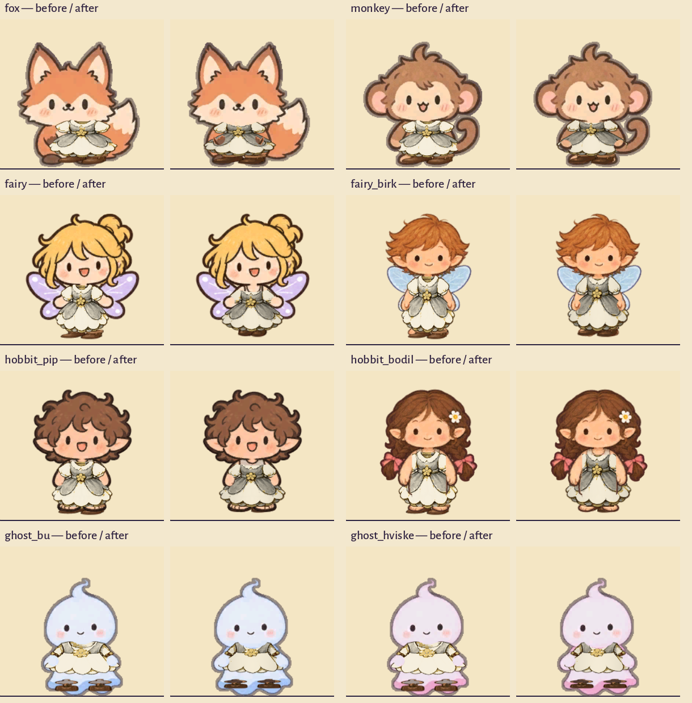

Clothing now follows each hero's anatomy, and changing one piece preserves the other clothing slots. Work was isolated in `codex-clothing-fit`, based on local main `3eb4160`.

The fox's torso is about 17 pixels left of its ground pivot in the front view; the old fits centred clothing on the entire tail-bearing image. Several humanoid fits also used waist positions from the older stock art rather than the current safe bases. The result squeezed sleeves sideways and put trousers below the actual waist.

The new fitting uses individual head/torso centres in all eight directions, shoulder/hip/foot widths, neck, waist and ankle landmarks. The existing paintings bend around shoulders and hems before the shared body animation moves them. Face, paw, skin, wing, braid and toe masks restore the body only where the fitted cloth overlaps. Birk's shoes have their own width. Ghosts retain their approved wraps, under-hem bands and charms. Fabric receives restrained side shading, and dye mapping retains painted grain and fold contrast.



The renderer retains unchanged garment sprites, materials and textures when a slot changes. Local try-ons survive category changes and the Hands tab. Equip commits the selected piece; other previews remain local. Remove immediately shows the uncovered base. Closing discards previews, while loading a saved outfit intentionally replaces the outfit and clears previews. Dresses still exclude shirts/trousers, and hats exclude circlets; the screen names these replacements. Displaced pieces remain owned. Saves, perks and the equipment owner keep their existing formats and rules.

`ACCEPTANCE.json` records the results. The final native suites contain 472 passing checks across all eight heroes, with no failures, skips or engine messages. The final preview wording and wardrobe/save-load UI paths pass another 232 native checks in `ui-final-*.json`. They render all 96 palettes on the fox and one item from each of the 30 families on each other hero: 306 catalogue cases. The face comparison stays below 0.89 mean byte difference against the uncovered baseline, within the existing limit of 3. All 3,312 authored clothing clip/frame/direction poses pass clock alignment. Four outfits in eight directions on each hero produce 256 turnaround views; the six-frame walking sheets add 384 views with a held sword. Existing held-tool/weapon, action ownership and save/load checks pass.

Visual inspection covers all eight before/after crops, all eight turnaround and walking sheets, the 96 fox palette cases, the monkey catalogue, and representative close-up, catalogue and equipment captures for the other heroes. The eight changed rasters are technical alpha masks. The 240 garment atlases, four safe-base paintings, source paintings and original character art retain their approved bytes. The style ledger continues to cover 2,925 assets with explicit dispositions. This is an animated 2D fitting improvement, not cloth simulation or a separate pixel review of every attack/jump/sleep frame.

Seven-piece pose updates, including a direction change on every sample, measure 0.032–0.033 ms at the 95th percentile across 240 samples per hero, below the existing 0.3 ms target. No additional clothing drawing nodes or texture atlases are introduced. These are CPU update measurements on the development Mac (Godot 4.7.2 Compatibility); they do not claim a GPU frame-time measurement or performance on other hardware.

The broader headless suite passes 531 checks across wardrobe ownership, the wardrobe UI, clothing/held rendering contracts, characters, save/load and UI navigation. Its 16 expected engine messages come from deliberately invalid character/save fixtures; unexpected errors and warnings are zero. Localization lint passes all 65 CSVs and 4,418 keys, and copy lint is clean. Copy remains in its existing draft review state. The wardrobe CSV review ledger reflects the three added labels.

The source-bound town extension and producer-mutation reports are refreshed for the final implementation. The old main reports are retained in `source-proof-3eb4160/` to preserve their original binding. An initial validation caught the changed wardrobe CSV row count; its ledger entry was corrected before the final proof. An interior warm-build diagnostic measured 12.44 ms against the unchanged 12 ms budget. The quiet rerun passed at 10.50 ms; the failed diagnostic is retained in `diagnostics/owners-warm-budget-12.44.*`. Superseded intermediate capture sets are outside the repository under `/tmp/clothing-fit-development-20261017/`; the final evidence is retained here.

Reproduce the main clothing checks from the project root:

```sh
tests/run_playtest.sh --strict --only=wardrobe,wardrobe_ui,wardrobe_render,held_equipment,characters,save,ui_nav
# Run one native instance at a time; repeat for animal, fairy, hobbit and ghost.
tools/dev/run_windowed.sh --strict --character=animal --only=wardrobe_ui,wardrobe_render,held_equipment --out=/tmp/clothing-review
python3 tools/loc/csv_lint.py --strict
python3 tools/copy/copy_lint.py --strict
tools/art/.venv/bin/python tools/art/drawn/style_audit_current.py --check
python3 tools/town/prove_extension.py --check-all
```

Fitting details and reusable future asset-repair prompts are in `docs/art/wardrobe/design.txt` and `docs/art/wardrobe/fitting-prompts.json`. This pass generated no new garment paintings.
